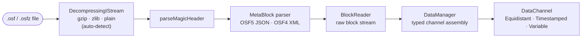
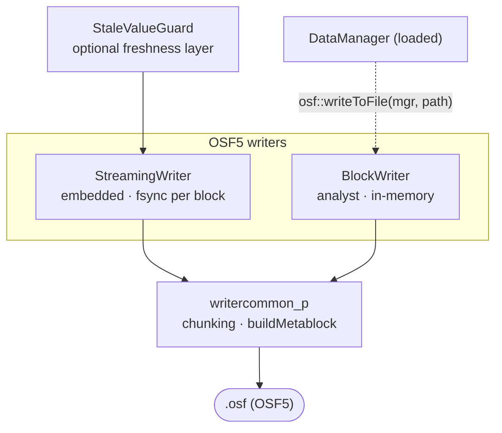
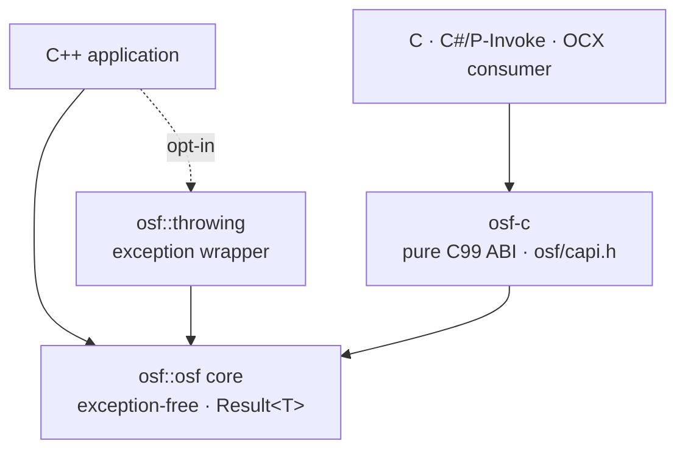

# Implementación en C++

Una **implementación independiente en C++17** del Open Streaming Format:
C++ moderno e idiomático, sin dependencias externas en tiempo de ejecución.
Lee archivos `.osf` y `.osfz` y escribe OSF5. La biblioteca puede utilizarse
y distribuirse de forma totalmente autónoma; su comportamiento queda
definido únicamente por la especificación del formato OSF.

:::tip Manual para desarrolladores
Esta página es la visión general. La documentación detallada para
desarrolladores se encuentra en el subcapítulo **C++ en detalle**:

| Página | Contenido |
|---|---|
| [Arquitectura](cpp/architecture.md) | Modelo de capas, módulos, modelo de datos, decisiones de diseño, seguridad en hilos |
| [Lectura](cpp/reading.md) | `DataManager`, `DataChannel`, segmentos, `BlockReader`, `ReaderStats`, OSFZ transparente |
| [Escritura](cpp/writing.md) | `StreamingWriter`, `BlockWriter`, `StaleValueGuard`, `ChannelDef`, valores predeterminados de metadatos, ida y vuelta (round-trip) |
| [Gestión de errores](cpp/error-handling.md) | `Result<T>`, catálogo completo de códigos de error, `osf::throwing` |
| [C-ABI](cpp/c-abi.md) | `osf-c` — reglas de propiedad (ownership), catálogo de funciones, ejemplos en C y P/Invoke |
| [Compilación e integración](cpp/building.md) | Opciones de CMake, destinos (targets), `add_subdirectory`/FetchContent, Doxygen, CI |
| [Recetario](cpp/cookbook.md) | Recetas listas para copiar, desde la inspección hasta el bucle embebido |
| [Internos](cpp/internals.md) | Codificador, matemática de chunking, máquina de estados del builder — para colaboradores |
:::

## Alcance funcional

La implementación es **funcionalmente completa**.
Las rutas de lectura y de escritura están cubiertas por una suite de
GoogleTest/ctest (0 advertencias con MSVC `/W4 /permissive-`), y la CI
compila y prueba en **Linux, macOS y Windows**.

**Ruta de lectura**

- Analizador de la cabecera mágica; analizadores del metabloque JSON de OSF5
  y XML de OSF4
- Lector del flujo de bloques y el `DataManager` tipado (lector unificado en
  memoria con canales tipados)
- Descompresión **OSFZ** transparente (gzip/zlib): `.osf` y `.osfz` se leen
  con la misma API
- **Mejor esfuerzo**: los archivos truncados (corte de alimentación)
  devuelven todos los bloques completamente legibles; los tipos de datos
  futuros desconocidos se omiten en lugar de interrumpir la carga

**Ruta de escritura (OSF5)**

- `StreamingWriter`: embebido, muestra a muestra, `fsync` por bloque
  (resistente a fallos ante pérdida de alimentación), necesidad de memoria
  constante
- `BlockWriter`: orientado al analista, recopila en memoria y escribe el
  archivo completo al final; ajusta automáticamente `sizeOfLengthValue` de
  2 a 4 cuando es necesario
- `StaleValueGuard`: capa opcional de frescura que vuelve a emitir el último
  valor de los canales inactivos
- Valores predeterminados automáticos de metadatos: `created_utc` se marca
  al escribir; `creator`/`tag` reciben valores de reserva si no se han
  establecido

**Comodidad y conexión**

- Una **capa cómoda que lanza excepciones** (`osf::throwing`) sobre el
  núcleo `Result<T>`, para quienes prefieren excepciones
- La **biblioteca C-ABI `osf-c`** (`osf/capi.h`): una capa C99 pura para el
  uso entre lenguajes (DLL/Shared Object)

## Arquitectura de un vistazo

Dos niveles de API se asientan sobre un núcleo común sin excepciones (`osf::Result<T>`). El lado de lectura ensambla canales tipados a partir del flujo de bloques; el lado de escritura ofrece dos clases de escritor para perfiles de uso distintos; y una C-ABI hace que todo sea accesible para consumidores que no usan C++. Más información: [Arquitectura](cpp/architecture.md).

### Ruta de lectura



`DataManager::loadFromFile()` controla toda esta canalización; OSFZ se reconoce y descomprime automáticamente, de modo que `.osf` y `.osfz` usan la misma llamada.

### Ruta de escritura (OSF5)



### Capas y C-ABI



### Qué clase para qué

| Quiero … | Clase | Notas |
|---|---|---|
| Leer un archivo y obtener canales tipados | `osf::DataManager` | Punto de entrada central: `loadFromFile()`, `channel("name")`. Lee `.osf` y `.osfz`. → [Lectura](cpp/reading.md) |
| Iterar el flujo de bloques en bruto | `osf::BlockReader` | Nivel más bajo; para archivos muy grandes y consumidores en streaming. → [Lectura](cpp/reading.md) |
| Mantener las muestras de un canal | `osf::DataChannel` | Variante entre Equidistant / Timestamped / Variable; accesores planos tipados. → [Lectura](cpp/reading.md) |
| Registrar en un dispositivo embebido | `osf::StreamingWriter` | `fsync` por bloque, memoria constante, resistente a fallos ante pérdida de alimentación. → [Escritura](cpp/writing.md) |
| Escribir el archivo completo de una vez | `osf::BlockWriter` | Recopila en memoria, escribe en `writeToFile()`; ajusta `sizeOfLengthValue` automáticamente. → [Escritura](cpp/writing.md) |
| Mantener «frescos» los canales inactivos | `osf::StaleValueGuard` | Vuelve a emitir el último valor de los canales que han superado un umbral. → [Escritura](cpp/writing.md) |
| Ida y vuelta (round-trip) / OSF4 → OSF5 | función libre `osf::writeToFile(mgr, …)` | Carga un `DataManager` en un `BlockWriter` y escribe OSF5. → [Recetario](cpp/cookbook.md) |
| Usar excepciones en lugar de `Result<T>` | `osf::throwing` | Cabecera opcional (opt-in); no se compila dentro del núcleo. → [Gestión de errores](cpp/error-handling.md) |
| Llamar desde C, C#, OCX … | `osf-c` (`osf/capi.h`) | ABI de C99 puro; compilar con `-D OSF_BUILD_C_API=ON`. → [C-ABI](cpp/c-abi.md) |

### Ejemplos ejecutables

`implementations/cpp/examples/` contiene cuatro pequeños programas sobre `<osf/osf.h>`:
**`inspect`** (cabecera / metadatos / canales, OSFZ transparente), **`dump`**
(valores de las muestras), **`write`** (sintetizar y escribir OSF5) y **`copy`**
(ida y vuelta). Se compilan con `-D OSF_BUILD_EXAMPLES=ON` (activo de forma predeterminada).
Recetas de código elaboradas: [Recetario](cpp/cookbook.md).

## Compilación — inicio rápido

```bash
cmake -B build
cmake --build build
ctest --test-dir build
```

Las indicaciones específicas de cada plataforma, las opciones de CMake y las
preguntas frecuentes figuran en el `BUILD.md` incluido con la biblioteca y en
la página [Compilación e integración](cpp/building.md).

### Opciones de CMake

| Opción | Valor predeterminado | Efecto |
|---|---|---|
| `OSF_BUILD_TESTS` | `ON` | Compilar la suite GoogleTest/ctest |
| `OSF_BUILD_EXAMPLES` | `ON` | Compilar los programas de ejemplo ejecutables de `examples/` |
| `OSF_BUILD_DOCS` | `OFF` | Generar la referencia de API con Doxygen (destino `osf-docs`; requiere Doxygen) |
| `OSF_BUILD_C_API` | `OFF` | Compilar también la biblioteca C-ABI `osf-c` (+ prueba en C) |
| `OSF_USE_SYSTEM_ZLIB` | `OFF` | Usar la zlib del sistema en lugar de FetchContent |
| `OSF_WARNINGS_AS_ERRORS` | `OFF` | Tratar las advertencias como errores (`/WX` o `-Werror`); `ON` en la CI |
| `BUILD_SHARED_LIBS` | `OFF` | Compilar la biblioteca principal como biblioteca compartida |

C++17 es la base de lenguaje fijada de la biblioteca. El paso a C++20 o superior es una actualización deliberada de la biblioteca, no una opción de compilación. El código de terceros (`tl::expected`,
`nlohmann/json`, `pugixml`) se incluye en el repositorio en `third_party/`;
zlib se obtiene mediante FetchContent o del sistema.

### Integración

La biblioteca exporta dos destinos de CMake:

- `osf::osf`: la biblioteca principal (estática de forma predeterminada;
  nombre de archivo `libosf.a` / `osf.lib`)
- `osf::headers`: un destino INTERFACE con las rutas de inclusión públicas

Integración mediante `add_subdirectory` o `FetchContent`; fragmentos de
ejemplo en [Compilación e integración](cpp/building.md).

## API de un vistazo

El núcleo está **libre de excepciones**: las operaciones que pueden fallar
devuelven `osf::Result<T>` (un `tl::expected<T, osf::Error>`).
El catálogo completo de códigos de error se encuentra en
[Gestión de errores](cpp/error-handling.md).

### Lectura

```cpp
#include <osf/manager.h>

auto result = osf::DataManager::loadFromFile("messung.osf");  // auch .osfz
if (!result) {
    // result.error().message  —  strukturierter Fehler, keine Exception
    return;
}
osf::DataManager const& mgr = *result;

// Kanal über den Namen ansprechen (primäre Zugriffsform)
if (osf::DataChannel const* ch = mgr.channel("Sensor.Temperatur")) {
    auto werte = osf::asDoublesFlat(
        std::get<osf::TimestampedChannel>(*ch));   // typisierter Zugriff
}
```

Quien prefiera trabajar con excepciones utiliza la capa opcional (opt-in):

```cpp
#include <osf/throwing.h>

auto mgr = osf::throwing::load("messung.osf");   // wirft osf::Exception bei Fehler
```

### Escritura (OSF5)

```cpp
#include <osf/blockwriter.h>

osf::BlockWriter writer;
writer.setCreator("mein-tool/1.0");

osf::ChannelDef def;
def.name        = "signale.sinus";
def.dataType    = osf::DataType::Double;
def.channelType = osf::ChannelType::Scalar;

auto idx = writer.addChannel(def);              // Result<uint16_t>
// … Samples zu *idx hinzufügen (addTimestampedSample, addEquidistantSegment, …)
writer.writeToFile("ausgabe.osf");
```

Para la escritura embebida y resistente a fallos existe, en su lugar, el
`StreamingWriter` (`fsync` por bloque). Un `DataManager` cargado puede
reescribirse directamente como OSF5 con la función libre
`osf::writeToFile(mgr, pfad)` (ida y vuelta / OSF4 → OSF5). Todos los
detalles y la elección del `sizeOfLengthValue` adecuado:
[Escritura](cpp/writing.md).

### C-ABI (`osf-c`)

Con `-D OSF_BUILD_C_API=ON` se genera además la biblioteca compartida
`osf-c`, con una interfaz C99 pura (`osf/capi.h`): manejadores opacos
(`osf_manager`, `osf_channel`), códigos `osf_status`, un
`osf_last_error_message()` local al hilo y lectores con copia de salida para
marcas de tiempo y valores, además de `osf_write_to_file` para la ruta de
escritura de ida y vuelta. Ninguna excepción de C++ cruza el límite de la
ABI. Pensada para la conexión desde C, C#/P-Invoke, ActiveX/OCX y futuros
enlaces de lenguajes. Catálogo de funciones y ejemplos: [C-ABI](cpp/c-abi.md).

## Notas

- **Solo se escribe OSF5**, aunque el origen fuera un archivo OSF4.
- **OSFZ al escribir es un paso posterior**: los escritores nunca comprimen en línea; OSFZ (gzip) se genera *después* de cerrar el archivo `.osf`, mediante un futuro compresor posterior al cierre (hilo en segundo plano) o una CLI de compresión independiente. OSFZ se **lee** de forma transparente.
- **Mejor esfuerzo al leer**: los archivos truncados devuelven todos los
  datos hasta el último bloque completamente legible, sin fallos.
- La biblioteca es **neutral respecto a Qt**; un complemento cercano a Qt
  podría añadirse más adelante como entrada propia de `integrations/`.

## Código fuente e información adicional

- Código fuente: [github.com/optimeas/osf](https://github.com/optimeas/osf),
  directorio `implementations/cpp/`
- Instrucciones de compilación: `BUILD.md` en el directorio de la biblioteca;
  resumen en [Compilación e integración](cpp/building.md)
- Referencia de API: generar con Doxygen mediante `-D OSF_BUILD_DOCS=ON` (destino `osf-docs`); véase [Compilación e integración](cpp/building.md)
- Especificación del formato: capítulo [Formato OSF](../osf_general.md)

> Este documento se distribuye bajo la licencia [CC BY 4.0](https://creativecommons.org/licenses/by/4.0/deed.de). Atribución: optiMEAS GmbH y optiMEAS Switzerland GmbH.
