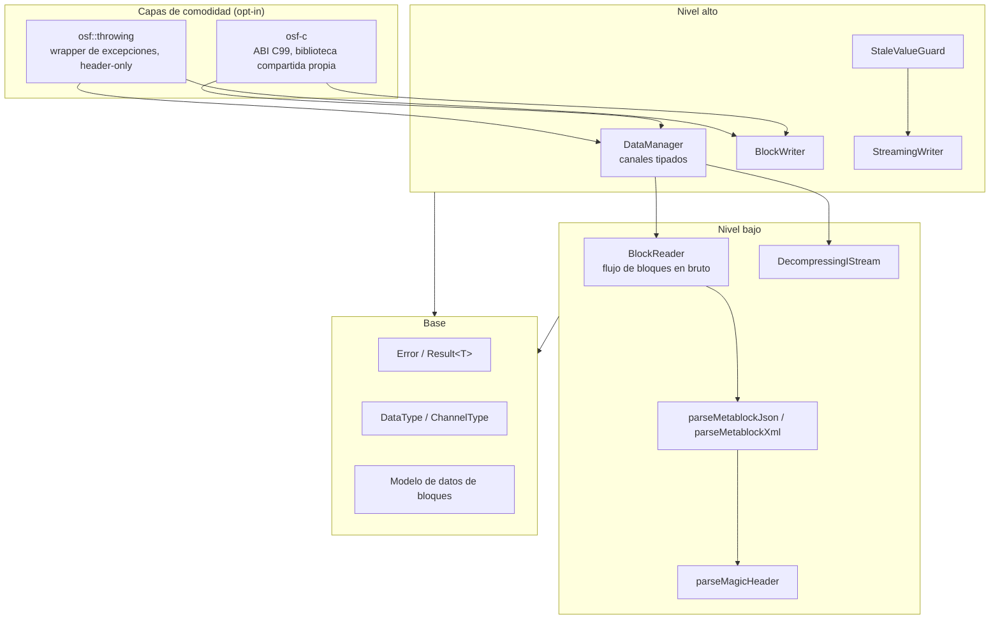
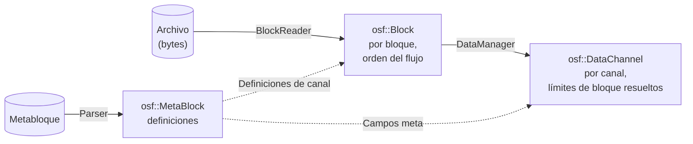

# Arquitectura de la implementación en C++

Esta página describe la estructura interna de la implementación en C++: el
modelo de capas, los módulos y su interacción, el modelo de datos y las
decisiones de diseño centrales. Está dirigida a desarrolladores que integran
la biblioteca **y** a quienes quieran colaborar en ella. La
[página de resumen](../cpp.md) ofrece una visión rápida; los temas
detallados (lectura, escritura, gestión de errores, C-ABI y compilación)
tienen sus propias páginas.

## Directrices

La implementación sigue cuatro principios:

1. **C++17 independiente.** C++ moderno e idiomático, sin puentes con otros
   lenguajes y sin dependencias externas en tiempo de ejecución; el
   comportamiento queda definido únicamente por la especificación del
   formato OSF.
2. **Núcleo libre de excepciones.** Toda operación que pueda fallar
   devuelve `osf::Result<T>` (un `tl::expected<T, osf::Error>`). Las
   excepciones solo existen en la capa opcional (opt-in) `osf::throwing`.
3. **Mejor esfuerzo al leer.** Los archivos truncados (corte de alimentación
   en el escritor embebido) devuelven todos los bloques completamente
   legibles en lugar de un error; los tipos de datos futuros desconocidos se
   omiten en lugar de interrumpir la carga.
4. **Dependencias ligeras.** Tres bibliotecas de solo cabeceras incluidas en
   el repositorio (vendored: `tl::expected`, `nlohmann/json`, `pugixml`) más
   zlib (FetchContent o del sistema). Sin dependencia de Boost ni de Qt.

## Modelo de capas



La mayoría de las aplicaciones trabajan exclusivamente en el nivel alto
(`DataManager` para leer, uno de los dos escritores para escribir). El nivel
bajo es público y estable: quien quiera leer en streaming o crear
herramientas propias utiliza `BlockReader` directamente.

## Módulos y responsabilidades

| Cabecera | Contenido | Capa |
|---|---|---|
| `osf/error.h` | `Error` (código + mensaje), `Result<T>` | Base |
| `osf/types.h` | `DataType`, `ChannelType`, `SpectrumType` + analizadores | Base |
| `osf/header.h` | Cabecera mágica: `OsfVersion`, `MagicHeader`, `parseMagicHeader` | Baja |
| `osf/metablock.h` | `MetaBlock`/`FileInfo`/`Channel`/`Info`; analizadores JSON y XML; serialización JSON | Baja |
| `osf/block.h` | Modelo de datos de bloques: `Block`, `BlockKind`, variantes de datos útiles, decodificador del byte de control | Base |
| `osf/reader.h` | `BlockReader` — iterador sobre el flujo de bloques | Baja |
| `osf/stats.h` | `ReaderStats` / `ChannelStats` — telemetría de lectura | Baja |
| `osf/compression.h` | `DecompressingIStream`, `detectCompression` — OSFZ transparente | Baja |
| `osf/datachannel.h` | Variante `DataChannel` (Equidistant / Timestamped / Variable), `Segment`, accesores planos | Alta |
| `osf/manager.h` | `DataManager` — carga + lista de canales tipados | Alta |
| `osf/streamingwriter.h` | `StreamingWriter` + `ChannelDef` | Alta |
| `osf/blockwriter.h` | `BlockWriter` + funciones libres `writeToFile` / `writeTo` | Alta |
| `osf/stalevalueguard.h` | `StaleValueGuard` — capa de frescura sobre `StreamingWriter` | Alta |
| `osf/binarysample.h` | `BinarySample` — vista de bytes sin propiedad (sustituto de span) | Base |
| `osf/throwing.h` | `osf::Exception`, `throwing::unwrap/load/writeToFile` — **no** incluido en la cabecera general (umbrella) | Comodidad |
| `osf/capi.h` | ABI de C99 puro de la biblioteca `osf-c` — **no** incluido en la cabecera general (umbrella) | Comodidad |
| `osf/osf.h` | Cabecera general (umbrella): todo salvo `throwing.h` y `capi.h` | — |
| `osf/version.h` | Generada; `osf::version()` y `OSF_VERSION_*` | Base |

Componentes privados de la implementación (bajo `src/`, no instalables):
`blockencode_p.{h,cpp}` (codificador de bloques OSF5), `writercommon_p.{h,cpp}`
(matemática de chunking + ensamblado del metabloque), `durablefile_p.{h,cpp}`
(archivo RAII con `fsync`), `binaryio_p.h` (utilidades little-endian).
Para más detalles, véase [Internos](internals.md).

## Tres modelos de datos — quién ve qué

La biblioteca tiene deliberadamente tres representaciones de los mismos
datos, según el nivel de abstracción:



1. **`osf::MetaBlock`** (`metablock.h`): las *definiciones*: metadatos del
   archivo (`FileInfo`), definiciones de canal (`osf::Channel`) y entradas
   `Info` opcionales. OSF4 (XML) y OSF5 (JSON) se diferencian solo en la
   serialización; ambos analizadores rellenan el mismo modelo de forma
   simétrica.
2. **`osf::Block`** (`block.h`): la *vista de flujo*: un bloque decodificado
   con índice de canal y variante `BlockKind` (`StartData`,
   `ContinuedData`, `AbsTimestampData`, `ContinuedRelStampData`,
   `Skipped`). Los datos útiles son vectores tipados ya desempaquetados, sin
   copia cero (los bloques tienen un tamaño de KB a pocos MB; la semántica
   sencilla de tiempo de vida compensa la asignación de memoria).
3. **`osf::DataChannel`** (`datachannel.h`): la *vista de canal*: un
   `std::variant` sobre tres diseños de almacenamiento, porque el
   almacenamiento realmente difiere:

   | Variante | Almacenamiento |
   |---|---|
   | `EquidistantChannel` | Vector plano de muestras + `std::vector<Segment>` |
   | `TimestampedChannel` | Vectores paralelos `timestampsNs` + `values` |
   | `VariableChannel` | Marcas de tiempo + muestras de cadena **o** binarias |

**Nota sobre los nombres:** `osf::Channel` es la *definición de canal* del
metabloque; `osf::DataChannel` son las *muestras ensambladas*. Ambos
comparten el espacio de nombres `osf`, de ahí los nombres distintos.

## Convenciones de nombres y de API

- **Tipos** en PascalCase (`DataManager`, `BlockReader`).
- **Métodos y funciones libres** en camelCase (`loadFromFile`,
  `channelName`, `asDoublesFlat`, `writeToFile`).
- **Campos públicos de struct** en camelCase sin prefijo (`blocksTotal`,
  `sizeOfLengthValue`, `startTimestampNs`, `compressionFormat`).
- **Miembros privados** con prefijo `m_` + camelCase (`m_channelData`,
  `m_writer`).
- **Constantes** en UPPER_SNAKE_CASE (`MAX_MAGIC_HEADER_LEN`,
  `GPS_WIRE_SIZE`).
- **Nombres de archivos de cabecera** en minúsculas, sin separadores y con
  extensión `.h` (`blockwriter.h`, `streamingwriter.h`, `datachannel.h`).
  Las cabeceras internas del directorio `src/` llevan el sufijo `_p.h`
  (`blockencode_p.h`, `writercommon_p.h`).
- La **C-ABI** (símbolos `osf_*` en `osf/capi.h`) sigue la convención
  habitual de C en `snake_case` y queda exenta de las reglas de C++.
- Los discriminadores en las variantes se llaman `kind` (`BlockKind`,
  `SkipReason::Kind`, `VariableValueRef::Kind`).
- Todo lo que pueda fallar devuelve `Result<T>` y es `[[nodiscard]]`.
- La construcción se realiza mediante fábricas estáticas
  (`DataManager::loadFromFile`) o mediante una configuración al estilo
  builder (escritores: `set*` → `addChannel` → fase de escritura).
- Los setters fluidos de `BlockReader` (`withCaptureSkippedPayload`,
  `withFileSize`) devuelven `BlockReader&`.
- Las marcas de tiempo son siempre `std::int64_t` en **nanosegundos desde la
  época Unix (UTC)**; las frecuencias de muestreo son `double` en Hz.

## Decisiones de diseño centrales

### `Result<T>` en lugar de excepciones en el núcleo

La biblioteca se dirige también a bases de código embebidas e industriales
en las que las excepciones están desactivadas o no son deseadas. Por ello el
núcleo nunca lanza excepciones; `tl::expected` (incluido en el repositorio,
CC0) aporta la mónada. Quien prefiera excepciones utiliza
[`osf::throwing`](error-handling.md): una capa fina, de solo cabeceras, que
deliberadamente **no** se ha incluido en la cabecera general (umbrella),
para que los usuarios del núcleo no incorporen maquinaria de excepciones.

### Mejor esfuerzo y compatibilidad hacia delante

Los archivos OSF reales se generan en dispositivos que pueden perder la
alimentación en cualquier momento y con versiones de la especificación que
el lector aún no conoce. De ello se derivan tres reglas de comportamiento:

- **El truncamiento no es un error.** Si el archivo termina en mitad de un
  bloque, el `BlockReader` devuelve todos los bloques completos, eleva
  `stats().blocksTruncated` a 1 y finaliza la iteración limpiamente.
- **Lo desconocido se omite, no se descarta en silencio.** Los canales con un
  tipo de datos desconocido (futuro) se analizan como
  `DataType::Unsupported`; sus bloques aparecen como `BlockKind::Skipped`
  (los bytes de datos útiles se consumen para que el flujo permanezca
  alineado). La grafía original se conserva en `Channel::dataTypeRaw`.
- **Los elementos eliminados de la especificación son errores graves.** Los
  tipos de datos que la revisión de la especificación del 2026-05-04
  eliminó (`pair`, `triple`, `candata`, `gpsdata`) se rechazan con
  `Error::Code::RemovedInSpec`: su diseño de datos útiles no puede
  reproducirse a partir de una compilación actual y adivinar en silencio
  supondría corrupción de datos.

### Dos escritores en lugar de uno

`StreamingWriter` (embebido: `fsync` por bloque, memoria constante,
resistente a fallos) y `BlockWriter` (analista: recopila en memoria, emite
al final y puede elevar automáticamente `sizeOfLengthValue`) tienen
invariantes incompatibles; un escritor común habría diluido ambos perfiles.
Los componentes compartidos (chunking, ensamblado del metabloque) residen
en `src/writercommon_p.*`. Detalles en la página [Escritura](writing.md).

### OSFZ transparente solo al leer

OSFZ (= OSF comprimido con gzip o zlib) se reconoce y se descomprime de
forma transparente al **leer** (`DecompressingIStream` antes del análisis de
la cabecera mágica). Al **escribir**, la biblioteca deliberadamente nunca
comprime en línea: la compresión es un paso posterior al cierre del
archivo, de modo que los modos de fallo de escritura y de compresión
permanecen desacoplados.

### Seguridad en hilos

| Clase | Contrato |
|---|---|
| `DataManager` (cargado) | Inmutable → legible en paralelo sin restricciones |
| `BlockReader` | No es seguro en hilos; una instancia por hilo |
| `StreamingWriter` / `BlockWriter` / `StaleValueGuard` | No es seguro en hilos; serializar las llamadas externamente (p. ej., `std::mutex`) |
| Distintos escritores sobre distintos archivos | Sin problemas en paralelo |
| `osf-c` | `osf_last_error_message()` es local al hilo; no compartir manejadores entre hilos sin serializar |

## Estructura de directorios

```
implementations/cpp/
├── CMakeLists.txt           — Projekt, Optionen, Targets
├── BUILD.md                 — Bauanleitung (EN)
├── cmake/                   — CompilerWarnings.cmake, version.h.in
├── include/osf/             — öffentliche Header (API-Fläche)
├── src/                     — Implementierung + private Header
├── tests/
│   ├── unit/                — GoogleTest-Units (synthetische Daten)
│   ├── integration/         — Tests gegen examples/*.osf(z)
│   └── capi/                — reiner C99-Test für osf-c
├── examples/                — inspect, dump, write, copy
└── third_party/             — tl::expected, nlohmann/json, pugixml (vendort)
```

## Para profundizar

- [Lectura — DataManager, DataChannel, BlockReader, OSFZ](reading.md)
- [Escritura — StreamingWriter, BlockWriter, StaleValueGuard](writing.md)
- [Gestión de errores — Result, catálogo de errores, throwing](error-handling.md)
- [C-ABI — osf-c para C, C#, OCX](c-abi.md)
- [Compilación e integración — CMake, opciones, CI](building.md)
- [Recetario — recetas para tareas habituales](cookbook.md)
- [Internos — codificador, chunking, máquina de estados del builder](internals.md)

> Este documento se distribuye bajo la licencia [CC BY 4.0](https://creativecommons.org/licenses/by/4.0/deed.de). Atribución: optiMEAS GmbH y optiMEAS Switzerland GmbH.
