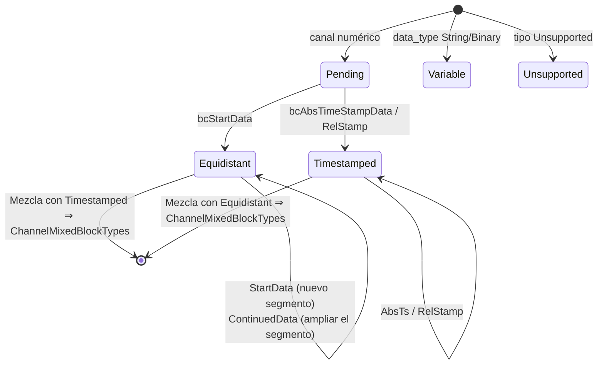

# Internos

Esta página describe los componentes privados del directorio `src/` de la
biblioteca; es relevante para quienes colaboran en ella o quieren seguir su
comportamiento hasta el nivel de byte. Las definiciones del formato en el
cable están en la [especificación de OSF](../../osf_general.md).

## Resumen de los componentes privados

| Componente | Archivos | Utilizado por |
|---|---|---|
| Codificador de bloques | `blockencode_p.{h,cpp}` | Ambos escritores |
| Elementos comunes de los escritores (chunking, ensamblado del metabloque) | `writercommon_p.{h,cpp}` | Ambos escritores |
| E/S de archivo duradera | `durablefile_p.{h,cpp}` | Solo `StreamingWriter` |
| Utilidades little-endian | `binaryio_p.h` | Codificador |
| Streambuf de descompresión | `compression.cpp` (clase `DecompressingIStream::Streambuf`) | Ruta de lectura |
| Máquina de estados del builder | `manager.cpp` (struct `ChannelBuilder`) | `DataManager` |

## Codificador de bloques (`osf::detail::encode*`)

El codificador escribe tramas de bloque completas
`[u16 índice de canal][campo de longitud][datos útiles]` en un vector de
bytes (little-endian en todo momento):

| Función | Bloque | Diseño de los datos útiles |
|---|---|---|
| `encodeStartData<T>` | `bcStartData` (6) | `[u8 ctrl][i64 start_ts][f64 rate][u32 N][N × T]` |
| `encodeContinuedData<T>` | `bcContinuedData` (5) | `[u8 ctrl][u32 N][N × T]` |
| `encodeAbsTimestampData<T>` | `bcAbsTimeStampData` (8) | `[u8 ctrl][u32 N][N × (i64 ts + T)]` |
| `encodeAbsTimestampDataGps` | Ídem para GPS | Valor = 3 × f64 (lat, lon, alt) = 24 bytes |
| Sobrecargas de cadena/binario | Ídem, muestra individual | `[u8 ctrl][i64 ts][bytes]` — bit 7 = 0, **sin** terminador `0x00` (OSF5) |

Convenciones: el bit 7 del byte de control solo se establece cuando se usa
la forma de varias muestras (prefijo u32-N); con `count == 1` se omite el
prefijo (ahorra 4 bytes por bloque de una sola muestra, revisión de la
especificación 2026-05-24). Los escritores llaman al codificador
exclusivamente con cantidades de muestras conformes a la capacidad,
calculadas previamente mediante `writercommon_p`.

## Matemática de chunking (`writercommon_p`)

El campo de longitud de un bloque tiene un ancho de `sizeOfLengthValue` (2 o
4) bytes; de ello resulta la carga útil máxima por bloque:

```cpp
maxPayloadForSov(2) == 0xFFFF;                  // 65 535 Bytes
maxPayloadForSov(4) == 0x7FFFFFFF - 1024;       // soft-cap, vermeidet i32-Überlauf
```

De ahí, tres funciones auxiliares derivan el número máximo de muestras por
tipo de bloque (sobrecarga: `bcStartData` 21 bytes = ctrl + ts + rate + N;
`bcContinuedData`/`bcAbsTimeStampData` 5 bytes = ctrl + N; en los bloques con
marca de tiempo, cada muestra cuenta 8 bytes adicionales de marca de
tiempo). Para los bloques variables de una sola muestra se aplica
`variableSampleCapacity(sov) = max_payload - 9` (ctrl + ts).
Estas funciones son el **único** lugar donde se calculan los tamaños de
bloque; los escritores en streaming y por bloques hacen el chunking de forma
idéntica con ellas.

`buildMetablock(FileInfoDraft, ChannelDefs)` ensambla el metabloque de OSF5:
índices secuenciales 0..N, `channeltype` normalizado (`equidistant` se
conserva, todo lo demás pasa a `scalar`, la convención establecida de los
archivos de referencia de OSF) y se aplican los valores predeterminados
automáticos de metadatos (`created_utc` = hora UTC actual como
`YYYY-MM-DDTHH:MM:SSZ`, valor de reserva de `creator` `osf-cpp/<version>`,
valor de reserva de `tag` `default`; `reason`/la tripleta GPS se omiten en
lugar de `null`).

## `DurableFile` — semántica de fsync del escritor en streaming

Envoltorio RAII alrededor de un manejador de archivo nativo con tres
operaciones: `write` (completa o con error), `force` (Windows:
`FlushFileBuffers`, POSIX: `fsync`) y `close`. El `StreamingWriter` llama a
`force` después de cada bloque; por eso «la llamada retorna con éxito»
equivale a «el bloque está en el medio de almacenamiento». Los errores de
`write`/`force` ponen al escritor en el estado `Broken` (error persistente,
sticky).

## Streambuf de descompresión (ruta de lectura)

`DecompressingIStream` oculta un `std::streambuf` personalizado tras un
PIMPL, de modo que la cabecera pública permanece libre de zlib:

- Clasificación mediante los dos primeros bytes (`detectCompression`, sin
  consumir: read + seek-back; el origen debe admitir posicionamiento).
- `underflow()` descomprime bajo demanda en un búfer fijo: memoria
  constante con independencia del tamaño del archivo.
- `inflateInit2(MAX_WBITS | 32)` activa el reconocimiento automático de
  cabeceras gzip/zlib de la propia zlib.
- Los flujos comprimidos truncados devuelven EOF en lugar de un error
  (mejor esfuerzo, coherente con el resto de la ruta de lectura).
- Con `CompressionFormat::None` los bytes se pasan tal cual, de modo que
  `DataManager` puede anteponer la fachada de forma incondicional.

## Máquina de estados del builder (`DataManager`)

Por cada canal, `manager.cpp` mantiene un `ChannelBuilder` con cinco
estados:



Reglas que imponen las transiciones (todas cubiertas con pruebas):

- `bcContinuedData` en el estado `Pending` ⇒ `ContinuedDataWithoutStart`.
- `bcContinuedRelStampData` sin una marca de tiempo absoluta previa ⇒
  `RelStampWithoutAnchor`; en caso contrario, los deltas u32 se suman
  tomando como ancla la última marca de tiempo absoluta.
- Tipo de datos de los datos útiles ≠ tipo de datos del canal ⇒
  `DataTypeMismatch`.
- Los canales `Unsupported` consumen sus bloques (en el lado del lector ya
  son `Skipped`) y se excluyen de la lista de canales en `finalize`.

`finalize_builder` traduce el estado final a la variante `DataChannel`
correspondiente; un estado `Pending` sin ningún bloque se materializa como
un canal vacío del tipo declarado.

## Detalles del lector

- La decodificación de bytes se realiza mediante pequeñas funciones
  auxiliares `readLeU16`/`readLeU32`/`readLeU64` (más sobrecargas con signo
  y de coma flotante) en lugar de `reinterpret_cast`, sin suposiciones de
  alineación ni de endianness.
- `PayloadCursor` recorre los datos útiles del bloque que están en memoria
  y devuelve `std::optional<T>`; así, un desbordamiento se convierte en un
  `InvalidBlock` limpio en lugar de en comportamiento indefinido (UB).
- Los bloques de cadena/binario de varias muestras (bit 7 establecido) se
  descomponen mediante división en partes de igual longitud; si la longitud
  no es divisible, el lector recurre a la muestra individual.
- El terminador nulo se trata de forma determinista según la versión (campo
  `m_osfVersion` en el lector): OSF4 elimina el último byte de cada dato útil
  de cadena/binario; OSF5 nunca (revisión de la especificación 2026-05-24).
- El bloque de información opcional `0xFFFF` de OSF4 y el trailer de 40
  bytes (`OSF_STREAM_END …`) se consumen y nunca se entregan como `Block`.

## Estructura de las pruebas y verificación

| Nivel | Ubicación | Carácter |
|---|---|---|
| Unitarias | `tests/unit/test_*.cpp` | Bytes/estructuras sintéticos, un archivo por módulo |
| Integración | `tests/integration/*_examples.cpp` | Archivos reales de `examples/` (datos de campo + 17 archivos de referencia generados) |
| Ida y vuelta (round-trip) | `tests/integration/roundtriphelper.h` | Cargar → escribir → recargar → comparación de muestras **exacta bit a bit** |
| C-ABI | `tests/capi/test_capi.c` | Programa C99 independiente, demuestra el enlazado en C |

Antes de cada push se aplica: ejecución completa de ctest en local en verde
(actualmente 321 pruebas con `OSF_BUILD_C_API=ON`), 0 advertencias; la CI
verifica además GCC/AppleClang/MSVC con `-Werror`/`/WX`.

## Añadir un nuevo tipo de datos (lista de comprobación)

Si una futura revisión de la especificación añade un tipo de datos:

1. `types.h/cpp` — enumerador + grafía en el cable en `parseDataType`.
2. `block.h` — ampliar las variantes de datos útiles (`NumericPayload`,
   `TimestampedPayload`, en su caso `RelTimestampedPayload`).
3. `reader.cpp` — rama del decodificador (tamaño de muestra, analizador de
   datos útiles).
4. `datachannel.h/cpp` — `NumericValues`, macro de accesor plano,
   `numericValuesEmptyFor`.
5. `manager.cpp` — ampliar el visitante `*PayloadDataType`.
6. `blockencode_p` + escritores — instanciación del codificador,
   especialización `IsTimestampedNumeric` en las cabeceras de ambos
   escritores.
7. `capi` — en su caso `osf_data_type` + lector de conversión.
8. Pruebas en cada nivel; completar los archivos de referencia en el
   generador.

Que la lista sea larga es intencionado: cada capa está tipada
explícitamente, nada se introduce a escondidas mediante `void*` o
conversiones (casts) en tiempo de ejecución.

> Este documento se distribuye bajo la licencia [CC BY 4.0](https://creativecommons.org/licenses/by/4.0/deed.de). Atribución: optiMEAS GmbH y optiMEAS Switzerland GmbH.
