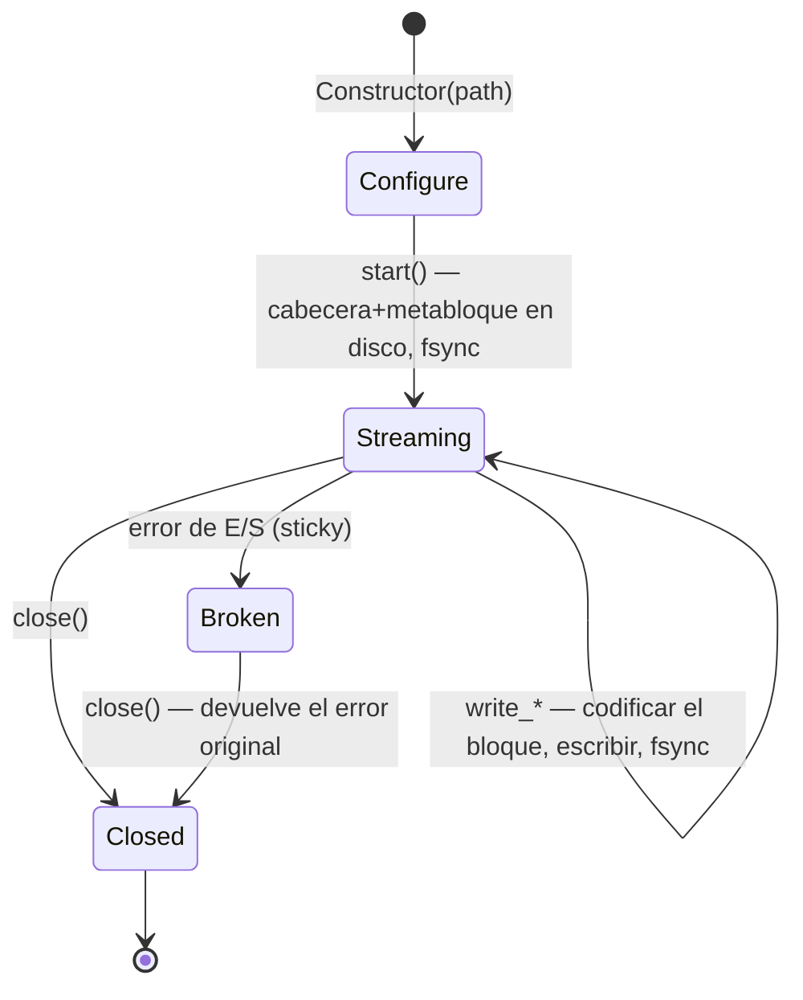

# Escritura

La biblioteca escribe **exclusivamente OSF5**, incluso cuando el origen era
un archivo OSF4. Dos clases de escritor cubren dos perfiles de uso muy
distintos:

| | `StreamingWriter` | `BlockWriter` |
|---|---|---|
| Uso | Registro embebido | Análisis, conversión, exportación |
| Memoria | Constante (búfer de trabajo) | Recopila todas las muestras en RAM |
| Durabilidad | `fsync` por bloque: resistente a fallos ante pérdida de alimentación | Sin fsync; el archivo se genera al final |
| Destino | Ruta de archivo | Ruta de archivo **o** `std::ostream` (memoria, socket) |
| `sizeOfLengthValue` | Fijo desde `start()` (el metabloque ya está en disco) | Elevación automática de 2 a 4 cuando es necesario |
| Ciclo de vida | Configurar → `start()` → escribir → `close()` | Recopilar → `writeToFile()` / `writeTo()` (tantas veces como se quiera) |
| Emisión múltiple | No (un archivo por instancia) | Sí (`writeTo*` es `const`) |

Ambos comparten la descripción de canal `osf::ChannelDef` y las mismas
familias de escritura (equidistante, numérico con marca de tiempo, GPS,
cadena/binario).

## Declarar canales — `ChannelDef`

```cpp
osf::ChannelDef def;
def.name             = "motor.drehzahl";         // Pflicht
def.dataType         = osf::DataType::Double;    // Pflicht
def.channelType      = osf::ChannelType::Scalar; // Pflicht (Scalar = Konvention)
def.sizeOfLengthValue = 2;                       // 2 (Standard) oder 4
def.physicalUnit     = "1/min";                  // optional
def.displayName      = "Motordrehzahl";          // optional
// ferner: physicalDimension, mimeType, reference, comment, timeIncrementNs
```

`addChannel(def)` devuelve el índice de canal (secuencial desde 0) que
utilizan todas las llamadas de escritura. Se rechazan (`InvalidArgument`):
`sizeOfLengthValue` ≠ 2/4, tipos `Unsupported`, más de 65535 canales; en el
`StreamingWriter`, además, cualquier llamada posterior a `start()`.

### Elegir correctamente `sizeOfLengthValue`

El campo de longitud de cada bloque tiene 2 o 4 bytes de ancho y limita el
tamaño del bloque (~64 KB o ~2 GB, respectivamente). Reglas prácticas:

- **Canales de cadena/binario con muestras grandes** (imágenes, audio,
  blobs): en el `StreamingWriter` es obligatorio declarar `4`; no puede
  cambiar el valor después de `start()` y rechaza las muestras demasiado
  grandes con `InvalidBlock`. El `BlockWriter` lo eleva por sí mismo (de 2 a
  4 al emitir), por lo que allí `2` como valor inicial siempre es correcto.
- **Canales numéricos de alta frecuencia** en el `StreamingWriter`: `4`
  evita el chunking; de lo contrario, un append de 100k muestras `double` en
  un canal con `sov=2` se fragmenta en ~13 bloques = ~13 fsyncs.
- En los demás casos: mantener el valor predeterminado `2` (bloques más
  compactos).

## `StreamingWriter` — embebido, resistente a fallos

### Ciclo de vida



```cpp
#include <osf/streamingwriter.h>

osf::StreamingWriter w("aufzeichnung.osf");
w.setCreator("logger-fw/3.2");                 // Metadaten vor start()
w.setTag("pruefstand-7");

auto rpm = w.addChannel(rpm_def);              // Result<uint16_t>
auto gps = w.addChannel(gps_def);
if (!rpm || !gps) { /* … */ }

if (auto r = w.start(); !r) { /* Datei offen, Metablock geschrieben */ }

// Aufzeichnungsschleife
while (running) {
    auto r = w.writeTimestampedSample<double>(*rpm, now_ns(), read_rpm());
    if (!r) { /* I/O-Fehler => Writer ist Broken; abbrechen */ break; }
}

if (auto r = w.close(); !r) { /* … */ }
```

Garantías y comportamiento:

- **Cada `write_*` que retorna con éxito está en disco**
  (`FlushFileBuffers` en Windows, `fsync` en POSIX). Tras un corte de
  alimentación, el archivo es legible hasta el último bloque confirmado; el
  lector está diseñado exactamente para este escenario (mejor esfuerzo ante
  truncamientos).
- **Error persistente (sticky):** tras un error de E/S, el escritor pasa al
  estado `Broken`; cada llamada posterior (incluido `close()`) devuelve el
  error original. Así, la causa del error no se pierde en bucles de tipo
  «dispara y olvida».
- **Los setters de metadatos solo son efectivos antes de `start()`**: el
  metabloque lo escribe `start()` y nunca se vuelve a tocar.
- **Sin OSFZ:** el escritor en streaming escribe archivos `.osf` sin
  procesar. La compresión es un paso posterior, de modo que los modos de
  fallo de escritura y de compresión permanecen desacoplados.
- Construible y asignable por movimiento, no copiable. No es seguro en
  hilos: serialice los accesos externamente.
- El búfer de trabajo crece hasta el tamaño del mayor bloque escrito jamás
  y solo se libera en el destructor.

### Familias de escritura

```cpp
// Äquidistant (nur float/double per Spec) — Segment öffnen + verlängern:
w.startEquidistantSegment(ch, t0_ns, 1000.0 /*Hz*/, daten.data(), daten.size());
w.appendEquidistantSamples(ch, weitere.data(), weitere.size());   // braucht offenes Segment

// Timestamped numerisch (11 Typen, Template):
w.writeTimestampedSample<std::int32_t>(ch, ts_ns, wert);
w.writeTimestampedSamples<double>(ch, ts_array, werte, n);        // parallele Arrays

// GPS (eigene Symbole, kein Template):
w.writeTimestampedGpsSample(ch, ts_ns, osf::GpsLocation{lat, lon, alt});

// String/Binary (ein Sample pro Block per Spec; OSF5: kein 0x00-Terminator):
w.writeTimestampedString(ch, ts_ns, "Ereignis: Tür offen");
w.writeTimestampedBinary(ch, ts_ns, osf::BinarySample::fromVector(jpeg_bytes));
```

Toda llamada con varias muestras se divide automáticamente (chunking) según
la capacidad de bloque del canal (un fsync por bloque). Un nuevo
`startEquidistantSegment` abre deliberadamente un **nuevo** segmento: los
huecos entre segmentos son el medio conforme a la especificación para
representar pausas de grabación.

## `BlockWriter` — recopilar y emitir

```cpp
#include <osf/blockwriter.h>

osf::BlockWriter w;
w.setCreator("analyse-tool/1.0");

auto ch = w.addChannel(def);
w.addEquidistantSegment(*ch, t0_ns, 100.0, samples.data(), samples.size());
w.addTimestampedSample<double>(*ev, ts_ns, 42.0);
w.addStringSample(*log, ts_ns, "Kalibrierung ok");

if (auto r = w.writeToFile("ergebnis.osf"); !r) { /* … */ }

std::ostringstream mem;                 // oder in einen beliebigen ostream
if (auto r = w.writeTo(mem); !r) { /* … */ }
```

- La familia `add*` refleja la familia `write*` del escritor en streaming
  (mismos tipos, misma validación), pero solo recopila en memoria; la
  división en bloques conformes a la especificación ocurre al emitir.
- `writeToFile` / `writeTo` son **`const`**: la misma instancia puede
  emitirse varias veces (p. ej., archivo + red).
- **Elevación automática:** los canales variables cuya muestra más grande no
  cabe en el campo de longitud u16 declarado reciben
  `sizeOfLengthValue = 4` para la emisión.
- Sin fsync: la durabilidad queda a cargo de quien llama.
- `channelIndex("name")` y `channelCount()` ayudan cuando no se conservan
  los índices.

## Valores predeterminados automáticos de metadatos

Ambos escritores aplican los mismos valores predeterminados al ensamblar el
metabloque:

| Campo | Comportamiento si no está establecido |
|---|---|
| `createdUtc` | **Siempre** se marca automáticamente (hora UTC actual, `YYYY-MM-DDTHH:MM:SSZ`; la clave JSON en disco es `created_utc`) |
| `creator` | `osf-cpp/<versión de la biblioteca>` |
| `tag` | `default` |
| `reason`, `createdAt*`, `namespaceSep`, `comment` | Se omiten (no se escriben como `null` si no están establecidos) |

## `StaleValueGuard` — mantener «frescos» los canales inactivos

Los canales esporádicos (de eventos) solo reciben una muestra cuando cambia
el valor. En una línea de tiempo, un canal cuya última escritura fue hace
horas es ambiguo: ¿sigue valiendo el valor o la grabación está muerta? La
convención de optiMEAS limita esta «obsolescencia» (staleness) repitiendo el
último valor como máximo cada 100 s. El guardián automatiza justamente eso
como envoltorio de escritura directa (write-through) sobre un
`StreamingWriter` ya iniciado:

```cpp
#include <osf/stalevalueguard.h>

osf::StreamingWriter w(path);
/* … konfigurieren, start() … */
osf::StaleValueGuard guard(w);                  // Default: 100 s; eigener Wert möglich

// Timestamped-Writes durch den Guard routen (cached den letzten Wert):
guard.writeTimestampedSample<double>(temp_ch, ts_ns, 21.5);

// Periodisch (z. B. im Aufzeichnungs-Tick):
auto reemitted = guard.poll(now_ns);            // Result<std::size_t>
```

Propiedades:

- **Basado en pull:** sin hilo interno ni reloj propio: quien llama
  proporciona `now_ns` a `poll()`. Determinista y apto para sistemas
  embebidos.
- Por cada `poll()`, como máximo **una** repetición por canal (sin relleno
  retroactivo del hueco).
- Solo canales numéricos + GPS; deliberadamente no cadena/binario (repetir
  blobs grandes sería contraproducente).
- Los canales se registran automáticamente en la primera escritura directa;
  `isTracked` / `forget` / `clear` controlan el seguimiento.
- Las escrituras reales reinician el reloj de inactividad: los canales en los
  que se escribe activamente nunca reciben una repetición sintética.

## Ida y vuelta (round-trip) y conversión

Volver a escribir un `DataManager` cargado (también como conversión
OSF4 → OSF5):

```cpp
#include <osf/manager.h>
#include <osf/blockwriter.h>

auto mgr = osf::DataManager::loadFromFile("alt.osf");      // auch OSF4 / OSFZ
if (!mgr) { /* … */ }

if (auto r = osf::writeToFile(*mgr, "neu.osf"); !r) { /* … */ }   // immer OSF5
```

Internamente, `BlockWriter::fromManager(mgr)` construye un escritor a partir
de los canales tipados; quien quiera filtrar o renombrar antes de escribir
utiliza `fromManager` directamente y trabaja sobre el escritor.

Se conservan: nombres de canal, tipos de datos, valores de las muestras
(exactos bit a bit), límites de segmento, metadatos del archivo (salvo
`created_utc`, que se vuelve a marcar al escribir). **No** se conserva el
índice de canal: el escritor lo reasigna secuencialmente de 0 a N.

## Lo que los escritores deliberadamente no hacen

- **Sin salida OSF4**: OSF5 es el único formato de escritura.
- **Sin salida OSFZ**: la compresión es posterior; un compresor posterior
  al cierre y una CLI `osf-compress` están diseñados como trabajo futuro.
- **Sin `bcContinuedRelStampData`**: el formato de tiempo relativo es una
  herencia de lectura de OSF4; los escritores emiten marcas de tiempo
  absolutas.
- **Sin validación de marcas de tiempo**: según la especificación no se
  exige la monotonía y no se impone.

> Este documento se distribuye bajo la licencia [CC BY 4.0](https://creativecommons.org/licenses/by/4.0/deed.de). Atribución: optiMEAS GmbH y optiMEAS Switzerland GmbH.
