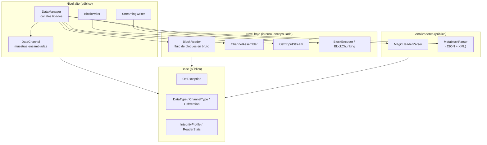
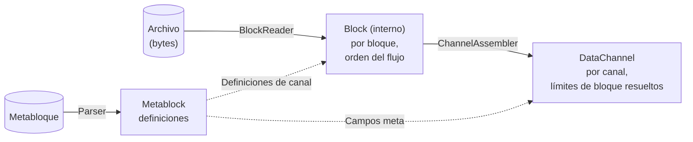

# Arquitectura de la implementación en Java

Esta página describe la estructura interna de la implementación en Java: el
modelo de capas, los módulos y su interacción, el modelo de datos y las
decisiones de diseño centrales. Está dirigida a desarrolladores que integran
la biblioteca **y** a quienes quieran colaborar en ella. La
[página de resumen](../java.md) ofrece una visión rápida; los temas
detallados (lectura, escritura, gestión de errores, herramientas y
compilación) tienen sus propias páginas.

## Directrices

La implementación sigue cuatro principios:

1. **Java 21 moderno e independiente.** Java idiomático en el estado LTS
   actual (registros, tipos sellados, patrones de `switch`) sin puentes con
   otros lenguajes. El comportamiento queda definido únicamente por la
   especificación del formato OSF, no por una portación de referencia.
2. **Encapsulación estricta mediante JPMS.** El descriptor del Java Platform
   Module System exporta exclusivamente `com.optimeas.osf`; el paquete
   interno `com.optimeas.osf.internal` permanece cerrado incluso frente a la
   reflexión. Así, la superficie pública es pequeña y estable.
3. **Mejor esfuerzo al leer.** Los archivos truncados (corte de alimentación
   en el escritor embebido) devuelven todos los bloques completamente
   legibles en lugar de un error; los tipos de datos futuros desconocidos se
   omiten en lugar de interrumpir la carga.
4. **Dependencias ligeras y habituales.** Jackson para el JSON de OSF5, la
   API StAX incluida en el JDK para el XML de OSF4, `java.util.zip`
   (descompresión OSFZ + CRC32C) y SLF4J como fachada de registro. Sin
   frameworks pesados.

## Modelo de capas



La mayoría de las aplicaciones trabajan exclusivamente en el nivel alto
(`DataManager` para leer, uno de los dos escritores para escribir). El nivel
bajo (lector de bloques, ensamblador de canales, flujo OSFZ, codificador)
reside en el paquete encapsulado `com.optimeas.osf.internal` y es invisible
desde fuera; la canalización de lectura la orquesta por completo el
`DataManager`.

## Módulos y responsabilidades

El reactor de Maven `com.optimeas.osf:osf-parent` agrupa tres módulos:

| Módulo | Artefacto | Función |
|---|---|---|
| Biblioteca principal | `com.optimeas.osf:osf-java` | Lectura (OSF4 + OSF5 + OSFZ), ambos escritores OSF5, el perfil de integridad `crc` |
| Línea de comandos | `osf-cli` | Inspección y conversión de archivos OSF; jar ejecutable |
| Visor | `osf-viewer` | Aplicación JavaFX para la visualización de señales de varios canales |

Esta página describe el módulo principal. La superficie pública del núcleo
(paquete `com.optimeas.osf`):

| Tipo | Contenido | Capa |
|---|---|---|
| `DataManager` | Carga + lista de canales tipados + telemetría | Alta |
| `DataChannel` | Muestras ensambladas de un canal; `Kind`, `Segment` | Alta |
| `StreamingWriter` | Escritor OSF5 resistente a fallos (`fsync` por bloque) | Alta |
| `BlockWriter` | Escritor OSF5 que recopila en memoria; `fromManager` | Alta |
| `MagicHeader` / `MagicHeaderParser` | Línea de cabecera mágica + token de integridad | Analizador |
| `Metablock` / `MetablockParser` / `ChannelDef` | Definiciones; analizadores JSON **y** XML | Analizador |
| `DataType` / `ChannelType` | Enumeraciones de formato en el cable + `fromWireName` | Base |
| `OsfVersion` | Versión en disco (OSF4 / OSF5) | Base |
| `GpsLocation` | Muestra GPS (registro: `latitude`/`longitude`/`altitude`) | Base |
| `IntegrityProfile` | Nivel de integridad (`NONE` / `CRC32C` / `ED25519`) | Base |
| `ReaderStats` | Telemetría de lectura (bloques, truncamiento, compresión) | Base |
| `OsfException` | Jerarquía de excepciones (véase más abajo) | Base |

Componentes internos (paquete `com.optimeas.osf.internal`, **no**
exportado): `BlockReader` + `Block` (flujo de bloques en bruto),
`ChannelAssembler` (bloque → canal), `OsfzInputStream` (descompresión OSFZ
transparente), `BlockEncoder` + `BlockChunking` (codificador de bloques OSF5
+ matemática de chunking), `Integrity` (marco CRC32C), `MetablockBuilder`,
`JsonMetablockParser` / `XmlMetablockParser` y `LittleEndian` (utilidades de
orden de bytes). Para más detalles, véase [Internos](internals.md).

## Encapsulación JPMS

El descriptor de módulo `module-info.java` traza un límite estricto:

```
module com.optimeas.osf {
    requires com.fasterxml.jackson.databind;
    requires org.slf4j;
    requires java.xml;          // StAX für den OSF4-XML-Metablock

    exports com.optimeas.osf;
    // com.optimeas.osf.internal ist bewusst NICHT exportiert.
}
```

Solo `com.optimeas.osf` está exportado. El paquete interno está encapsulado
en dos niveles: el compilador deniega el acceso a los tipos no exportados y,
dado que no existe ningún `opens`, también permanece cerrado frente a la
reflexión en tiempo de ejecución. Por tanto, el código de la aplicación no
puede importar las clases internas ni direccionarlas por reflexión.

Esto tiene una consecuencia visible en el modelo de datos: `DataChannel`
tiene, en teoría, un constructor `public` para el `ChannelAssembler`, pero
el tipo de su parámetro (`Block.Values`) reside en el paquete interno.
Desde fuera del módulo, ese constructor no puede invocarse; las instancias
de `DataChannel` se crean exclusivamente a través del `DataManager`.

## Tres modelos de datos — quién ve qué

La biblioteca tiene deliberadamente tres representaciones de los mismos
datos, según el nivel de abstracción:



1. **`Metablock`** (`MetablockParser`): las *definiciones*: metadatos del
   archivo (`Map<String,String>`) y definiciones de canal (`ChannelDef`).
   OSF4 (XML, mediante StAX) y OSF5 (JSON, mediante Jackson) se diferencian
   solo en la serialización; ambos analizadores rellenan el mismo modelo de
   forma simétrica.
2. **`Block`** (interno): la *vista de flujo*: un bloque decodificado con
   índice de canal y tipo de bloque (`bcStartData`, `bcContinuedData`,
   `bcAbsTimeStampData`, `bcContinuedRelStampData`). Los datos útiles se
   presentan como registros `Block.Values` desempaquetados y tipados, de modo
   que no se pierde información del tipo de datos. Este modelo está
   encapsulado y nunca aparece en la API pública.
3. **`DataChannel`**: la *vista de canal*: por canal, una secuencia plana de
   muestras con marcas de tiempo absolutas paralelas, con los límites de
   bloque resueltos. Un único tipo de clase cuyo diseño de almacenamiento se
   distingue mediante un discriminador `Kind`:

   | `Kind` | Almacenamiento |
   |---|---|
   | `EQUIDISTANT` | Secuencia plana de muestras + `List<Segment>`; marcas de tiempo reconstruidas |
   | `TIMESTAMPED` | Numérico/GPS con marcas de tiempo explícitas paralelas |
   | `VARIABLE` | Muestras de cadena **o** binarias, siempre con marca de tiempo |

**Nota sobre los nombres:** `ChannelDef` es la *definición de canal* del
metabloque; `DataChannel` son las *muestras ensambladas*. Los accesores
tipados `asDoubles()`, `asLongs()`, `asBooleans()`, `asStrings()`,
`asBinaries()` y `asGps()` proyectan la secuencia almacenada; si el
`dataType()` no coincide con la vista solicitada, el accesor lanza
`OsfException.UnsupportedType`.

## Convenciones de nombres y de API

- **Tipos** en PascalCase (`DataManager`, `BlockWriter`).
- **Métodos y accesores** en camelCase **sin** prefijo `get`
  (`loadFromFile`, `channelByName`, `timestampsNs`, `asDoubles`); los
  registros tienen accesores con el mismo nombre que el componente
  (`name()`, `index()`).
- **Constantes de enumeración** en UPPER_SNAKE_CASE (`EQUIDISTANT`, `OSF4`,
  `CRC32C`, `GPS_LOCATION`); cada enumeración de formato en el cable lleva
  la grafía exacta del formato mediante `wireName()` y se resuelve con la
  fábrica infalible `fromWireName(String)`.
- **Contenedores de valores** son registros cuando son inmutables
  (`GpsLocation`, `DataChannel.Segment`).
- Las operaciones que pueden fallar lanzan excepciones de una jerarquía
  bajo `OsfException` (`RuntimeException`); la API de lectura y escritura no
  tiene excepciones comprobadas.
- Las búsquedas devuelven `Optional<DataChannel>` (`channelByName`,
  `channelByIndex`) en lugar de `null`.
- La construcción se realiza mediante fábricas estáticas
  (`DataManager.loadFromFile`, `DataManager.load`,
  `BlockWriter.fromManager`) o mediante una configuración de escritor al
  estilo builder (`add…Channel` → añadir muestras → fase de escritura).
- Las marcas de tiempo son siempre `long` en **nanosegundos desde la época
  Unix (UTC)**; las frecuencias de muestreo son `double` en Hz.

## Decisiones de diseño centrales

### Encapsulación en lugar de una API amplia

La superficie pública se limita deliberadamente a un paquete. Toda la ruta
de lectura (decodificación de bloques, ensamblado de canales, descompresión
OSFZ, comprobación de CRC) queda tras `DataManager` y es inaccesible
mediante JPMS. Así, la API comprometida se mantiene pequeña y las
reestructuraciones internas no rompen el código de los consumidores.

### Mejor esfuerzo y compatibilidad hacia delante

Los archivos OSF reales se generan en dispositivos que pueden perder la
alimentación en cualquier momento y con versiones de la especificación que
el lector aún no conoce. De ello se derivan tres reglas de comportamiento:

- **El truncamiento no es un error.** Si el archivo termina en mitad de un
  bloque, el lector devuelve todos los bloques completos y establece
  `ReaderStats.truncationSeen()` en `true` en lugar de lanzar una excepción.
- **Lo desconocido se tolera.** Un tipo de datos desconocido (futuro) se
  analiza como `DataType.UNSUPPORTED`, un tipo de canal desconocido como
  `ChannelType.UNSUPPORTED`; el archivo sigue cargándose y la grafía
  original se conserva en la entrada `attributes` del canal.
- **Los elementos eliminados de la especificación son errores graves.** Los
  tipos de datos eliminados de la especificación (`pair`, `triple`,
  `candata`, `gpsdata`) se rechazan con `OsfException.UnsupportedType`: su
  diseño de datos útiles no puede reproducirse y adivinar en silencio
  supondría corrupción de datos.

### Dos escritores en lugar de uno

`StreamingWriter` (embebido: `fsync` por bloque mediante
`FileChannel.force`, memoria constante, resistente a fallos) y `BlockWriter`
(analista: recopila en memoria, emite al final y puede elevar
automáticamente `sizeoflengthvalue` de 2 a 4) tienen invariantes
incompatibles; un escritor común habría diluido ambos perfiles. Sin embargo,
ambos comparten la misma matemática de chunking (`BlockChunking`) y generan
**OSF5 idéntico byte a byte** para los mismos canales, muestras,
`sizeoflengthvalue` y `created_utc`. Detalles en la página
[Escritura](writing.md).

### OSFZ transparente solo al leer

OSFZ (= OSF comprimido con gzip o zlib) se reconoce y se descomprime de
forma transparente al **leer**: `DataManager.load` coloca un
`OsfzInputStream` sobre el origen antes del análisis de la cabecera mágica y
rellena `ReaderStats.compressed()` / `compressionFormat()`. Al **escribir**,
la biblioteca deliberadamente nunca comprime en línea; la compresión es un
paso posterior.

### Perfil de integridad `crc`

Si la cabecera mágica lleva un token `crc32c`, `DataManager.load` comprueba
el CRC32C del metabloque contra el valor de la cabecera de forma fail-closed
y lo rechaza con `OsfException.MetablockCrcMismatch` si hay discrepancia;
las tramas de bloque también se validan mediante CRC32C. Los archivos
firmados (`IntegrityProfile.ED25519`) se leen de forma transparente (los
bloques de firma se omiten y se cuentan), pero las firmas no se verifican.

### Seguridad en hilos

| Clase | Contrato |
|---|---|
| `DataManager` (cargado) | Inmutable → legible en paralelo sin restricciones |
| `DataChannel` | Inmutable; no mutar las matrices de respaldo |
| `StreamingWriter` / `BlockWriter` | No es seguro en hilos; serializar las llamadas externamente |
| Distintos escritores sobre distintos archivos | Sin problemas en paralelo |

## Estructura de directorios

```
implementations/java/
├── pom.xml                    — Reaktor (osf-parent), drei Module
├── osf-java/                  — Kernbibliothek
│   ├── pom.xml
│   └── src/main/java/
│       ├── module-info.java   — JPMS-Deskriptor
│       └── com/optimeas/osf/
│           ├── *.java         — öffentliche API-Fläche
│           └── internal/      — gekapselte Bausteine
├── osf-cli/                   — Kommandozeilenwerkzeug (picocli)
└── osf-viewer/                — JavaFX-Betrachter
```

## Para profundizar

- [Lectura — DataManager, DataChannel, OSFZ](reading.md)
- [Escritura — StreamingWriter, BlockWriter](writing.md)
- [Gestión de errores — jerarquía OsfException](error-handling.md)
- [Herramientas — osf-cli y osf-viewer](tools.md)
- [Compilación e integración — Maven, JPMS, CI](building.md)
- [Recetario — recetas para tareas habituales](cookbook.md)
- [Internos — codificador, chunking, ensamblador](internals.md)
- [Especificación del formato](../../osf_general.md)

> Este documento se distribuye bajo la licencia [CC BY 4.0](https://creativecommons.org/licenses/by/4.0/deed.de). Atribución: optiMEAS GmbH y optiMEAS Switzerland GmbH.
