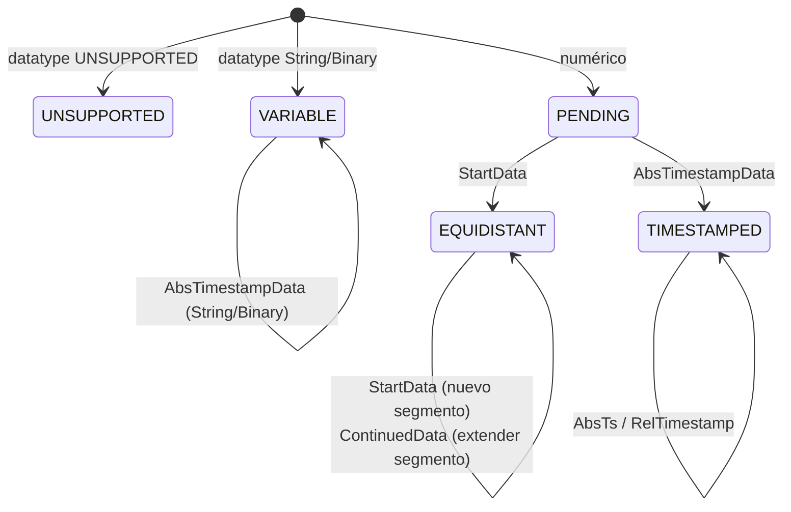

# Aspectos internos

Esta página describe los componentes privados del paquete encapsulado
`com.optimeas.osf.internal` — relevante para quienes colaboran en la
biblioteca o quieren seguir su comportamiento hasta el nivel de byte. Las
definiciones del formato de transmisión (wire format) se encuentran en la
[especificación del formato](../../osf_general.md); la estructura pública la
describe la [Arquitectura](./architecture.md).

## El límite «no exportado»

El descriptor de módulo `module-info.java` exporta **exclusivamente**
`com.optimeas.osf`. El paquete `com.optimeas.osf.internal` deliberadamente
**no** se exporta y —como no existe ningún `opens`— también está cerrado a
la reflexión en tiempo de ejecución. El código de aplicación no puede
importar estas clases ni direccionarlas por reflexión; son pura superficie
de implementación y pueden reestructurarse sin romper la API.

| Componente | Clase(s) | Utilizado por |
|---|---|---|
| Modelo de bloques | `Block` (sellada) + `Block.Values` | Lector, ensamblador |
| Lector de bloques | `BlockReader` | `DataManager` |
| Codificador de bloques | `BlockEncoder` | ambos escritores |
| Matemática de chunking | `BlockChunking` | ambos escritores |
| Lectura del metabloque | `JsonMetablockParser`, `XmlMetablockParser` | `DataManager` |
| Escritura del metabloque | `MetablockBuilder` | ambos escritores |
| Utilidades de integridad (escritura) | `Integrity` | ambos escritores |
| Ensamblador de canales | `ChannelAssembler` | `DataManager` |
| Descompresión OSFZ | `OsfzInputStream` | `DataManager` |
| Utilidad de orden de bytes | `LittleEndian` | Lector + codificador |

Toda la E/S binaria pasa por `java.nio.ByteBuffer` / `FileChannel` con
`ByteOrder.LITTLE_ENDIAN` — no hay conversiones de tipo (casts) del estilo
`reinterpret` ni suposiciones sobre el orden de bytes.

## Codificador de bloques (`BlockEncoder`)

El codificador escribe un bloque OSF5 completo en un `byte[]`. La trama es
little-endian en todo momento:

```
[u16 channelIndex][Längenfeld (sizeOfLengthValue Bytes)][u8 control][body…]
```

El campo de longitud cuenta los bytes de `control + body`. El byte de
control lleva en los bits 0–6 el tipo de bloque y en el bit 7 (`0x80`) el
indicador multimuestra — activado exactamente cuando `count != 1`; en ese
caso el cuerpo comienza con un contador de muestras `u32` N; en caso
contrario sigue exactamente una muestra sin prefijo N.

| Método | Tipo de bloque (control) | Cuerpo |
|---|---|---|
| `timestampedBlock` | `bcAbsTimeStampData` (`0x08`) | por muestra `[i64 ts][Wert]` |
| `timestampedGpsBlock` | `bcAbsTimeStampData` | por muestra `[i64 ts][3 × f64]` (24 B) |
| `startDataBlock` | `bcStartData` (`0x06`) | `[i64 startTs][f64 rate][N?][Werte]` |
| `continuedDataBlock` | `bcContinuedData` (`0x05`) | `[N?][Werte]` |
| `variableStringBlock` / `variableBinaryBlock` | `bcAbsTimeStampData` | muestra individual `[i64 ts][Bytes]` |

`startDataBlock` y `continuedDataBlock` solo aceptan `float` / `double`
(`requireFloatOrDouble`, en caso contrario `OsfException.MalformedFile`).
Las cadenas de texto y los datos binarios se escriben **una** muestra por
bloque en la forma compacta (bit 7 libre, sin prefijo N), codificadas en
UTF-8 y **sin** `0x00` final (OSF5); un `0x00` contenido es contenido
legítimo y se conserva. `frame(…)` comprueba que
`sizeOfLengthValue ∈ {2, 4}` y que la carga útil cabe en el campo de
longitud. La clase interna `Body` es un pequeño constructor de bytes
little-endian (`u8/u16/u32/i16/i32/i64/f32/f64`); `f32`/`f64` pasan por
`Float.floatToRawIntBits` / `Double.doubleToRawLongBits`.

`applyFrameCrc(frame, sizeOfLengthValue)` dota a una trama terminada del
CRC de integridad: aumenta en 4 el campo de longitud en disco (para que
cuente también el CRC) y añade el CRC32C de la trama parcheada **completa**
como cuatro bytes little-endian — exactamente lo que el lector vuelve a
calcular.

## Matemática de chunking (`BlockChunking`)

Esta clase es el **único** lugar donde se calculan los tamaños de bloque;
como ambos escritores la invocan, dividen en bloques byte a byte de forma
idéntica (base de la garantía de identidad de bytes). Del ancho del campo
de longitud se deduce la carga útil máxima:

```java
MAX_PAYLOAD_U16 = 0xFFFF;                 // 2-Byte-Längenfeld
MAX_PAYLOAD_U32 = Integer.MAX_VALUE - 1024;  // Soft-Cap, vermeidet i32-Überlauf
```

Si el perfil de integridad está activo, el CRC de trama
(`FRAME_CRC_RESERVE = 4` bytes) se cuenta por bloque en el campo de
longitud y, por tanto, reduce el presupuesto de carga útil. Sobre este
presupuesto, tres utilidades derivan el número máximo de muestras por tipo
de bloque (sobrecarga: `bcAbsTimeStampData` 5 B = ctrl + N y 8 B adicionales
de marca de tiempo por muestra; `bcStartData` 21 B = ctrl + startTs + rate
+ N; `bcContinuedData` 5 B = ctrl + N):

```java
maxSamplesPerTimestamped(valueSize, sov, frameCrc);  // perSample = 8 + valueSize
maxSamplesPerStart(valueSize, sov, frameCrc);
maxSamplesPerContinued(valueSize, sov, frameCrc);
maxSamplesPerTimestampedGps(sov, frameCrc);          // GPS_VALUE_SIZE = 24
```

Cada utilidad devuelve al menos 1 (`Math.max(1, …)`), de modo que una única
muestra sobredimensionada nunca entra en un bucle infinito.

## Utilidades de integridad (`Integrity`)

El lado de escritura del perfil de integridad de OSF5 *nivel crc*.
`magicLine` construye la línea del Magic Header `OSF5 <len>\n` y, con el
perfil activo, añade un token `crc32c:<HEX8>` — el CRC32C de los bytes del
metabloque como ocho dígitos hexadecimales en mayúsculas (`hex8`). Con ello
el metabloque queda protegido en la cabecera; los CRC de trama de los
bloques de datos los proporciona `BlockEncoder`. Todo el cálculo de CRC
utiliza `java.util.zip.CRC32C`.

## Flujo de descompresión OSFZ (`OsfzInputStream`)

`wrap(in, onFormat)` reconoce de forma transparente gzip/zlib al inicio del
flujo. Mediante un `PushbackInputStream(in, 2)` se leen por adelantado dos
bytes y se clasifican:

- **gzip** — `0x1F 0x8B` → `GZIPInputStream`, `onFormat("gzip")`.
- **zlib** — `0x78` seguido de `0x01 / 0x5E / 0x9C / 0xDA` →
  `InflaterInputStream`, `onFormat("zlib")`.
- **plain** — cualquier otro caso (un OSF auténtico comienza con
  `'O' = 0x4F`); los bytes leídos se devuelven al flujo y este se pasa sin
  modificar; `onFormat` **no** se invoca.

Los flujos con menos de dos bytes se consideran plain — el analizador del
Magic Header posterior notifica entonces el error correspondiente. El
callback suele alimentar `ReaderStats.setCompression`.

## Analizadores del metabloque (`JsonMetablockParser` / `XmlMetablockParser`)

Ambos analizadores rellenan, de forma simétrica, el mismo modelo
`Metablock` (metadatos del archivo como `Map<String,String>` más la lista
`ChannelDef`):

- **OSF5 / JSON** — `JsonMetablockParser` (Jackson) lee la envoltura `osf`
  con `format`, `version`, `file{}` y `channels[]`. Campos obligatorios por
  canal: `index` (0..65535), `name`, `channeltype`, `datatype`,
  `sizeoflengthvalue` (debe ser 2 o 4). `timeincrement` (ausente/0 ⇒ no
  equidistante) y `physicalunit` son opcionales; los demás campos
  escalares de cadena de texto pasan al mapa `attributes`.
- **OSF4 / XML** — `XmlMetablockParser` (StAX) lee el elemento raíz
  `<optimeas>` con atributos de archivo y elementos hijo `<channel>`. La
  `XMLInputFactory` está configurada de forma **segura frente a XXE**
  (`IS_SUPPORTING_EXTERNAL_ENTITIES = false`, `SUPPORT_DTD = false`,
  `IS_REPLACING_ENTITY_REFERENCES = false`); la versión se establece en 4.

Los tipos de datos (futuros) desconocidos pasan a ser
`DataType.UNSUPPORTED`, los tipos de canal desconocidos a
`ChannelType.UNSUPPORTED`; la grafía original se conserva en la entrada de
`attributes`. Los tipos de datos eliminados de la especificación lanzan
`OsfException.UnsupportedType`. Los tipos de Jackson o de StAX **nunca**
aparecen en los records públicos del modelo. El lado de escritura es
`MetablockBuilder` (construye el mismo contrato JSON de transmisión:
`osf.file` literal, `osf.channels[]` con `index` rederivado de la posición
en la lista; `timeincrement` solo si existe incremento).

## Ensamblador de canales (`ChannelAssembler`)

`assemble(channelDefs, blocks)` pliega la `List<Block>` plana con las
definiciones de canal en `DataChannel` tipados, en el orden del metabloque.
Por cada canal, un `Builder` mantiene una máquina de estados:



- `StartData` abre un segmento equidistante
  (`Segment(startTs, rate, startIndex, count)`); el primer bloque tipado
  fija el `Kind`.
- `ContinuedData` prolonga el último segmento correspondiente.
- `AbsTimestampData` se añade a un diseño `TIMESTAMPED` (numérico/GPS) o
  `VARIABLE` (String/Binary) y actualiza el ancla (`lastTimestampNs`).
- `RelTimestampData` solo prolonga un canal `TIMESTAMPED` con ancla: cada
  delta se suma de forma acumulativa, mediante `saturatingAdd`, a la última
  marca de tiempo absoluta.
- Las marcas de tiempo equidistantes se reconstruyen por segmento como
  `start + (long)(i * 1e9 / rate)` (suma saturante); las lagunas entre
  segmentos no se interpolan.

El ensamblador es deliberadamente tolerante: un tipo ajeno al bloque en un
canal ya fijado se ignora en lugar de tratarse como error (best-effort).
`finish()` descarta los canales `UNSUPPORTED` (`null`) y materializa un
`PENDING` sin ningún bloque como un canal equidistante vacío. Los fragmentos
de valores (uno por bloque) solo se concatenan al final en un array plano
por cada primitivo de Java — así el ensamblado sigue siendo O(total de
muestras).

## Utilidad de orden de bytes (`LittleEndian`)

Un módulo diminuto pero central: `wrap(byte[])` y `allocate(int)` devuelven
un `ByteBuffer` con `ByteOrder.LITTLE_ENDIAN`. Es el **único** lugar donde
se fija el orden de bytes; el lector y el codificador pasan siempre por
aquí, de modo que el orden de bytes no tiene que repetirse en ningún otro
punto.

## Estructura de pruebas y verificación

Las pruebas se realizan con **JUnit** en
`osf-java/src/test/java/com/optimeas/osf/`:

| Nivel | Ubicación | Carácter |
|---|---|---|
| Unitarias (internas) | `…/internal/*Test.java` | bytes sintéticos, un archivo por componente (`BlockEncoderTest`, `BlockReaderTest`, `JsonMetablockParserTest`, `XmlMetablockParserTest`, `MetablockBuilderTest`, `LittleEndianTest`, `OsfzInputStreamTest`, `FrameCrcCheckValueTest`) |
| API pública | `…/*Test.java` | `DataManagerTest`, `BlockWriterTest`, `StreamingWriterTest`, `MagicHeaderParserTest`, `IntegrityReaderTest`, `WriterIntegrityTest` |
| Ejemplos / round-trip | `*ExamplesTest`, `Roundtrip…` | archivos reales de `examples/` (datos de campo + conjunto de referencia), incl. `OsfzExamplesTest` |
| Identidad de bytes | `WriterIdentityTest` | ambos escritores generan el mismo OSF5 para la misma entrada |
| Conformidad | `ConformanceManifestTest` | `reference_manifest.json` común |
| Robustez | `FuzzTruncationTest` | las entradas truncadas / mutiladas nunca provocan una excepción inesperada |

La ejecución completa se realiza con
`mvn -f implementations/java/pom.xml test`; la CI la ejecuta en cada push.
Código fuente completo del paquete interno:
[`osf-java/src/main/java/com/optimeas/osf/internal/`](https://github.com/optimeas/osf/tree/main/implementations/java/osf-java/src/main/java/com/optimeas/osf/internal).

## Continuar

- [Arquitectura](./architecture.md) — modelo de capas y modelos de datos.
- [Lectura](./reading.md) y [Escritura](./writing.md) — la API pública.
- [Gestión de errores](./error-handling.md) — la jerarquía `OsfException`.
- [Herramientas](./tools.md) y [Compilación](./building.md).
- [Recetario](./cookbook.md) — recetas para copiar.
- [Volver al resumen de Java](../java.md).

> Este documento está licenciado bajo [CC BY 4.0](https://creativecommons.org/licenses/by/4.0/deed.de). Atribución: optiMEAS GmbH y optiMEAS Switzerland GmbH.
