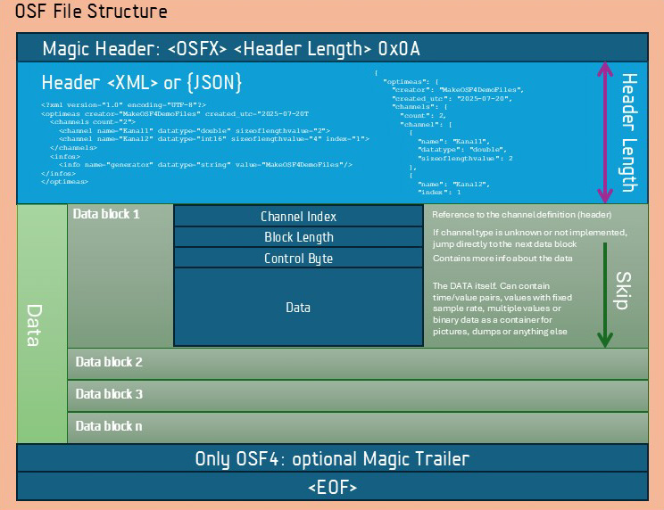

## Descripción general del formato OSF
- Válida para las versiones de formato 4 y 5 -

El **Open Streaming Format (OSF)** es un formato de datos binario, orientado a bloques, para el registro continuo de datos de medición y de proceso con referencia temporal. Está concebido para resultar óptimo no solo para el **streaming en sistemas embebidos con recursos limitados**, sino también para el **procesamiento eficiente por bloques de grandes volúmenes de datos** en plataformas de análisis de alto rendimiento, ya sea en servidores, PC o en el posprocesamiento directamente en dispositivos embebidos.


### Principios fundamentales

* **El tiempo como eje central:** todos los datos se almacenan con información temporal inequívoca, ya sea equidistante con una cuadrícula temporal fija o individual con marcas de tiempo.
* **Apto para streaming:** los datos pueden escribirse de forma continua en el archivo durante la medición en curso, sin conocer de antemano la cantidad total.
* **Robustez:** incluso ante un corte de alimentación o un apagado inesperado, todos los datos almacenados hasta el último bloque escrito siguen siendo legibles.
* **Estructura abierta:** combinación de un bloque de metadatos claro (XML en OSF4, JSON en OSF5) y un flujo de datos binario sencillo.
* **Almacenamiento por bloques:** en lugar de escribir los valores individuales de forma secuencial, se utilizan bloques de datos. Esto reduce las operaciones de escritura y permite cargar rápidamente grandes volúmenes de datos.
* **Flexibilidad:** compatibilidad con diversos tipos de datos, desde escalares simples, pasando por vectores y matrices, hasta datos binarios como imágenes o archivos de audio.
* **Metadatos:** cada canal puede describirse con nombre, unidades físicas, dimensiones e información adicional opcional.

### Estructura básica de un archivo OSF

Con independencia de la versión 4 o la versión 5, todo archivo OSF sigue el mismo esquema básico:




1. **Magic Header**

   * Identificador del formato (OSF4, OSF5, OCEAN\_STREAM\_FORMAT4, OCEAN\_STREAMING\_FORMAT4)
   * Indicación de la longitud del bloque de metadatos siguiente

2. **Bloque de metadatos (XML o JSON)**

   * Contiene información sobre canales, tipos de datos, unidades físicas y datos de contexto
   * Define la estructura de los bloques de datos siguientes

3. **Bloques de datos binarios**

   * Contienen los valores de medición propiamente dichos en formato de streaming
   * Admiten datos equidistantes y con marca de tiempo
   * Pueden contener valores individuales, vectores, matrices o datos binarios

4. **Bloque de cierre opcional**

   * En OSF4, tráiler XML opcional con estadísticas y resumen de canales
   * En OSF5, este tráiler se omite de forma predeterminada

### Organización de los datos

* **Canales:** cada flujo de datos se describe como un canal que contiene el nombre, el tipo de datos, la unidad física y, opcionalmente, otros atributos.
* **Base de tiempo:** todos los datos temporales se almacenan en nanosegundos desde la época (Epoch) y permiten una sincronización de alta precisión.
* **Cabecera de bloque:** cada bloque de datos comienza con un índice de canal y una indicación de longitud, de modo que el flujo sigue siendo interpretable incluso con canales desconocidos o ante interrupciones.
* **Byte de control:** define el tipo y la estructura del bloque de datos siguiente (p. ej., inicio, continuación, tipo de marca de tiempo). En OSF5 se simplifica el uso de este byte, pero sigue siendo funcionalmente compatible.


## Magic Header

Todo archivo OSF comienza con el denominado **Magic Header**.
Sirve para dos fines:

1. Identificación inequívoca como archivo OSF.
2. Indicación de la longitud del bloque de metadatos siguiente, para que pueda leerse y analizarse directamente.

### Estructura

El Magic Header es una línea ASCII terminada con salto de línea (`\n`).

**Ejemplo OSF4:**

```
OSF4 173762\n
```

* **OSF4** es el identificador del formato.
* **173762** indica la longitud del bloque de metadatos en bytes.

**Ejemplo OSF5:**

```
OSF5 84512\n
```

* **OSF5** identifica la nueva versión.
* **84512** El número indica la longitud del bloque de metadatos, que en OSF5 es JSON de forma predeterminada.

### Identificadores admitidos

Por motivos de compatibilidad, las implementaciones de OSF reconocen varias cabeceras:

* **OSF4** – archivo OSF4 clásico
* **OCEAN\_STREAM\_FORMAT4** – identificador heredado (legacy) para archivos OSF4 que los dispositivos suministrados siguen escribiendo; los lectores deben admitirlo
* **OCEAN\_STREAMING\_FORMAT4** – grafía histórica más antigua; también debe interpretarse como OSF4
* **OSF5** – archivo OSF5

### Tokens de cabecera (campos adicionales opcionales)

La línea de cabecera de OSF5 PUEDE llevar, tras la longitud del bloque de metadatos, tokens opcionales separados por espacios:

```
header-line = identifier SP metablock-len *(SP token) LF
token       = key ":" value
```

Aquí, `key` consta de letras minúsculas `a-z`, dígitos `0-9` y el guion `-`; `value` son caracteres visibles sin espacios. Entre los campos hay exactamente un espacio; antes del LF final no hay ningún espacio.

Los tokens son **«must understand»**: si un lector encuentra una `key` que no conoce, DEBE rechazar el archivo, con un diagnóstico como `unknown header token '<key>'`, **no** como error de análisis numérico.

Los tokens son una **característica exclusiva de OSF5**: los identificadores heredados de OSF4 (`OSF4`, `OCEAN_STREAM_FORMAT4`, `OCEAN_STREAMING_FORMAT4`) NO DEBEN llevar tokens; un token tras un identificador de OSF4 es un archivo defectuoso.

Las keys definidas (`crc32c`, `ed25519`) y su significado se establecen en el perfil de integridad; consulte el [perfil de integridad de OSF5](references/osf5_integrity.md).

### Detección del formato del bloque de metadatos

Si el bloque de metadatos siguiente es **XML** o **JSON** se determina por el primer carácter tras la cabecera:

* `<` → XML (formato OSF4)
* `{` → JSON (formato OSF5)
* Cualquier otro carácter → error

### Ventajas

* **Arranque rápido:** los lectores pueden extraer de inmediato el bloque de metadatos y pasarlo al analizador correcto.
* **Apto para streaming:** no es necesario conocer el tamaño total del archivo.
* **Compatible con versiones anteriores:** OSF5 procesa archivos OSF4 (incl. OCEAN\_STREAM\_FORMAT4 y OCEAN\_STREAMING\_FORMAT4).
* **Implementación sencilla:** una línea basta para determinar la versión y el analizador.


## Bloque de metadatos – canales y metadatos

Inmediatamente después del Magic Header, en todo archivo OSF sigue el **bloque de metadatos**.
Contiene toda la información necesaria para interpretar correctamente los bloques de datos siguientes. Entre ella se incluyen:

* **Parámetros del archivo:** información de contexto sobre el archivo y su origen.
* **Definiciones de canal:** describen cada flujo de datos con nombre, tipo de datos y propiedades físicas.
* **Metadatos:** información adicional que no está vinculada directamente a un canal (p. ej., estado del sistema, comentarios, datos de calibración).

El bloque de metadatos constituye el «índice» del archivo y está diseñado para ser **inequívoco, legible por máquina y fácil de ampliar**.


### Parámetros del archivo (en el bloque de metadatos)

* **created\_utc** – momento de creación del archivo en UTC en formato ISO 8601
* **creator** – `optional` identificación del creador (p. ej., número de serie del dispositivo, nombre del programa, UUID)
* **created\_at\_longitude** / **created\_at\_latitude** / **created\_at\_altitude** – `optional` posición geográfica de la creación del archivo
* **reason** – `optional` motivo de la creación del archivo (p. ej., `BOOT`, `SEQUENCE`, `TRIGGERED`)
* **total\_seq\_no** – `obsoleto` número de secuencia absoluto desde el arranque del sistema (comenzando en 0)
* **triggered\_seq\_no** – `obsoleto` número de secuencia relativo desde el último evento de disparo (comenzando en 0)
* **namespacesep** – `optional` separador para nombres de canal jerárquicos (predeterminado `"."`)
* **tag** – `optional` etiqueta libre para clasificar el archivo (p. ej., `preview`)
* **comment** – `optional` texto de comentario opcional


### Definiciones de canal (channel)

Cada canal describe un flujo de datos dentro del archivo.
Los parámetros se describen a continuación


#### **Identificación y organización**

* **index**
  Índice de canal único dentro del archivo (comenzando en 0).
* **name**
  Nombre del canal, opcionalmente con ruta jerárquica (p. ej., `Motor.Temperatur`).
* **reference**
  Referencia única opcional o UUID para identificar el origen de los datos.


#### **Base de tiempo**

* **timeincrement**
  Incremento de tiempo fijo en nanosegundos para canales equidistantes.
  *Valor = 0 o no establecido → el canal utiliza marcas de tiempo individuales.*

  **Nota:** el `timeincrement` del bloque de metadatos es una **indicación opcional**. En grabaciones de alta resolución o basadas en disparador, la frecuencia de muestreo exacta suele ser todavía desconocida al crear la cabecera. La **frecuencia de muestreo realmente válida se suministra como `double` en cada bloque `bcStartData`** y es válida desde ese momento para todos los bloques `bcContinuedData` posteriores del mismo canal, hasta que se escriba un nuevo bloque `bcStartData`. Esto se aplica tanto a **OSF4** como a **OSF5**.


#### **Tipos de datos y estructura** {#datentypen-und-struktur}

* **datatype**
  Tipo de datos de los valores almacenados (p. ej., `bool`, `int32`, `double`, `string`, `gpslocation`).
  → *Una descripción completa de todos los tipos de datos y de su codificación se encuentra en el capítulo [Tipos de datos](#datentypen).*

* **channeltype**
  Tipo estructural del canal:

  * `scalar` – valores individuales a lo largo del tiempo
  * `binary` – bloques binarios arbitrarios (p. ej., imágenes)
    *(Vector y matriz se describen en un documento aparte)*
    → *Una explicación detallada de los tipos de canal se encuentra en el capítulo [Tipos de canal](#kanaltypen).*

* **sizeoflengthvalue**
  Tamaño de la indicación de longitud de cada bloque de datos:

  * `2` → 2 bytes (uint16, tamaño máximo de bloque \~64 kB)
  * `4` → 4 bytes (uint32, tamaño máximo de bloque \~4 GB)
    Se utiliza para determinar el tamaño del bloque y leer correctamente los bloques de datos en el flujo.
    *→ Puede encontrarse una explicación detallada en el capítulo [sizeoflengthvalue](#sizeoflengthvalue).*

* **mimetype**
  Opcional, tipo MIME para canales binarios (p. ej., `image/jpeg`, `audio/wav`).

* **spectrumtype**
  Opcional, tipo de datos espectrales:

  * `amplitude` (predeterminado)
  * `realImag`
  * `ampPhaseRad`
  * `ampPhaseDeg`


#### **Propiedades físicas**

* **physicalunit**
  Opcional, unidad física (conforme al SI, p. ej., `V`, `°C`).
* **physicaldimension**
  Opcional, descripción de la dimensión física (`temperature`, `pressure`, …).


#### **Representación e información adicional**

* **displayname**
  Nombre para mostrar opcional para visualización o GUI.
* **comment**
  Comentario opcional sobre el canal.


### Metadatos (info)

Los metadatos complementan el archivo con información adicional que no está vinculada a un canal.
Parámetros típicos:

* **name** – nombre de la información
* **value** – valor (como cadena o tipificado)
* **datatype** – tipo del valor (`string`, `int32`, `float`, `binary`, `gpslocation`, etc.)
* **physicalunit** – opcional, unidad física del valor

Los metadatos son de definición libre y resultan adecuados para:

* Datos del sistema o del dispositivo
* Comentarios y mensajes de estado
* Valores de calibración
* Información adicional definida por el usuario

> **Nota:** `bytearray` es un alias de `binary`. Ambas denominaciones son válidas en OSF4 y OSF5 y los lectores las interpretan de forma idéntica. Los escritores **deben** utilizar `binary` de manera uniforme al escribir; `bytearray` sigue siendo legible por compatibilidad con versiones anteriores.


### Ventajas de la estructura

* **Separación clara entre datos y descripción:** el bloque de metadatos define cómo se interpretan los datos, sin contener él mismo valores de medición.
* **Autodescriptivo:** los archivos pueden leerse e interpretarse sin definiciones externas.
* **Ampliable:** pueden añadirse nuevos canales, tipos de datos o metainformación sin modificar el formato base.
* **Robusto:** gracias a los índices fijos y a las indicaciones de longitud, el archivo sigue siendo interpretable incluso si no se conocen todos los canales.


## Parámetros básicos de la descripción de canal

Los parámetros siguientes definen la estructura fundamental de un canal en OSF y determinan cómo se almacenan e interpretan los datos en el formato de streaming. Son relevantes para todos los canales y constituyen la base de la descripción de canal.

<a name="datentypen"></a>
### Tipos de datos (datatype) {#datentypen}

El parámetro `datatype` establece el formato de datos de los valores de un canal. Cada valor se almacena en un formato binario exactamente definido.

#### Tipos de datos admitidos y codificación:

| Tipo de datos | Tamaño (bytes) | Descripción                                                                                                                                         |
| --------- | ------------- | ---------------------------------------------------------------------------------------------------------------------------------------------------- |
| `bool`    | 1             | Verdadero/falso (0 = false, 1 = true)                                                                                                                    |
| `int8`    | 1             | Entero con signo                                                                                                                              |
| `int16`   | 2             | Entero con signo                                                                                                                              |
| `int32`   | 4             | Entero con signo                                                                                                                              |
| `int64`   | 8             | Entero con signo                                                                                                                              |
| `uint8`   | 1             | Entero sin signo, intervalo de valores 0 … 255                                                                                                       |
| `uint16`  | 2             | Entero sin signo, intervalo de valores 0 … 65 535                                                                                                    |
| `uint32`  | 4             | Entero sin signo, intervalo de valores 0 … 4 294 967 295                                                                                             |
| `uint64`  | 8             | Entero sin signo, intervalo de valores 0 … 18 446 744 073 709 551 615                                                                                |
| `float`   | 4             | IEEE 754 de precisión simple                                                                                                                            |
| `double`  | 8             | IEEE 754 de precisión doble                                                                                                                            |
| `string`  | variable      | Codificado en UTF-8, longitud definida por el tamaño del bloque. En disco, en `bcAbsTimeStampData`: en OSF4 con byte nulo final (`0x00`), en OSF5 sin byte final; consulte el bloque de notas siguiente para las reglas. En `bcMessageEvent`, en cambio, la carga útil lleva prefijo de longitud y en ambas versiones nunca termina en nulo. |
| `binary` *(alias: `bytearray`)* | variable | Secuencias de bytes arbitrarias para imágenes, audio u otros datos binarios con tipo MIME. La longitud máxima del bloque se determina mediante el campo `sizeoflengthvalue` del canal. En disco, en `bcAbsTimeStampData`: en OSF4 con byte nulo final (`0x00`), en OSF5 sin byte final; consulte el bloque de notas siguiente para las reglas. En `bcMessageEvent`, en cambio, la carga útil lleva prefijo de longitud y en ambas versiones nunca termina en nulo. |
| `gpslocation` | 24        | Estructura para posiciones GPS (véase más abajo)                                                                                                            |

> **Nota sobre los tipos enteros:** los valores enteros (`int8`, `int16`, `int32`, `int64`, `uint8`, `uint16`, `uint32`, `uint64`) se utilizan en los archivos OSF típicamente para **estados, información de estado o valores de contador**, no como valores brutos escalados de una magnitud física. Por este motivo, OSF deliberadamente **no** contempla parámetros `scale`/`offset` para la conversión a valores físicos; las magnitudes físicas se almacenan directamente como `float` o `double`.

#### Nota sobre la terminación nula de `string` y `binary` {#hinweis-zur-nullterminierung-von-string-und-binary}

> **Nota sobre la terminación nula de `string` y `binary`:**
> El byte final `0x00` en las cargas útiles `string` y `binary` de `bcAbsTimeStampData` es una herencia histórica de la serialización `QString` de Qt en los dispositivos originales de Optimeas. La longitud del bloque ya queda determinada de forma inequívoca por `sizeoflengthvalue`, por lo que un terminador nulo como centinela es redundante. En los datos binarios es una trampa activa: un lector que no elimine el byte produce salidas no válidas (un archivo JPEG con un `0x00` añadido deja de ser un JPEG válido). A la inversa, un lector que elimine un byte de una carga útil binaria de OSF5 sin terminador (un blob ASN.1 que legítimamente termina en `0x00`, un mensaje Protobuf, una cadena terminada en nulo almacenada como binary) recorta un byte de datos real. Por ello, la regla está vinculada al número de versión en disco, para que ni los escritores ni los lectores tengan que adivinar.
>
> **OSF4:**
>
> - **Los escritores DEBEN** añadir un único byte `0x00` final después de cada carga útil `string` y `binary` en `bcAbsTimeStampData`.
> - **Los lectores DEBEN** eliminar incondicionalmente el último byte de la carga útil; el byte está garantizado.
>
> **OSF5:**
>
> - **Los escritores NO DEBEN** añadir ningún byte final. La carga útil termina en el último byte de datos; `sizeoflengthvalue` define la longitud exacta.
> - **Los lectores NO DEBEN** eliminar ningún byte final. Un `0x00` final se trata como un byte de datos normal.
>
> Por tanto, la longitud efectiva de la carga útil es: longitud del bloque en OSF5, longitud del bloque menos un byte en OSF4. No existe ninguna heurística ni paso de detección de centinela.

#### Estructura `gpslocation`

```c
struct gps_location {
    double latitude;   // Breitengrad
    double longitude;  // Längengrad
    double altitude;   // Höhe
};
```

> **Nota:** para los canales con `datatype="binary"` se recomienda definir el tipo MIME (`mimetype`) en el canal (p. ej., `image/jpeg`, `audio/wav`) para poder interpretar los datos de forma inequívoca. El tamaño máximo de bloque lo determina el parámetro [`sizeoflengthvalue`](#sizeoflengthvalue) del canal.


<a name="kanaltypen"></a>
### Tipos de canal (channeltype) {#kanaltypen}

El parámetro `channeltype` define la **organización lógica de los valores** de un canal (su *forma de datos*). Establece cuántos valores se almacenan por bloque de datos y qué estructura tienen esos valores.

> **Importante:** `channeltype` es la **forma de datos**, no el modo de almacenamiento/muestreo. Que un canal sea **equidistante** o **con marca de tiempo** se deduce del **byte de control del bloque de datos** (`bcStartData`/`bcContinuedData` ⇒ equidistante; `bcAbsTimeStampData` ⇒ marca de tiempo por valor) junto con `timeincrement`, **no** de `channeltype`. Por tanto, `equidistant` y `timestamped` **no** son valores de `channeltype` y no deben escribirse como tales.

OSF conoce los siguientes tipos de canal (`scalar`, `vector`, `matrix`, `binary`; véanse también la descripción de campos en [Tipos de datos y estructura](#datentypen-und-struktur) y [osf4.md](references/osf4.md)):


#### scalar

* **Descripción:**
  Un canal con exactamente un valor por instante.
  Aplicación típica: magnitudes físicas continuas (temperatura, tensión, presión) o señales digitales (p. ej., estado de una puerta).

* **Propiedades:**

  * Cada bloque de datos contiene una o varias muestras con un único valor.
  * Admite muestreo equidistante mediante `timeincrement` o marcas de tiempo individuales por valor.
  * Es el tipo de canal más sencillo y más utilizado.

* **Ejemplo XML (OSF4):**

  ```xml
  <channel 
      index="0"
      name="Sensor.Temperature"
      channeltype="scalar"
      datatype="double"
      physicalunit="°C"/>
  ```

* **Ejemplo JSON (OSF5):**

  ```json
  {
    "index": 0,
    "name": "Sensor.Temperature",
    "channeltype": "scalar",
    "datatype": "double",
    "physicalunit": "°C"
  }
  ```


#### vector

* **Descripción:**
  Un canal en el que cada bloque de datos contiene una **secuencia de varios valores** que forman una unidad lógica.
  Aplicación típica: espectros de frecuencia (FFT), segmentos de series temporales, grabaciones multicanal en un bloque.

* **Propiedades:**

  * La longitud del vector puede variar de un bloque a otro.
  * Ahorra sobrecarga con una frecuencia de muestreo alta, ya que se escriben varios valores en un bloque.
  * Puede funcionar tanto con marcas de tiempo por bloque como con un incremento de tiempo fijo.
  * Requiere parámetros adicionales para la información de ejes (documento aparte).

* **Ejemplo XML (OSF4):**

  ```xml
  <channel 
      index="2"
      name="FFT.Magnitude"
      channeltype="vector"
      datatype="float"
      physicalunit="dB"/>
  ```

* **Ejemplo JSON (OSF5):**

  ```json
  {
    "index": 2,
    "name": "FFT.Magnitude",
    "channeltype": "vector",
    "datatype": "float",
    "physicalunit": "dB"
  }
  ```


#### matrix

* **Descripción:**
  Un canal que almacena por marca de tiempo una **estructura de datos bidimensional**.
  Aplicación típica: clasificaciones rainflow, mapas de calor, matrices de sensores 2D, datos de imagen.

* **Propiedades:**

  * El tamaño de la matriz puede variar de un bloque a otro.
  * Permite estructuras de datos complejas en una base de tiempo uniforme.
  * Requiere parámetros adicionales para la descripción de filas y columnas (documento aparte).

* **Ejemplo XML (OSF4):**

  ```xml
  <channel 
      index="5"
      name="Rainflow.Matrix"
      channeltype="matrix"
      datatype="int32"
      physicalunit="counts"/>
  ```

* **Ejemplo JSON (OSF5):**

  ```json
  {
    "index": 5,
    "name": "Rainflow.Matrix",
    "channeltype": "matrix",
    "datatype": "int32",
    "physicalunit": "counts"
  }
  ```


#### binary

* **Descripción:**
  Un canal que almacena por instante un **bloque binario arbitrario** (un blob por valor).
  Aplicación típica: imágenes, fragmentos de audio, mensajes serializados.

* **Propiedades:**

  * Equivalente en carga útil a un canal `scalar` con `datatype="binary"`; un lector trata ambas notaciones de forma idéntica.
  * Se recomienda establecer el `mimetype` del canal (p. ej., `image/jpeg`).
  * El tamaño máximo de bloque lo determina `sizeoflengthvalue`.

* **Ejemplo JSON (OSF5):**

  ```json
  {
    "index": 3,
    "name": "Camera.Frame",
    "channeltype": "binary",
    "datatype": "binary",
    "mimetype": "image/jpeg"
  }
  ```


#### Indicaciones sobre vector y matrix

* **Parámetros adicionales:** ambos tipos necesitan metainformación sobre dimensiones, ejes, unidades físicas y, en su caso, etiquetas. Se describen en detalle en documentos aparte.
* **Eficiencia:** los canales de vector y matriz reducen las operaciones de escritura y resultan especialmente adecuados para datos con una frecuencia de muestreo alta o una estructura compleja.
* **Flexibilidad:** el tamaño y la estructura de los bloques pueden variar, lo que permite adaptarse a distintos escenarios de medición.
* **Sincronización:** comparten la misma base de tiempo que los canales scalar, de modo que diferentes tipos de datos pueden almacenarse en un archivo con una sincronización exacta.

---

#### Resumen

* **`scalar`** – tipo de canal sencillo, un valor por instante. Ideal para magnitudes de medición continuas.
* **`vector`** – varios valores en un bloque, optimizado para espectros de frecuencia y datos de alta frecuencia.
* **`matrix`** – bloques multidimensionales, adecuados para clasificaciones, datos de imagen y de matrices.
* **`binary`** – un bloque binario arbitrario por instante (imágenes, audio, mensajes serializados); equivalente a `scalar` + `datatype="binary"`.

> **Nota:** combinando estos tipos de canal, OSF cubre tanto señales sencillas como conjuntos de datos complejos y, al mismo tiempo, sigue siendo fácil de implementar.


<a name="sizeoflengthvalue"></a>
### Campo de tamaño de bloque (sizeoflengthvalue) {#sizeoflengthvalue}

El parámetro `sizeoflengthvalue` define el tamaño del campo de longitud que precede a cada bloque de datos de un canal. Determina, por tanto, cuántos bytes se utilizan para indicar el tamaño del bloque y, con ello, cuál puede ser como máximo el tamaño de un bloque de datos individual.

#### Finalidad

OSF es un formato de streaming. Cada bloque de datos puede tener un tamaño distinto y contiene un número variable de valores de medición. Para poder leer correctamente estos bloques, es necesario conocer su longitud. El campo `sizeoflengthvalue` indica si para la indicación de longitud se utilizan **2 bytes** o **4 bytes**.

#### Valores

* **2** – el campo de longitud es de 2 bytes (uint16).

  * Valor máximo: 65.535 bytes por bloque de datos.
  * Valor predeterminado para canales de medición típicos con tamaños de bloque moderados.
  * Menor consumo de memoria y menor sobrecarga.
* **4** – el campo de longitud es de 4 bytes (uint32).

  * Valor máximo: \~4 GB por bloque de datos.
  * Adecuado para canales con paquetes de datos muy grandes, p. ej., datos de imagen, audio o binarios.

#### Valor predeterminado

Si no se indica explícitamente, se utiliza `sizeoflengthvalue="2"`.

#### Efectos

* **Necesidad de memoria:** 2 bytes ahorran espacio en bloques pequeños, 4 bytes permiten datos grandes.
* **Legibilidad:** antes de interpretar cada bloque, el lector debe leer la indicación de longitud y tratar los siguientes `N` bytes como bloque.
* **Resistencia a errores:** incluso si la escritura se interrumpe, el lector puede omitir correctamente bloques y encontrar el siguiente bloque válido.

#### Recomendaciones

* Para señales continuas y canales con valores escalares → utilizar `2`.
* Para canales binarios con imágenes, audio o paquetes de datos grandes → elegir `4`.
* Elección uniforme por canal; puede establecerse por canal en la definición del canal.


## Bloques de datos

Los **bloques de datos** constituyen el núcleo del formato OSF. Contienen los valores de medición propiamente dichos y están estructurados de modo que puedan escribirse y leerse de forma eficiente tanto en el streaming continuo en sistemas embebidos como en el procesamiento por bloques en servidores y PC. Cada bloque de datos es autocontenido y sigue siendo interpretable incluso si se interrumpe la grabación.

### Introducción

En OSF, todos los valores de medición se almacenan en **bloques de datos**. Cada bloque es una unidad cerrada que contiene uno o varios valores de un canal y está vinculada a información temporal.  
El concepto de bloque permite dos propiedades centrales del formato:

- **Streaming continuo**: los valores pueden escribirse de forma continua durante la grabación sin conocer toda la estructura del archivo.  
- **Procesamiento eficiente**: gracias al almacenamiento por bloques, grandes volúmenes de datos pueden cargarse y procesarse rápidamente en servidores, PC o en el posprocesamiento.

Cada bloque de datos está diseñado para que, incluso ante una interrupción repentina de la medición (p. ej., un corte de alimentación), siga siendo legible hasta la última unidad escrita por completo.  
La estructura de los bloques de datos es idéntica para OSF4 y OSF5 y constituye la base para un registro robusto y sin pérdidas de datos de medición con referencia temporal.


### Estructura general de un bloque de datos

Un bloque de datos en OSF consta de una estructura de cabecera fija, seguida de metadatos opcionales y de los valores de medición propiamente dichos.  
La estructura está diseñada para que cada bloque pueda interpretarse de forma independiente y siga siendo válido incluso ante streaming o interrupción del archivo.

**Estructura básica:**

1. **Índice de canal (`uint16`)**  
   - Identifica a qué canal pertenecen los datos.  
   - Se corresponde con el atributo `index` del bloque de metadatos.  

2. **Campo de longitud (`uint16` o `uint32`)**  
   - Tamaño en bytes del contenido de bloque siguiente (byte de control y área de datos; en el nivel de integridad `crc` de OSF5, además la CRC de trama final).  
   - La longitud del campo se define mediante el parámetro de canal `sizeoflengthvalue`.  
   - Permite omitir bloques o saltar correctamente a la unidad siguiente en caso de errores.  

3. **Byte de control (`uint8`)**  
   - Define el tipo del bloque de datos y contiene información sobre la estructura de los datos siguientes.  
   - El bit más significativo (bit 7) indica si el bloque contiene **un único valor** (0) o **varios valores/pares de valores** (1).  
   - En la sección *El byte de control* se encuentra una visión general completa de los valores del byte de control.  

4. **Área de datos**  
   - Los valores de medición o bloques de datos propiamente dichos.  
   - El formato y el tamaño dependen del tipo de canal (típicamente scalar) y del tipo de datos.
<br/>

<a name="zero-length-data-blocks"></a>
#### Bloques de datos de longitud cero (no conformes) {#zero-length-data-blocks}

Esta regla se aplica por igual a OSF4 y OSF5; la estructura de bloques es idéntica
en ambas versiones del formato.

Todo bloque de datos lleva al menos su byte de control, por lo que en un archivo
conforme nunca aparece un campo de longitud leído literalmente del flujo con valor
`0`. En el nivel de integridad `crc` de OSF5 nunca es inferior a `5`, ya que los
cuatro bytes de la CRC de trama se cuentan en el campo de longitud (consulte el
[perfil de integridad de OSF5](references/osf5_integrity.md)).

- **Los escritores NO DEBEN** escribir ningún bloque de datos con campo de longitud `0`.
- **Los lectores NO DEBEN tratar un campo de longitud leído literalmente como `0`
  como un archivo truncado ni abortar la lectura.** El bloque consta exclusivamente
  de índice de canal y campo de longitud, y el lector ya ha consumido ambos. El
  lector omite el bloque, lo cuenta como bloque omitido con el motivo
  `ZeroLengthBlock` y continúa la lectura en el siguiente índice de canal.
- **La comprobación de `0` se realiza antes de la comprobación de longitud de la CRC
  en todos los niveles de integridad.** Un campo de longitud de `0` se clasifica
  siempre como `ZeroLengthBlock`, nunca como error de CRC. Una longitud de `1`–`4`
  en el nivel `crc` es un bloque defectuoso y sigue siendo una cuestión de CRC, no
  un bloque nulo.
- **La anomalía DEBE ser visible mediante un contador propio en las estadísticas del
  lector**, de modo que un archivo no conforme pueda diagnosticarse en lugar de
  aceptarse en silencio.

Con ello, el lector siempre avanza: cada uno de estos bloques consume 4 o 6 bytes
(un índice de canal `uint16` más un campo de longitud de 2 o 4 bytes), por lo que
una secuencia de bloques nulos no puede bloquearlo.

<br/>

### El byte de control

Todo bloque de datos en OSF contiene un **byte de control (`blockContent`)** que determina el tipo del bloque y la estructura de los datos contenidos.  
Además, el bit más significativo (bit 7) contiene la información de si el bloque contiene **solo un único valor** o **varios valores o pares de valores**:

- **Bit 7 = 0** → un único valor o par de valores en el bloque.  
- **Bit 7 = 1** → varios valores o pares de valores en el bloque (N > 1).

El byte de control se interpreta como un valor de 8 bits. Los 7 bits inferiores definen el **tipo de bloque**, el bit superior el número de valores.

<br/>

<a name="overview-of-block-types"></a>
#### Visión general de los tipos de bloque {#overview-of-block-types}

| Valor (0–8) | Enum                | Significado                                                                                  | Contenido del bloque de datos |
|------------|--------------------|-------------------------------------------------------------------------------------------|-------------------|
| **0**      | `bcReserved`       | Reservado para uso futuro. Originalmente *bcMetaData*, hasta ahora sin uso.        | Variable, funciones especiales internas |
| **1**      | `bcTrustedTimestamp` | `Eliminado` Concebido originalmente para valores constantes con una marca de tiempo «válido hasta». Recomendación: establecer los puntos de apoyo desde la aplicación. | `int64`: marca de tiempo absoluta (ns desde Epoch) |
| **2**      | `bcTimebaseRealign` | `Eliminado` Ajuste del eje de tiempo. Si es necesario, puede sustituirse escribiendo un nuevo bloque con instante inicial absoluto. | `int64`: marca de tiempo absoluta<br/>`int64`: desplazamiento temporal (ns) |
| **3**      | `bcStatusEvent`    | `Eliminado` Servía para transportar información de estado por canal. Ya no se utiliza. A diferencia de `bcMessageEvent`, su carga útil es una palabra de estado fija en lugar de un valor del canal, por lo que nunca se decodifica como muestra de canal. Los lectores DEBEN registrarlo con un contador propio, separado del contador general de elementos obsoletos (deprecated), para que su aparición en campo siga siendo visible. | `int64`: marca de tiempo absoluta<br/>`uint32`: palabra de estado |
| **4**      | `bcMessageEvent`   | `Eliminado`, `debe leerse` Los dispositivos en uso en campo siguen generándolo para canales `string` en OSF4; allí es una codificación admisible, ya que la especificación solo excluye que el tipo se siga generando a partir de OSF5. Puede sustituirse por completo por `bcAbsTimeStampData` con el mismo `datatype`. Los lectores DEBEN decodificarlo como una muestra con marca de tiempo del `datatype` del canal; los escritores NO DEBEN generarlo. **El bit 7 no está especificado para este tipo de bloque y NO DEBE interpretarse:** un lector que lo encuentre activado trata el bloque como desconocido, lo omite mediante el campo de longitud, lo cuenta y continúa la lectura (estructura completa del bloque y casos límite más abajo). | `int64`: marca de tiempo absoluta<br/>`uint32`: longitud de la carga útil N<br/>`N` bytes de carga útil, interpretados según el `datatype` del canal; definido solo para `string` y `binary` (véase más abajo). **Sin `0x00` final**: la carga útil lleva prefijo de longitud, por lo que la regla de terminación nula de OSF4 de `bcAbsTimeStampData` **no** se aplica. |
| **5**      | `bcContinuedData`  | Continuar datos con frecuencia de muestreo fija. Con el bit 7 activado, varios valores en el bloque.        | `[uint32 N]`: número de muestras (solo si el bit 7 está activado)<br/>`N` × valores de datos |
| **6**      | `bcStartData`      | Primer bloque de datos con frecuencia de muestreo fija; transporta además la frecuencia de muestreo válida a partir de este bloque (p. ej., en un disparador). Contiene siempre una marca de tiempo inicial absoluta. | `int64`: marca de tiempo absoluta<br/>`double`: frecuencia de muestreo (Hz)<br/>`[uint32 N]`: número de muestras (solo si el bit 7 está activado)<br/>`N` × valores de datos |
| **7**      | `bcContinuedRelStampData` | `Eliminado`, `En OSF5 se admite en la lectura` Originalmente para ahorrar 4 bytes por muestra mediante marcas de tiempo relativas. | `[uint32 N]`: número de muestras (solo si el bit 7 está activado)<br/>`N` × (`uint32` tiempo relativo + valor de datos) |
| **8**      | `bcAbsTimeStampData` | Bloques de datos con marca de tiempo absoluta por valor. Ahora admite también cadenas y datos binarios en combinación con `datatype` y `mimetype`. | `[uint32 N]`: número de muestras (solo si el bit 7 está activado)<br/>`N` × (`int64` tiempo absoluto + valor de datos) |


Restricción de los tipos de bloque en relación con la información del canal:

| Tipo ENUM     | Datos equidistantes | Datos con marca de tiempo |
| ------------- |-------------| -----|
| bcStartData            | permitido | no permitido |
| bcContinuedData        | permitido | no permitido |
| bcContinuedRelStampData | no permitido | permitido|
| bcAbsTimeStampData | no permitido | permitido|
| bcMessageEvent | no permitido | permitido|

<br/>
### Estructura de datos según el tipo de control

La estructura de los datos útiles de un bloque depende directamente del tipo de control.  
Las secciones siguientes describen cómo se almacenan los valores para los distintos tipos de datos y qué restricciones se aplican.

#### bcStartData (datos equidistantes, bloque de inicio)

- **Uso:**  
  - Comienzo de una serie de datos con frecuencia de muestreo fija.  
  - Contiene siempre el instante inicial absoluto de la serie.  
  - Solo permitido para `datatype` numéricos (`int*`, `float`, `double`).  

- **Estructura del bloque:**  
  1. `int64` – marca de tiempo inicial absoluta (ns desde Epoch).  
  2. `double` – frecuencia de muestreo en Hz (válida desde este bloque hasta el siguiente `bcStartData`).  
  3. **[uint32 N]** – número de muestras (solo si el bit 7 está activado; de lo contrario, 1).  
  4. **N × valores de datos** – datos sin procesar según `datatype`.  

- **Ejemplo `datatype=double`:** [int64 ZeitStart] [double SampleRate] [uint32 N] [double Wert1] [double Wert2] ... [double WertN]


- **Indicaciones:**
  - `bcStartData` puede aparecer **varias veces por archivo y canal**. Se escribe:
    - al comienzo de una grabación equidistante,
    - en cada disparador o evento que desencadene una nueva secuencia de datos,
    - en caso de una corrección necesaria de la traza temporal (compensación de deriva).
  - **Consecuencia para los lectores:** los datos de un canal equidistante se generan **por bloques o por eventos**. Entre secuencias consecutivas del mismo canal puede haber **huecos temporales**. Los lectores deben tomar la frecuencia de muestreo efectiva del bloque `bcStartData` vigente en ese momento y **no** deben suponer que el `timeincrement` del bloque de metadatos es siempre correcto.

#### bcContinuedData (datos equidistantes, continuación)

- **Uso:**  
  - Continúa una serie iniciada con `bcStartData` sin una nueva marca de tiempo.  
  - El primer valor enlaza directamente con el último valor del bloque anterior.  
  - Solo permitido para `datatype` numéricos (`int*`, `float`, `double`).  

- **Estructura del bloque:**  
    1. **[uint32 N]** – número de muestras (solo si el bit 7 está activado; de lo contrario, 1).  
    2. **N × valores de datos** – datos sin procesar según `datatype`.  

- **Ejemplo `datatype=int16`:**[uint32 N] [int16 Wert1] [int16 Wert2] ... [int16 WertN]

- **Nota:** el tiempo por muestra en un bloque `bcContinuedData` resulta de `1 / SampleRate` del último bloque `bcStartData` leído del mismo canal.


#### bcAbsTimeStampData (datos con marca de tiempo)

- **Uso:**  
  - Para canales con marcas de tiempo individuales por valor.  
  - Admite todos los `datatype`, incl. `string` y `binary`.

- **Estructura del bloque:**  
  1. **[uint32 N]** – número de muestras (solo si el bit 7 está activado; de lo contrario, 1).  
  2. **N × (int64 tiempo + valor de datos)** – marca de tiempo absoluta + valor.  

- **Ejemplo `datatype=int16`:**[uint32 N] [int64 Zeit1] [int16 Wert1] [int64 Zeit2] [int16 Wert2] ...
- **Ejemplo `datatype=double`:**[uint32 N] [int64 Zeit1] [double Wert1] [int64 Zeit2] [double Wert2] ...
- **Ejemplo `datatype=string`:**
  - Las cadenas se almacenan como bytes UTF-8 sin procesar. La longitud efectiva de la cadena resulta de la longitud de carga útil del campo de datos, menos un byte en OSF4 (el `0x00` final prescrito por la especificación) o la longitud de carga útil completa en OSF5 (consulte el bloque de notas anterior para las reglas completas).
  - Forma de muestra única (bit 7 = 0, N implícito 1): [int64 Zeit] [UTF-8 Bytes des Strings]
  - La forma de varias muestras (bit 7 = 1) para tipos de longitud variable no forma parte del formato de transmisión (wire format) estándar; consulte la nota sobre bloques de varias muestras para longitudes variables más abajo.

- **Ejemplo `datatype=binary`:**
  - Los datos binarios se escriben como bytes sin procesar. El `mimetype` del canal define la interpretación. La longitud efectiva de la carga útil es la longitud de carga útil del campo de datos, menos un byte en OSF4 (el `0x00` final prescrito por la especificación) o la longitud de carga útil completa en OSF5 (consulte el bloque de notas anterior para las reglas completas).
  - Forma de muestra única (bit 7 = 0, N implícito 1): [int64 Zeit] [Byte1] [Byte2] ... [Byte M]
  - La forma de varias muestras (bit 7 = 1) para tipos de longitud variable no forma parte del formato de transmisión (wire format) estándar; consulte la nota sobre bloques de varias muestras para longitudes variables más abajo.


> **Bloques de varias muestras para longitudes variables.** Para datos `string` y `binary` en `bcAbsTimeStampData`, los escritores deben emitir una muestra por bloque (N=1). La forma de varias muestras (bit 7 = 1 con N > 1) para tipos de longitud variable no forma parte del formato de transmisión (wire format) estándar. Los lectores pueden encontrar bloques de varias muestras de longitud variable procedentes de escritores más antiguos o no conformes con el estándar; en ese caso, el comportamiento del lector depende de la implementación. Los lectores de referencia de Rust y C++ aceptan exclusivamente disposiciones con segmentos de igual longitud por muestra; el escritor histórico de Delphi utiliza un prefijo de longitud `uint32` por muestra que otros lectores no analizan.

- **Nota:** con varias muestras por bloque (`N>1`), los tipos numéricos deben tener un tamaño fijo de transmisión (wire) por muestra. Los bloques de varias muestras para longitudes variables no son estándar; consulte la nota sobre bloques de varias muestras para longitudes variables más arriba.


#### bcContinuedRelStampData (con marca de tiempo, relativo)

- **Uso:**  
  - Para canales con marcas de tiempo individuales y distancias relativas.  
  - **Ya no se utiliza a partir de OSF5**, se mantiene para los lectores de OSF4.

- **Estructura del bloque:**  
  1. **[uint32 N]** – número de muestras (solo si el bit 7 está activado; de lo contrario, 1).  
  2. **N × (uint32 Δt + valor de datos)** – distancia temporal relativa en ns + valor.  

- **Ejemplo `datatype=int16`:**[uint32 N] [uint32 Δt1] [int16 Wert1] [uint32 Δt2] [int16 Wert2] ...
- Más ejemplos en bcAbsTimeStampData


- **Nota:**  
- Desarrollado originalmente para ahorrar 4 bytes por muestra.  
- En OSF5 este tipo se elimina en favor de una implementación más sencilla.


#### bcMessageEvent (eliminado, debe leerse) {#bcmessageevent}

- **Uso:**  
  - Codificación histórica de un valor `string` o `binary` con marca de tiempo; puede sustituirse por completo por `bcAbsTimeStampData` con el mismo `datatype`.  
  - Los dispositivos en uso en campo siguen generándolo para canales `string` en OSF4; allí es una codificación admisible, ya que la especificación solo excluye que el tipo se siga generando a partir de OSF5. Los lectores DEBEN decodificarlo en **cualquier** versión del formato, porque existen en campo archivos con este bloque. Los escritores NO DEBEN generarlo.

- **Estructura del bloque:**  
  1. `int64` – marca de tiempo absoluta (ns desde Epoch).  
  2. `uint32` – longitud de la carga útil N (bytes).  
  3. `N` bytes de carga útil, interpretados según el `datatype` del canal.

- **Ejemplo `datatype=string`:** [int64 Zeit] [uint32 N] [N Bytes UTF-8-Nutzlast]

- **Sin `0x00` final.** La carga útil lleva prefijo de longitud mediante `N`, por lo que la regla de terminación nula de OSF4 de `bcAbsTimeStampData` (consulte el bloque de notas sobre el tratamiento del byte nulo) **no** se aplica aquí: nunca hubo un byte que eliminar. Solo se reutiliza la *interpretación del valor* de las cargas útiles `string`/`binary` de `bcAbsTimeStampData`, no su entramado.

- **Ámbito de validez de `datatype`.** Solo `datatype=string` y `datatype=binary` están definidos para este tipo de bloque. Con cualquier otro `datatype`, los lectores DEBEN omitir el bloque mediante su campo de longitud y contarlo; NO DEBEN generar un error ni abortar el archivo. Omitir mantiene legible el resto de una grabación real; abortar volvería a introducir en otro lugar el mismo tipo de error que la [regla sobre bloques nulos](#zero-length-data-blocks) ha eliminado.

- **`N = 0` es admisible** y se decodifica como un valor vacío (cadena vacía o carga útil binaria de longitud 0), sin error. Esto **no** es la anomalía de los [bloques de datos de longitud cero](#zero-length-data-blocks): allí el propio *campo de longitud* es `0` y nunca se lee un byte de control; aquí el campo de longitud se corresponde con el tamaño real de la trama (`1 + 8 + 4 + N` bytes), solo que la carga útil resulta estar vacía.

- **El bit 7 (varios valores) no está especificado para este tipo de bloque.** Nunca se ha observado activado en campo, y para este tipo de bloque no hay definida ninguna disposición de varias muestras. Un lector que lo encuentre activado NO DEBE interpretarlo: trata el bloque como un tipo desconocido, lo omite mediante el campo de longitud, lo cuenta y continúa la lectura, con el mismo tratamiento conservador que para cualquier otra forma no reconocida.


#### Restricciones

- **Canales equidistantes (bcStartData, bcContinuedData):**
  - Solo tipos de datos numéricos directos (`int*`, `float`, `double`).  
  - Sin cadenas, sin datos binarios, sin estructuras complejas.  

- **Canales con marca de tiempo (bcAbsTimeStampData, bcContinuedRelStampData):**
  - Admiten todos los tipos de datos.
  - Las cadenas y los datos binarios llevan en OSF4 un byte `0x00` final (eliminado por los lectores) y en OSF5 ningún byte final; consulte el bloque de notas sobre el tratamiento del byte nulo para las reglas deterministas.

#### Puntos importantes

- **Compatibilidad:**  
  - OSF5 puede leer todos los tipos de bloque de OSF4.  
  - A partir de OSF5, `bcContinuedRelStampData`, `bcStatusEvent` y `bcMessageEvent` ya no se generan. Que ya no se generen no significa que ya no se lean: los lectores deben seguir admitiendo `bcContinuedRelStampData` y `bcMessageEvent` **en cualquier versión**, porque existen en campo archivos con estos bloques.  
  - `bcTrustedTimestamp` se ignora y está marcado como *deprecated*.

- **Implementación:**  
  - Los lectores deben comprobar siempre el bit 7 para interpretar correctamente los bloques de valor único frente a los de varios valores.  
  - Los tipos de bloque no reconocidos pueden omitirse mediante la indicación de longitud.

- **Cadenas y datos binarios:**
  - Para `bcAbsTimeStampData` con `datatype=string` o `datatype=binary`, el byte nulo final (`0x00`) está **siempre presente en OSF4** (el escritor debe añadirlo, el lector debe eliminarlo) y **nunca presente en OSF5** (el escritor no debe añadirlo, el lector no debe eliminarlo). Consulte el bloque de notas sobre el tratamiento del byte nulo para las reglas completas.
  - La longitud del bloque resulta de `sizeoflengthvalue`.
  - Los datos binarios utilizan `datatype=binary` más `mimetype`.
<br/>


## Cierre del archivo y Magic Trailer

Al final de un archivo OSF puede escribirse opcionalmente un **bloque de datos de información** con el índice de canal especial `0xFFFF`.  
Este bloque proporciona metainformación sobre el flujo de datos finalizado y marca el cierre regular del archivo.  

### Bloque de datos de información (índice de canal 0xFFFF)

- **Finalidad:**  
  Proporciona una visión rápida del intervalo de tiempo y de la segmentación del archivo, sin necesidad de leer todos los bloques de datos.  
  Útil para herramientas de análisis e indexación.

- **Estructura:**  
    1. `uint16` – índice de canal (`0xFFFF`)  
    2. `uint32` – longitud del bloque de opciones siguiente  
    3. `uint8` – byte de control (siempre `bcReserved` / 0)  
    4. `string` – bloque de información codificado en UTF-8 (formato dependiente de la versión de OSF)

#### Ejemplo (OSF4, XML):

```xml
<trailer finalized_utc="2019-08-12T12:23:01+02:00" reason="fileStartGrid_min">
    <channels count="8">
        <channel index="0" samples="29452" last_ns="1384899599997800000" last_utc="2019-11-19T23:19:59"/>
        <channel index="1" samples="29452" last_ns="1384899599997800000" last_utc="2019-11-19T23:19:59"/>
        <channel index="2" samples="29452" last_ns="1384899599997800000" last_utc="2019-11-19T23:19:59"/>
        <channel index="3" samples="29452" last_ns="1384899599997800000" last_utc="2019-11-19T23:19:59"/>
    </channels>
</trailer>
````

#### Ejemplo (OSF5, JSON):

```json
{
  "trailer": {
    "finalized_utc": "2019-08-12T12:23:01+02:00",
    "reason": "fileStartGrid_min",
    "channels": [
      {
        "index": 0,
        "samples": 29452,
        "last_ns": 1384899599997800000,
        "last_utc": "2019-11-19T23:19:59"
      },
      {
        "index": 1,
        "samples": 29452,
        "last_ns": 1384899599997800000,
        "last_utc": "2019-11-19T23:19:59"
      }
    ]
  }
}
```

* **Observación:**

  * OSF4 utiliza XML de forma predeterminada para el bloque de información.
  * OSF5 utiliza JSON, pero por compatibilidad también puede leer XML, aunque no escribirlo.

<br/>

### Magic Trailer

Opcionalmente, tras el bloque de datos de información puede seguir un **Magic Trailer**.
Sirve como marca fija del final del archivo e indica dónde comienza el bloque `0xFFFF`.

* **Formato:**

```
OSF_STREAM_END 321316454==============
```

* El número indica la posición del archivo en la que comienza el bloque `0xFFFF`.
* La etiqueta del tráiler se rellena hasta **40 bytes**, con caracteres `=` tras el número hasta alcanzar la longitud.

#### Finalidad del Magic Trailer

* Permite encontrar el bloque de datos de información al final del archivo sin recorrer todo el archivo.
* Facilita las implementaciones de acceso aleatorio y la indexación de archivos grandes.
* Ofrece una marca clara del cierre regular de un archivo OSF.

<br/>


### Opcionalidad y esfuerzo de implementación

* **Escritura:**

  * El bloque de información y el Magic Trailer no son obligatorios.
  * Si se escriben, permiten una indexación rápida y la determinación del intervalo de tiempo del archivo.
  * En sistemas embebidos con recursos ajustados pueden omitirse.

* **Lectura:**

  * Los analizadores no deben suponer la presencia del bloque.
  * Los archivos sin tráiler se interpretan hasta el último bloque legible por completo.
  * En caso de interrupción brusca, el último bloque puede ser más corto que su indicación de longitud; en ese caso, el lector debe detenerse al final del archivo.

<br/>


**Ventajas**

* Determinación rápida del intervalo de tiempo y de estadísticas sin leer el archivo completo.
* Útil para mediciones largas y análisis automatizado.
* Permite el acceso aleatorio para herramientas de análisis.

**Inconvenientes**

* Mayor esfuerzo de implementación para escritura y lectura.
* Si el archivo se interrumpe, el tráiler puede faltar o estar incompleto.
* Para un streaming sencillo no es estrictamente necesario.

<br/>

## OSFZ — Archivos OSF comprimidos

Los archivos OSF pueden comprimirse para su almacenamiento o transmisión. Los
archivos comprimidos suelen llevar la extensión `.osfz` y contienen un archivo
OSF completo (OSF4 u OSF5) como carga útil comprimida. No existe un Magic Header
OSFZ propio: la detección se realiza a partir de los bytes mágicos de
compresión al principio del archivo.

### Formatos de compresión admitidos

Los lectores deben reconocer y descomprimir de forma transparente ambos
formatos de compresión habituales:

| Formato | Bytes mágicos                                      | Especificación |
|--------|----------------------------------------------------|---------------|
| gzip   | `0x1F 0x8B`                                        | RFC 1952      |
| zlib   | `0x78 0x01`, `0x78 0x5E`, `0x78 0x9C`, `0x78 0xDA` | RFC 1950      |

Ambos formatos son válidos en la práctica: los dispositivos de Optimeas escriben
actualmente archivos OSFZ comprimidos con gzip; las herramientas más antiguas y
los pipelines de almacenamiento utilizan zlib. Una implementación que solo
admita uno de los dos formatos no podría leer archivos reales de campo.

### Detección

La detección se realiza a partir de los dos primeros bytes del archivo:

* `0x1F 0x8B` → descompresión gzip
* `0x78 0x01 / 0x5E / 0x9C / 0xDA` → descompresión zlib
* en otro caso → sin comprimir, leer el archivo directamente como OSF

Tras la descompresión, el archivo comienza con un Magic Header OSF normal
(`OSF4`, `OSF5`, `OCEAN_STREAM_FORMAT4` u `OCEAN_STREAMING_FORMAT4`).

### Escritura

Los escritores pueden generar salidas OSFZ. Como formato de compresión se
utiliza **gzip (RFC 1952)**.

Los **escritores de streaming** (que escriben los bloques de forma incremental
con `fsync` por bloque) deben tratar la compresión como un **paso posterior a
la finalización**, desacoplado de la ruta de escritura propiamente dicha. Una
compresión en línea haría imposible la descompresión en caso de un corte de
alimentación y posterior truncamiento, y anularía la durabilidad de mejor
esfuerzo (best effort). El paso de compresión se ejecuta tras cerrar el
escritor, ya sea como hilo en segundo plano de baja prioridad (el proceso no
puede terminar hasta que este haya finalizado) o como proceso CLI externo. El
archivo OSF de origen debe conservarse hasta que el archivo OSFZ se haya
escrito correctamente y se haya ejecutado `fsync` sobre él; antes de eliminarlo
no es necesaria una verificación mediante nueva lectura.

Los **escritores de bloque** (que almacenan en búfer todo el archivo en memoria
y lo escriben de forma atómica) pueden escribir directamente comprimido y
generar archivos OSFZ en línea, ya que no existe riesgo de salida parcial ni de
interrupción causada por un corte de alimentación.

<br/>

## Siguientes pasos

El capítulo anterior describe la estructura general del **Open Streaming Format (OSF)** y todos los componentes que se aplican **por igual a OSF4 y OSF5**.  
Para una implementación completa o una integración más profunda resultan adecuados los siguientes temas adicionales:

- **Particularidades de OSF4 y OSF5:**  
  - Detalles de los respectivos formatos de cabecera (XML frente a JSON)  
  - Diferencias en el byte de control y en el tráiler  
  - Compatibilidad con versiones anteriores e indicaciones de implementación
  - Continuar con [OSF4](references/osf4.md) u [OSF5](references/osf5.md)

- **Vectores y matrices:**  
  - Tipos de canal ampliados para datos multidimensionales  
  - Parámetros adicionales para ejes, dimensiones y unidades físicas  
  - Ejemplos de FFT, clasificaciones y datos de imagen  

- **Ejemplos:**  
  - Archivos OSF completos (OSF4/XML y OSF5/JSON) con cabecera, bloque de metadatos y bloques de datos  
  - Volcados hexadecimales y estructuras comentadas  

- **Acceso al código fuente y al código abierto:**  
  - Implementaciones de referencia para OSF4 y OSF5  
  - Bibliotecas de analizador y escritor para diversas plataformas  
  - Código de ejemplo para sistemas embebidos y análisis en PC

> Este documento está licenciado bajo [CC BY 4.0](https://creativecommons.org/licenses/by/4.0/deed.de). Atribución: optiMEAS GmbH y optiMEAS Switzerland GmbH.
