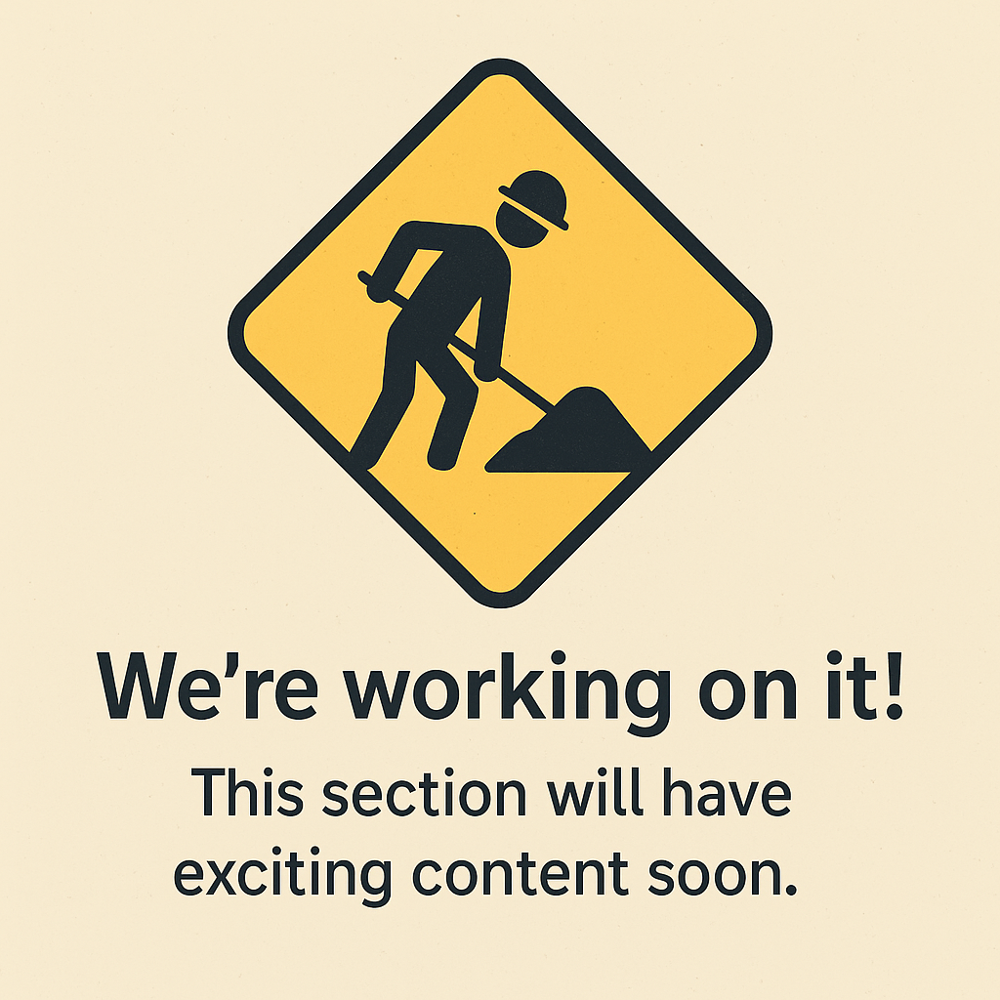

## Introducción

En este documento se describen exclusivamente las funciones y propiedades que solo son válidas para el formato OSF 5.

> Este documento está licenciado bajo [CC BY 4.0](https://creativecommons.org/licenses/by/4.0/deed.de). Atribución: optiMEAS GmbH y optiMEAS Switzerland GmbH.
