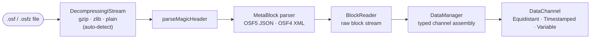
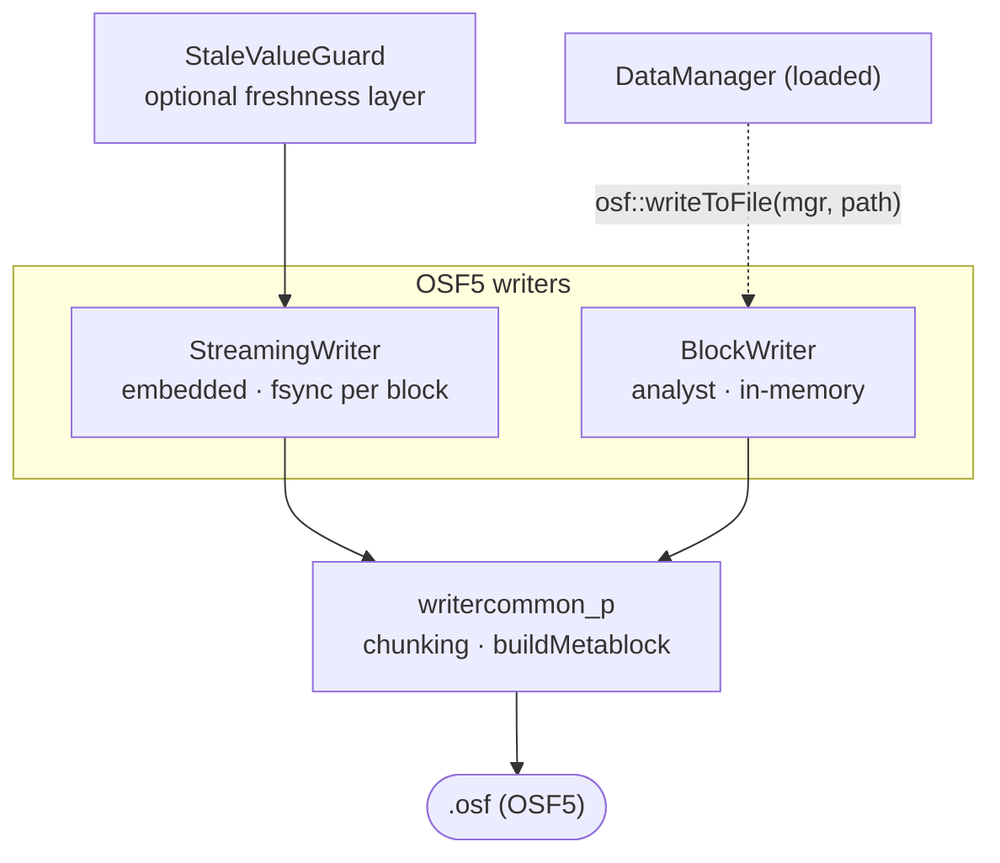
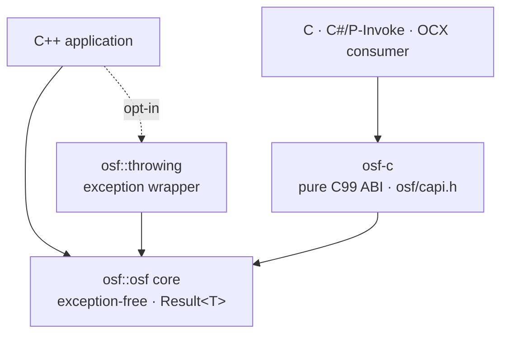

# Implémentation C++

Une **implémentation C++17 autonome** du Open Streaming Format — du C++
moderne idiomatique, sans dépendances d'exécution externes. Elle lit les
fichiers `.osf` et `.osfz` et écrit de l'OSF5. La bibliothèque est entièrement
utilisable et distribuable de manière autonome ; son comportement est défini
uniquement par la spécification du format OSF.

:::tip Manuel du développeur
Cette page est la vue d'ensemble. La documentation détaillée pour développeurs
se trouve dans le sous-chapitre **C++ en détail** :

| Page | Contenu |
|---|---|
| [Architecture](cpp/architecture.md) | Modèle en couches, modules, modèle de données, décisions de conception, sécurité des threads |
| [Lecture](cpp/reading.md) | `DataManager`, `DataChannel`, segments, `BlockReader`, `ReaderStats`, OSFZ transparent |
| [Écriture](cpp/writing.md) | `StreamingWriter`, `BlockWriter`, `StaleValueGuard`, `ChannelDef`, valeurs par défaut des métadonnées, aller-retour |
| [Gestion des erreurs](cpp/error-handling.md) | `Result<T>`, catalogue complet des codes d'erreur, `osf::throwing` |
| [ABI C](cpp/c-abi.md) | `osf-c` — règles de propriété, catalogue de fonctions, exemples C et P/Invoke |
| [Build et intégration](cpp/building.md) | Options CMake, cibles, `add_subdirectory`/FetchContent, Doxygen, CI |
| [Livre de recettes](cpp/cookbook.md) | recettes prêtes à copier, de l'inspection à la boucle embarquée |
| [Éléments internes](cpp/internals.md) | Encodeur, calcul du chunking, machine à états du builder — pour les contributeurs |
:::

## Étendue fonctionnelle

L'implémentation est **fonctionnellement complète**.
Les chemins de lecture et d'écriture sont couverts par une suite
GoogleTest/ctest (0 avertissement sous MSVC `/W4 /permissive-`),
et la CI construit et teste sous **Linux, macOS et Windows**.

**Chemin de lecture**

- Parseur d'en-tête magique ; parseurs de métabloc OSF5 JSON et OSF4 XML
- Lecteur de flux de blocs et `DataManager` typé (reader en mémoire unifié
  avec canaux typés)
- Décompression **OSFZ** transparente (gzip/zlib) — `.osf` et `.osfz`
  sont lus via la même API
- **Best effort** : les fichiers tronqués (coupure de courant) fournissent
  tous les blocs entièrement lisibles ; les types de données futurs inconnus
  sont ignorés au lieu d'interrompre le chargement

**Chemin d'écriture (OSF5)**

- `StreamingWriter` — embarqué, échantillon par échantillon, `fsync` par bloc
  (tolérant aux coupures de courant), besoin mémoire constant
- `BlockWriter` — convivial pour les analystes, collecte en mémoire et écrit
  le fichier complet à la fin ; adapte automatiquement `sizeOfLengthValue`
  de 2 → 4 si nécessaire
- `StaleValueGuard` — couche de fraîcheur facultative qui réémet la dernière
  valeur des canaux inactifs
- Valeurs par défaut automatiques des métadonnées : `created_utc` est
  horodaté à l'écriture ; `creator`/`tag` reçoivent des valeurs de repli s'ils
  ne sont pas définis

**Confort et raccordement**

- Une **couche de confort à exceptions** (`osf::throwing`) au-dessus du cœur
  `Result<T>` pour les appelants qui préfèrent les exceptions
- La **bibliothèque ABI C `osf-c`** (`osf/capi.h`) — une couche C99 pure pour
  l'usage inter-langages (DLL/shared object)

## Architecture en un coup d'œil

Deux niveaux d'API reposent sur un cœur commun sans exceptions (`osf::Result<T>`). Le côté lecture assemble des canaux typés à partir du flux de blocs ; le côté écriture propose deux classes writer pour des profils d'utilisation différents ; et une ABI C rend l'ensemble accessible aux consommateurs non C++. Pour approfondir : [Architecture](cpp/architecture.md).

### Chemin de lecture



`DataManager::loadFromFile()` pilote l'ensemble de ce pipeline ; OSFZ est reconnu et décompressé automatiquement, de sorte que `.osf` et `.osfz` utilisent le même appel.

### Chemin d'écriture (OSF5)



### Couches et ABI C



### Quelle classe pour quel usage

| Je souhaite … | Classe | Remarques |
|---|---|---|
| Lire un fichier, obtenir des canaux typés | `osf::DataManager` | Point d'entrée central — `loadFromFile()`, `channel("name")`. Lit `.osf` et `.osfz`. → [Lecture](cpp/reading.md) |
| Itérer sur le flux de blocs brut | `osf::BlockReader` | Niveau inférieur ; pour les très gros fichiers et les consommateurs en streaming. → [Lecture](cpp/reading.md) |
| Conserver les échantillons d'un canal | `osf::DataChannel` | Variant sur Equidistant / Timestamped / Variable ; accesseurs plats typés. → [Lecture](cpp/reading.md) |
| Enregistrer sur un appareil embarqué | `osf::StreamingWriter` | `fsync` par bloc, mémoire constante, tolérant aux coupures de courant. → [Écriture](cpp/writing.md) |
| Écrire un fichier complet en une seule étape | `osf::BlockWriter` | Collecte en mémoire, écrit lors de `writeToFile()` ; adapte `sizeOfLengthValue` automatiquement. → [Écriture](cpp/writing.md) |
| Garder les canaux inactifs « frais » | `osf::StaleValueGuard` | Réémet la dernière valeur des canaux ayant dépassé un seuil. → [Écriture](cpp/writing.md) |
| Aller-retour / OSF4 → OSF5 | fonction libre `osf::writeToFile(mgr, …)` | Charge un `DataManager` dans un `BlockWriter` et écrit de l'OSF5. → [Livre de recettes](cpp/cookbook.md) |
| Utiliser des exceptions au lieu de `Result<T>` | `osf::throwing` | En-tête opt-in ; non compilé dans le cœur. → [Gestion des erreurs](cpp/error-handling.md) |
| Appeler depuis C, C#, OCX … | `osf-c` (`osf/capi.h`) | ABI C99 pure ; à construire avec `-D OSF_BUILD_C_API=ON`. → [ABI C](cpp/c-abi.md) |

### Exemples exécutables

`implementations/cpp/examples/` contient quatre petits programmes basés sur `<osf/osf.h>` —
**`inspect`** (en-tête / métadonnées / canaux, OSFZ transparent), **`dump`**
(valeurs des échantillons), **`write`** (synthétiser et écrire de l'OSF5) et **`copy`**
(aller-retour). Ils sont construits avec `-D OSF_BUILD_EXAMPLES=ON` (actif par défaut).
Recettes de code détaillées : [Livre de recettes](cpp/cookbook.md).

## Build — démarrage rapide

```bash
cmake -B build
cmake --build build
ctest --test-dir build
```

Les remarques spécifiques aux plateformes, les options CMake et la FAQ se
trouvent dans le fichier `BUILD.md` fourni avec la bibliothèque et sur la page
[Build et intégration](cpp/building.md).

### Options CMake

| Option | Par défaut | Effet |
|---|---|---|
| `OSF_BUILD_TESTS` | `ON` | construire la suite GoogleTest/ctest |
| `OSF_BUILD_EXAMPLES` | `ON` | construire les programmes d'exemple exécutables sous `examples/` |
| `OSF_BUILD_DOCS` | `OFF` | générer la référence d'API Doxygen (cible `osf-docs` ; nécessite Doxygen) |
| `OSF_BUILD_C_API` | `OFF` | construire aussi la bibliothèque ABI C `osf-c` (+ test C) |
| `OSF_USE_SYSTEM_ZLIB` | `OFF` | utiliser la zlib du système au lieu de FetchContent |
| `OSF_WARNINGS_AS_ERRORS` | `OFF` | avertissements traités comme erreurs (`/WX` ou `-Werror`) ; `ON` en CI |
| `BUILD_SHARED_LIBS` | `OFF` | construire la bibliothèque principale comme bibliothèque partagée |

C++17 est la base de langage définie de manière fixe pour la bibliothèque. Passer à C++20 ou plus est une mise à niveau délibérée de la bibliothèque, et non une option de build. Le code tiers (`tl::expected`,
`nlohmann/json`, `pugixml`) est fourni dans le dépôt sous `third_party/` ;
zlib vient de FetchContent ou du système.

### Intégration

La bibliothèque exporte deux cibles CMake :

- `osf::osf` — la bibliothèque principale (statique par défaut ; nom de fichier `libosf.a`
  / `osf.lib`)
- `osf::headers` — une cible INTERFACE avec les chemins d'inclusion publics

Intégration par `add_subdirectory` ou `FetchContent` —
extraits d'exemple sur [Build et intégration](cpp/building.md).

## L'API en un coup d'œil

Le cœur est **sans exceptions** : les opérations pouvant échouer renvoient
`osf::Result<T>` (un `tl::expected<T, osf::Error>`).
Le catalogue complet des codes d'erreur se trouve sous
[Gestion des erreurs](cpp/error-handling.md).

### Lecture

```cpp
#include <osf/manager.h>

auto result = osf::DataManager::loadFromFile("messung.osf");  // auch .osfz
if (!result) {
    // result.error().message  —  strukturierter Fehler, keine Exception
    return;
}
osf::DataManager const& mgr = *result;

// Kanal über den Namen ansprechen (primäre Zugriffsform)
if (osf::DataChannel const* ch = mgr.channel("Sensor.Temperatur")) {
    auto werte = osf::asDoublesFlat(
        std::get<osf::TimestampedChannel>(*ch));   // typisierter Zugriff
}
```

Ceux qui préfèrent travailler avec des exceptions utilisent la couche opt-in :

```cpp
#include <osf/throwing.h>

auto mgr = osf::throwing::load("messung.osf");   // wirft osf::Exception bei Fehler
```

### Écriture (OSF5)

```cpp
#include <osf/blockwriter.h>

osf::BlockWriter writer;
writer.setCreator("mein-tool/1.0");

osf::ChannelDef def;
def.name        = "signale.sinus";
def.dataType    = osf::DataType::Double;
def.channelType = osf::ChannelType::Scalar;

auto idx = writer.addChannel(def);              // Result<uint16_t>
// … Samples zu *idx hinzufügen (addTimestampedSample, addEquidistantSegment, …)
writer.writeToFile("ausgabe.osf");
```

Pour une écriture embarquée tolérante aux pannes, il existe à la place le
`StreamingWriter` (`fsync` par bloc). Un `DataManager` chargé peut être
réécrit directement en OSF5 avec la fonction libre `osf::writeToFile(mgr, pfad)`
(aller-retour / OSF4 → OSF5). Tous les détails et le choix du bon
`sizeOfLengthValue` : [Écriture](cpp/writing.md).

### ABI C (`osf-c`)

Avec `-D OSF_BUILD_C_API=ON`, la bibliothèque partagée `osf-c` est produite
en plus, avec une interface C99 pure (`osf/capi.h`) : handles opaques
(`osf_manager`, `osf_channel`), codes `osf_status`, un
`osf_last_error_message()` local au thread et des lecteurs à copie vers
l'extérieur pour les horodatages et les valeurs — ainsi que `osf_write_to_file`
pour le chemin d'écriture aller-retour. Aucune exception C++ ne franchit la
frontière de l'ABI. Prévue pour le raccordement depuis C, C#/P-Invoke,
ActiveX/OCX et de futurs bindings de langages. Catalogue de fonctions et
exemples : [ABI C](cpp/c-abi.md).

## Remarques

- **Seul OSF5 est écrit** — même si la source était un fichier OSF4.
- **OSFZ à l'écriture est une étape en aval** : les writers ne compressent jamais en ligne ; OSFZ (gzip) est produit *après* la finalisation du fichier `.osf` — par un futur compresseur post-fermeture (thread d'arrière-plan) ou par une CLI de compression autonome. OSFZ est **lu** de manière transparente.
- **Best effort à la lecture** : les fichiers tronqués fournissent toutes les
  données jusqu'au dernier bloc entièrement lisible, sans plantage.
- La bibliothèque est **neutre vis-à-vis de Qt** ; un complément proche de Qt
  pourra suivre plus tard comme entrée `integrations/` distincte.

## Code source et informations complémentaires

- Code source : [github.com/optimeas/osf](https://github.com/optimeas/osf),
  répertoire `implementations/cpp/`
- Guide de build : `BUILD.md` dans le répertoire de la bibliothèque — résumé
  sous [Build et intégration](cpp/building.md)
- Référence d'API : à générer avec Doxygen via `-D OSF_BUILD_DOCS=ON` (cible `osf-docs`) — voir [Build et intégration](cpp/building.md)
- Spécification du format : chapitre [Format OSF](../osf_general.md)

> Ce document est publié sous licence [CC BY 4.0](https://creativecommons.org/licenses/by/4.0/deed.de). Attribution : optiMEAS GmbH et optiMEAS Switzerland GmbH.
