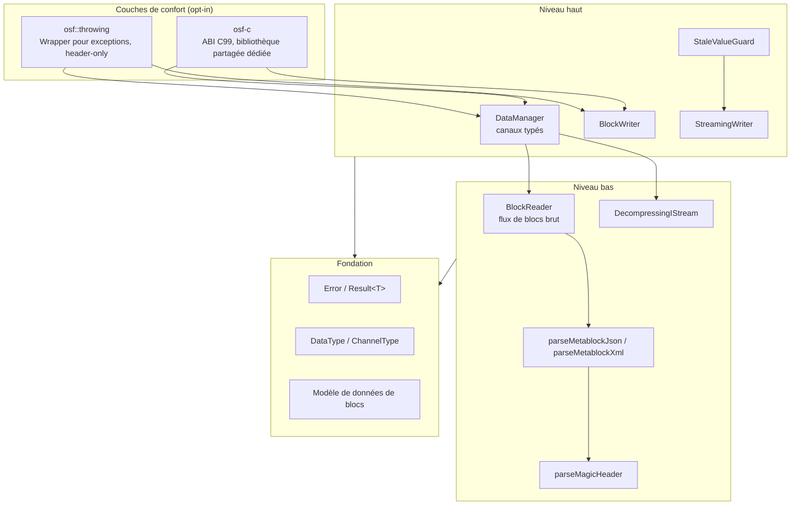
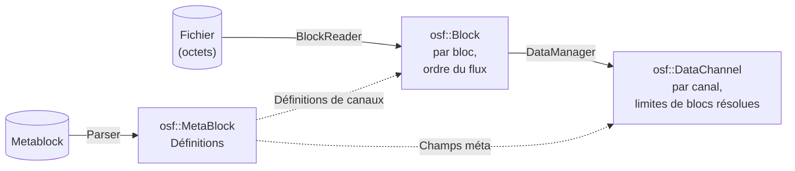

# Architecture de l'implémentation C++

Cette page décrit la structure interne de l'implémentation C++ :
le modèle en couches, les modules et leur interaction, le modèle de données
et les principales décisions de conception. Elle s'adresse aux développeurs
qui intègrent la bibliothèque **et** à ceux qui souhaitent y contribuer.
La [page de présentation](../cpp.md) donne un aperçu rapide ; les sujets
détaillés (lecture, écriture, gestion des erreurs, ABI C et build) ont
leurs propres pages.

## Principes directeurs

L'implémentation suit quatre principes :

1. **C++17 autonome.** C++ moderne idiomatique, sans passerelles vers
   d'autres langages et sans dépendances externes à l'exécution ; le
   comportement est défini uniquement par la spécification du format OSF.
2. **Noyau sans exceptions.** Toute opération susceptible d'échouer renvoie
   `osf::Result<T>` (un `tl::expected<T, osf::Error>`).
   Les exceptions n'existent que dans la couche optionnelle `osf::throwing`.
3. **Best-effort à la lecture.** Les fichiers tronqués (coupure de courant
   pendant l'écriture par un système embarqué) fournissent tous les blocs
   entièrement lisibles au lieu d'une erreur ; les types de données futurs
   inconnus sont ignorés au lieu d'interrompre le chargement.
4. **Dépendances réduites.** Trois bibliothèques header-only intégrées
   (`tl::expected`, `nlohmann/json`, `pugixml`) plus zlib (FetchContent
   ou système). Aucune dépendance à Boost ni à Qt.

## Modèle en couches



La plupart des applications travaillent exclusivement au niveau haut
(`DataManager` pour la lecture, l'un des deux writers pour l'écriture). Le
niveau bas est public et stable — qui souhaite lire en flux continu ou
construire ses propres outils utilise directement `BlockReader`.

## Modules et responsabilités

| Header | Contenu | Couche |
|---|---|---|
| `osf/error.h` | `Error` (code + message), `Result<T>` | Fondation |
| `osf/types.h` | `DataType`, `ChannelType`, `SpectrumType` + parseurs | Fondation |
| `osf/header.h` | Magic header : `OsfVersion`, `MagicHeader`, `parseMagicHeader` | Bas |
| `osf/metablock.h` | `MetaBlock`/`FileInfo`/`Channel`/`Info` ; parseurs JSON et XML ; sérialisation JSON | Bas |
| `osf/block.h` | Modèle de données de blocs : `Block`, `BlockKind`, variantes de payload, décodeur de control byte | Fondation |
| `osf/reader.h` | `BlockReader` — itérateur sur le flux de blocs | Bas |
| `osf/stats.h` | `ReaderStats` / `ChannelStats` — télémétrie de lecture | Bas |
| `osf/compression.h` | `DecompressingIStream`, `detectCompression` — OSFZ transparent | Bas |
| `osf/datachannel.h` | Variante `DataChannel` (Equidistant / Timestamped / Variable), `Segment`, accesseurs à plat | Haut |
| `osf/manager.h` | `DataManager` — chargement + liste de canaux typés | Haut |
| `osf/streamingwriter.h` | `StreamingWriter` + `ChannelDef` | Haut |
| `osf/blockwriter.h` | `BlockWriter` + fonctions libres `writeToFile` / `writeTo` | Haut |
| `osf/stalevalueguard.h` | `StaleValueGuard` — couche de fraîcheur au-dessus de `StreamingWriter` | Haut |
| `osf/binarysample.h` | `BinarySample` — vue d'octets non propriétaire (substitut de span) | Fondation |
| `osf/throwing.h` | `osf::Exception`, `throwing::unwrap/load/writeToFile` — **absent** de l'umbrella | Confort |
| `osf/capi.h` | ABI C99 pur de la bibliothèque `osf-c` — **absent** de l'umbrella | Confort |
| `osf/osf.h` | Header umbrella (tout sauf `throwing.h` et `capi.h`) | — |
| `osf/version.h` | généré ; `osf::version()` et `OSF_VERSION_*` | Fondation |

Composants d'implémentation privés (sous `src/`, non installables) :
`blockencode_p.{h,cpp}` (encodeur de blocs OSF5), `writercommon_p.{h,cpp}`
(mathématiques de chunking + assemblage du metablock), `durablefile_p.{h,cpp}`
(fichier RAII avec `fsync`), `binaryio_p.h` (utilitaires little-endian).
Détails dans [Internes](internals.md).

## Trois modèles de données — qui voit quoi

La bibliothèque propose volontairement trois représentations des mêmes
données, selon le niveau d'abstraction :



1. **`osf::MetaBlock`** (`metablock.h`) — les *définitions* :
   métadonnées du fichier (`FileInfo`), définitions de canaux (`osf::Channel`)
   et entrées `Info` optionnelles. OSF4 (XML) et OSF5 (JSON)
   ne diffèrent que par la sérialisation ; les deux parseurs remplissent
   le même modèle de manière symétrique.
2. **`osf::Block`** (`block.h`) — la *vue flux* : un bloc décodé
   avec son index de canal et sa variante `BlockKind` (`StartData`,
   `ContinuedData`, `AbsTimestampData`, `ContinuedRelStampData`,
   `Skipped`). Les payloads sont des vecteurs typés décompressés — pas de
   zero-copy (les blocs font de quelques Ko à quelques Mo ; la sémantique
   de durée de vie simple compense l'allocation).
3. **`osf::DataChannel`** (`datachannel.h`) — la *vue canal* :
   un `std::variant` sur trois dispositions de stockage, car le stockage
   diffère réellement :

   | Variante | Stockage |
   |---|---|
   | `EquidistantChannel` | vecteur d'échantillons plat + `std::vector<Segment>` |
   | `TimestampedChannel` | vecteurs parallèles `timestampsNs` + `values` |
   | `VariableChannel` | horodatages + échantillons string **ou** binaires |

**Remarque sur les noms :** `osf::Channel` est la *définition de canal*
issue du metablock ; `osf::DataChannel` correspond aux *échantillons
assemblés*. Les deux partagent l'espace de noms `osf`, d'où les noms
différents.

## Conventions de nommage et d'API

- **Types** en PascalCase (`DataManager`, `BlockReader`).
- **Méthodes et fonctions libres** en camelCase (`loadFromFile`,
  `channelName`, `asDoublesFlat`, `writeToFile`).
- **Champs publics de struct** en camelCase sans préfixe (`blocksTotal`,
  `sizeOfLengthValue`, `startTimestampNs`, `compressionFormat`).
- **Membres privés** avec préfixe `m_` + camelCase (`m_channelData`,
  `m_writer`).
- **Constantes** en UPPER_SNAKE_CASE (`MAX_MAGIC_HEADER_LEN`,
  `GPS_WIRE_SIZE`).
- **Noms de fichiers header** en minuscules, sans séparateur, extension
  `.h` (`blockwriter.h`, `streamingwriter.h`, `datachannel.h`).
  Les headers internes du répertoire `src/` reçoivent le suffixe `_p.h`
  (`blockencode_p.h`, `writercommon_p.h`).
- L'**ABI C** (symboles `osf_*` dans `osf/capi.h`) suit la convention
  `snake_case` habituelle en C et est exemptée des règles C++.
- Les discriminants dans les variantes s'appellent `kind` (`BlockKind`,
  `SkipReason::Kind`, `VariableValueRef::Kind`).
- Tout ce qui peut échouer renvoie `Result<T>` et est `[[nodiscard]]`.
- Construction via des fabriques statiques (`DataManager::loadFromFile`)
  ou une configuration de type builder (writers : `set*` → `addChannel` →
  phase d'écriture).
- Les setters fluent de `BlockReader` (`withCaptureSkippedPayload`,
  `withFileSize`) renvoient `BlockReader&`.
- Les horodatages sont systématiquement des `std::int64_t` en **nanosecondes
  depuis l'époque Unix (UTC)** ; les fréquences d'échantillonnage sont des
  `double` en Hz.

## Principales décisions de conception

### `Result<T>` plutôt que des exceptions dans le noyau

La bibliothèque vise aussi les bases de code embarquées et industrielles
dans lesquelles les exceptions sont désactivées ou indésirables. Le noyau
ne lève donc jamais d'exception ; `tl::expected` (intégré, CC0) fournit la
monade. Qui préfère les exceptions utilise [`osf::throwing`](error-handling.md) —
une couche fine, header-only, volontairement **non** incluse dans le
header umbrella, afin que les utilisateurs du noyau n'embarquent pas la
mécanique des exceptions.

### Best-effort et compatibilité ascendante

Les fichiers OSF réels sont produits par des appareils qui peuvent perdre
l'alimentation à tout moment, et avec des versions de spécification que
le lecteur ne connaît pas encore. Il en découle trois règles de comportement :

- **La troncature n'est pas une erreur.** Si le fichier se termine au
  milieu d'un bloc, le `BlockReader` renvoie tous les blocs complets,
  porte `stats().blocksTruncated` à 1 et termine proprement l'itération.
- **L'inconnu est ignoré, pas avalé.** Les canaux dont le type de données
  est inconnu (futur) sont analysés comme `DataType::Unsupported` ; leurs
  blocs apparaissent comme `BlockKind::Skipped` (les octets de payload sont
  consommés afin que le flux reste aligné). La graphie d'origine est
  conservée dans `Channel::dataTypeRaw`.
- **Les éléments supprimés de la spécification sont des erreurs dures.** Les
  types de données supprimés par la révision de spécification du 2026-05-04
  (`pair`, `triple`, `candata`, `gpsdata`) sont rejetés avec
  `Error::Code::RemovedInSpec` — leur disposition de payload ne peut pas
  être reproduite à partir d'un build actuel, et deviner silencieusement
  reviendrait à corrompre des données.

### Deux writers plutôt qu'un

`StreamingWriter` (embarqué : `fsync` par bloc, mémoire constante,
tolérant aux pannes) et `BlockWriter` (analyste : collecte en mémoire,
émet à la fin, peut relever automatiquement `sizeOfLengthValue`) ont des
invariants incompatibles — un writer commun aurait dilué les deux profils.
Les composants communs (chunking, assemblage du metablock) se trouvent
dans `src/writercommon_p.*`. Détails sur la page [Écriture](writing.md).

### OSFZ transparent uniquement à la lecture

L'OSFZ (= OSF compressé en gzip ou zlib) est détecté et décompressé de
manière transparente à la **lecture** (`DecompressingIStream` avant
l'analyse du magic header). À l'**écriture**, la bibliothèque ne
compresse volontairement jamais en ligne : la compression est une
étape en aval après la clôture du fichier, afin que les modes de défaillance
de l'écriture et de la compression restent découplés.

### Sécurité des threads

| Classe | Contrat |
|---|---|
| `DataManager` (chargé) | immuable → lisible en parallèle sans restriction |
| `BlockReader` | non thread-safe ; une instance par thread |
| `StreamingWriter` / `BlockWriter` / `StaleValueGuard` | non thread-safe ; sérialiser les appels de l'extérieur (p. ex. `std::mutex`) |
| writers distincts sur des fichiers distincts | parallélisme sans problème |
| `osf-c` | `osf_last_error_message()` est local au thread ; ne pas partager les handles entre threads sans sérialiser |

## Organisation des répertoires

```
implementations/cpp/
├── CMakeLists.txt           — Projekt, Optionen, Targets
├── BUILD.md                 — Bauanleitung (EN)
├── cmake/                   — CompilerWarnings.cmake, version.h.in
├── include/osf/             — öffentliche Header (API-Fläche)
├── src/                     — Implementierung + private Header
├── tests/
│   ├── unit/                — GoogleTest-Units (synthetische Daten)
│   ├── integration/         — Tests gegen examples/*.osf(z)
│   └── capi/                — reiner C99-Test für osf-c
├── examples/                — inspect, dump, write, copy
└── third_party/             — tl::expected, nlohmann/json, pugixml (vendort)
```

## Pour aller plus loin

- [Lecture — DataManager, DataChannel, BlockReader, OSFZ](reading.md)
- [Écriture — StreamingWriter, BlockWriter, StaleValueGuard](writing.md)
- [Gestion des erreurs — Result, catalogue d'erreurs, throwing](error-handling.md)
- [ABI C — osf-c pour C, C#, OCX](c-abi.md)
- [Compilation et intégration — CMake, options, CI](building.md)
- [Cookbook — recettes pour les tâches courantes](cookbook.md)
- [Internes — encodeur, chunking, machine à états du builder](internals.md)

> Ce document est placé sous licence [CC BY 4.0](https://creativecommons.org/licenses/by/4.0/deed.de). Attribution : optiMEAS GmbH et optiMEAS Switzerland GmbH.
