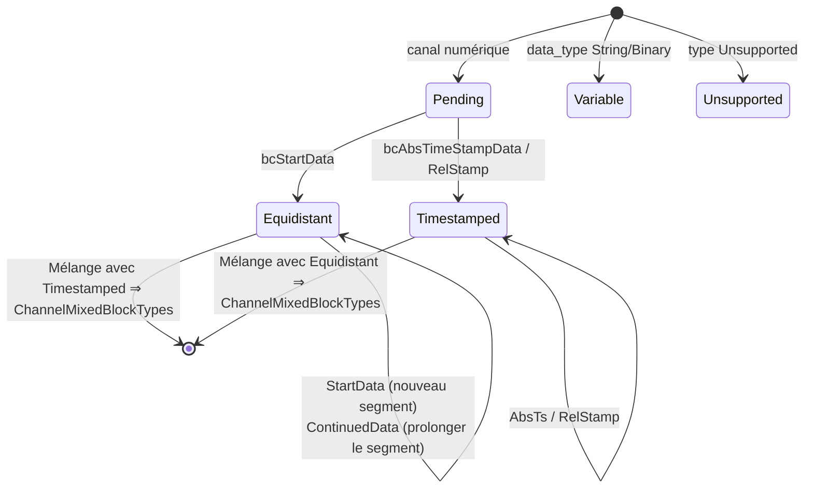

# Internes

Cette page décrit les composants privés du répertoire `src/`
de la bibliothèque — pertinents pour toute personne qui y contribue ou qui souhaite
comprendre son comportement jusqu'au niveau de l'octet. Les définitions du
format sur le fil figurent elles-mêmes dans la
[spécification OSF](../../osf_general.md).

## Vue d'ensemble des composants privés

| Composant | Fichiers | Utilisé par |
|---|---|---|
| Encodeur de blocs | `blockencode_p.{h,cpp}` | les deux writers |
| Éléments communs aux writers (chunking, assemblage du metablock) | `writercommon_p.{h,cpp}` | les deux writers |
| E/S de fichier durables | `durablefile_p.{h,cpp}` | uniquement `StreamingWriter` |
| Utilitaires little-endian | `binaryio_p.h` | encodeur |
| Streambuf de décompression | `compression.cpp` (classe `DecompressingIStream::Streambuf`) | chemin de lecture |
| Machine à états du builder | `manager.cpp` (struct `ChannelBuilder`) | `DataManager` |

## Encodeur de blocs (`osf::detail::encode*`)

L'encodeur écrit des trames de bloc complètes
`[u16 index de canal][champ de longueur][payload]` dans un vecteur d'octets
(little-endian partout) :

| Fonction | Bloc | Disposition du payload |
|---|---|---|
| `encodeStartData<T>` | `bcStartData` (6) | `[u8 ctrl][i64 start_ts][f64 rate][u32 N][N × T]` |
| `encodeContinuedData<T>` | `bcContinuedData` (5) | `[u8 ctrl][u32 N][N × T]` |
| `encodeAbsTimestampData<T>` | `bcAbsTimeStampData` (8) | `[u8 ctrl][u32 N][N × (i64 ts + T)]` |
| `encodeAbsTimestampDataGps` | idem pour le GPS | valeur = 3 × f64 (lat, lon, alt) = 24 octets |
| Surcharges String/Binary | idem, échantillon unique | `[u8 ctrl][i64 ts][octets]` — bit 7 = 0, **pas** de terminateur `0x00` (OSF5) |

Conventions : le bit 7 du control byte n'est positionné que si la
forme multi-échantillons (préfixe N en u32) est utilisée ; pour `count == 1`,
le préfixe est omis (économise 4 octets par bloc à échantillon unique,
rév. de spécification 2026-05-24). Les writers n'appellent l'encodeur qu'avec
des quantités d'échantillons conformes à la capacité, calculées au préalable via
`writercommon_p`.

## Mathématiques de chunking (`writercommon_p`)

Le champ de longueur d'un bloc a une largeur de `sizeOfLengthValue` (2 ou 4) octets ;
il en découle le payload maximal par bloc :

```cpp
maxPayloadForSov(2) == 0xFFFF;                  // 65 535 Bytes
maxPayloadForSov(4) == 0x7FFFFFFF - 1024;       // soft-cap, vermeidet i32-Überlauf
```

À partir de là, trois utilitaires dérivent le nombre maximal d'échantillons par type de bloc
(surcharge : `bcStartData` 21 octets = ctrl + ts + rate + N ;
`bcContinuedData`/`bcAbsTimeStampData` 5 octets = ctrl + N ; pour
timestamped, chaque échantillon compte 8 octets d'horodatage en plus). Pour
les blocs variables à échantillon unique, on a
`variableSampleCapacity(sov) = max_payload - 9` (ctrl + ts).
Ces fonctions sont **le seul** endroit où les tailles de bloc
sont calculées — le streaming writer et le block writer découpent donc de manière identique.

`buildMetablock(FileInfoDraft, ChannelDefs)` assemble le metablock OSF5 :
index séquentiels 0..N, `channeltype` normalisé
(`equidistant` est conservé, tout le reste devient `scalar` — la convention
établie des fichiers de référence OSF), et les valeurs par défaut automatiques
des métadonnées sont appliquées (`created_utc` = heure UTC actuelle sous la forme
`YYYY-MM-DDTHH:MM:SSZ`, repli `creator` `osf-cpp/<version>`,
repli `tag` `default` ; `reason`/triplet GPS restent omis
au lieu de `null`).

## `DurableFile` — sémantique fsync du streaming writer

Wrapper RAII autour d'un handle de fichier natif avec trois opérations :
`write` (complète ou erreur), `force` (Windows :
`FlushFileBuffers`, POSIX : `fsync`) et `close`. Le
`StreamingWriter` appelle `force` après chaque bloc — c'est pourquoi « l'appel
retourne avec succès » équivaut à « le bloc est sur le
support ». Les erreurs de `write`/`force` placent le writer dans l'état
`Broken` (sticky error).

## Streambuf de décompression (chemin de lecture)

`DecompressingIStream` cache un `std::streambuf` personnalisé derrière
un PIMPL afin que le header public reste exempt de zlib :

- Classification via les deux premiers octets (`detectCompression`,
  sans consommation via read + seek-back — la source doit être
  positionnable).
- `underflow()` décompresse à la demande dans un tampon fixe —
  mémoire constante indépendamment de la taille du fichier.
- `inflateInit2(MAX_WBITS | 32)` active la détection automatique des
  headers gzip/zlib par zlib lui-même.
- Les flux compressés tronqués fournissent EOF au lieu d'une erreur
  (best-effort, cohérent avec le reste du chemin de lecture).
- Avec `CompressionFormat::None`, les octets sont transmis tels quels (1:1) —
  `DataManager` peut donc intercaler la façade sans condition.

## Machine à états du builder (`DataManager`)

Pour chaque canal, `manager.cpp` tient un `ChannelBuilder` à cinq
états :



Règles imposées par les transitions (toutes couvertes par des tests) :

- `bcContinuedData` à l'état `Pending` ⇒ `ContinuedDataWithoutStart`.
- `bcContinuedRelStampData` sans horodatage absolu préalable ⇒
  `RelStampWithoutAnchor` ; sinon, les deltas u32 sont cumulés avec le dernier
  horodatage absolu comme ancrage.
- Type de données du payload ≠ type de données du canal ⇒ `DataTypeMismatch`.
- Les canaux `Unsupported` consomment leurs blocs (déjà
  `Skipped` côté lecteur) et sont exclus de la liste des canaux lors de
  `finalize`.

`finalize_builder` traduit l'état final en la variante
`DataChannel` appropriée ; `Pending` sans aucun bloc est matérialisé comme canal
vide du type déclaré.

## Détails du lecteur

- Décodage des octets via de petits utilitaires `readLeU16`/`readLeU32`/`readLeU64`
  (plus des surcharges signed/float) au lieu de `reinterpret_cast` — sans
  hypothèses d'alignement ni d'endianness.
- `PayloadCursor` parcourt le payload de bloc présent en mémoire
  et fournit des `std::optional<T>` ; un dépassement devient ainsi
  un `InvalidBlock` propre au lieu d'un UB.
- Les blocs String/Binary multi-échantillons (bit 7 positionné) sont décomposés par
  découpage en longueurs égales ; si la longueur n'est pas divisible, le
  lecteur retombe sur l'échantillon unique.
- Le terminateur nul est traité de manière déterministe selon la version
  (champ `m_osfVersion` dans le lecteur) : OSF4 retire le dernier octet de chaque
  payload String/Binary, OSF5 jamais (rév. de spécification 2026-05-24).
- Le bloc d'info OSF4 optionnel `0xFFFF` et le trailer de 40 octets
  (`OSF_STREAM_END …`) sont consommés et jamais fournis comme `Block`.

## Organisation des tests et vérification

| Niveau | Emplacement | Nature |
|---|---|---|
| Unitaire | `tests/unit/test_*.cpp` | octets/structures synthétiques, un fichier par module |
| Intégration | `tests/integration/*_examples.cpp` | fichiers réels de `examples/` (données de terrain + 17 fichiers de référence générés) |
| Aller-retour | `tests/integration/roundtriphelper.h` | chargement → écriture → rechargement → comparaison des échantillons **exacte au bit près** |
| ABI C | `tests/capi/test_capi.c` | programme C99 autonome, prouve le linkage C |

Avant chaque push : exécution complète de ctest en local au vert (actuellement 321
tests avec `OSF_BUILD_C_API=ON`), 0 avertissement ; la CI vérifie en plus
GCC/AppleClang/MSVC avec `-Werror`/`/WX`.

## Ajouter un nouveau type de données (liste de contrôle)

Si une future révision de la spécification ajoute un type de données :

1. `types.h/cpp` — énumérateur + graphie sur le fil dans `parseDataType`.
2. `block.h` — étendre les variantes de payload (`NumericPayload`,
   `TimestampedPayload`, le cas échéant `RelTimestampedPayload`).
3. `reader.cpp` — branche de décodeur (taille d'échantillon, parseur de payload).
4. `datachannel.h/cpp` — `NumericValues`, macro d'accesseur à plat,
   `numericValuesEmptyFor`.
5. `manager.cpp` — étendre les visiteurs `*PayloadDataType`.
6. `blockencode_p` + writer — instanciation de l'encodeur,
   spécialisation `IsTimestampedNumeric` dans les deux headers de writer.
7. `capi` — le cas échéant `osf_data_type` + lecteur de conversion.
8. Tests à chaque niveau ; compléter les fichiers de référence dans le générateur.

Que la liste soit longue est voulu : chaque couche est explicitement
typée, rien n'est acheminé via `void*` ou des casts à l'exécution.

> Ce document est placé sous licence [CC BY 4.0](https://creativecommons.org/licenses/by/4.0/deed.de). Attribution : optiMEAS GmbH et optiMEAS Switzerland GmbH.
