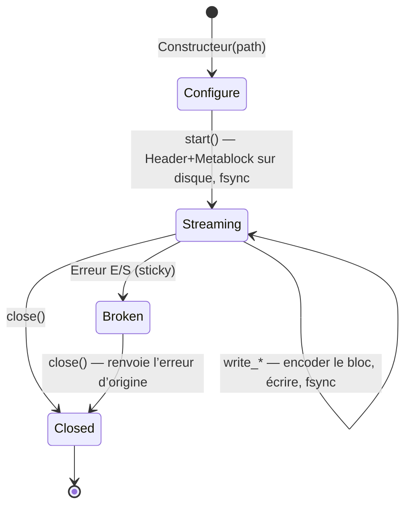

# Écriture

La bibliothèque écrit **exclusivement de l'OSF5** — y compris
lorsque la source était un fichier OSF4. Deux classes de writer couvrent
deux profils d'utilisation très différents :

| | `StreamingWriter` | `BlockWriter` |
|---|---|---|
| Usage | Enregistrement embarqué | Analyse, conversion, export |
| Mémoire | constante (tampon scratch) | collecte tous les échantillons en RAM |
| Durabilité | `fsync` par bloc — tolérant aux coupures de courant | pas de fsync ; le fichier est créé à la fin |
| Destination | chemin de fichier | chemin de fichier **ou** `std::ostream` (mémoire, socket) |
| `sizeOfLengthValue` | fixe à partir de `start()` (le metablock est sur le disque) | relèvement automatique 2 → 4 si nécessaire |
| Cycle de vie | Configure → `start()` → écriture → `close()` | collecte → `writeToFile()` / `writeTo()` (autant de fois que souhaité) |
| Émission multiple | non (un fichier par instance) | oui (`writeTo*` est `const`) |

Les deux partagent la description de canal `osf::ChannelDef` et les mêmes
familles d'écriture (équidistant, timestamped numérique, GPS, String/Binary).

## Déclarer des canaux — `ChannelDef`

```cpp
osf::ChannelDef def;
def.name             = "motor.drehzahl";         // Pflicht
def.dataType         = osf::DataType::Double;    // Pflicht
def.channelType      = osf::ChannelType::Scalar; // Pflicht (Scalar = Konvention)
def.sizeOfLengthValue = 2;                       // 2 (Standard) oder 4
def.physicalUnit     = "1/min";                  // optional
def.displayName      = "Motordrehzahl";          // optional
// ferner: physicalDimension, mimeType, reference, comment, timeIncrementNs
```

`addChannel(def)` fournit l'index de canal (séquentiel à partir de 0), que tous les
appels d'écriture utilisent. Sont rejetés (`InvalidArgument`) :
`sizeOfLengthValue` ≠ 2/4, types `Unsupported`, plus de 65535
canaux — et, pour le `StreamingWriter`, tout appel après `start()`.

### Bien choisir `sizeOfLengthValue`

Le champ de longueur de chaque bloc a une largeur de 2 ou 4 octets et limite la
taille du bloc (~64 Ko ou ~2 Go). Règles pratiques :

- **Canaux String/Binary avec de gros échantillons** (images, audio, blobs) :
  pour le `StreamingWriter`, déclarer impérativement `4` — il ne peut plus modifier la valeur
  après `start()` et rejette les échantillons trop grands avec
  `InvalidBlock`. Le `BlockWriter` relève lui-même (bump 2 → 4 lors de
  l'émission) ; pour lui, `2` comme valeur de départ est toujours correct.
- **Canaux numériques à haute fréquence** sur le `StreamingWriter` : `4` évite
  le chunking — un append de 100k échantillons `double` dans un canal `sov=2`
  se décompose sinon en ~13 blocs = ~13 fsync.
- Sinon : conserver la valeur par défaut `2` (blocs plus compacts).

## `StreamingWriter` — embarqué, tolérant aux pannes

### Cycle de vie



```cpp
#include <osf/streamingwriter.h>

osf::StreamingWriter w("aufzeichnung.osf");
w.setCreator("logger-fw/3.2");                 // Metadaten vor start()
w.setTag("pruefstand-7");

auto rpm = w.addChannel(rpm_def);              // Result<uint16_t>
auto gps = w.addChannel(gps_def);
if (!rpm || !gps) { /* … */ }

if (auto r = w.start(); !r) { /* Datei offen, Metablock geschrieben */ }

// Aufzeichnungsschleife
while (running) {
    auto r = w.writeTimestampedSample<double>(*rpm, now_ns(), read_rpm());
    if (!r) { /* I/O-Fehler => Writer ist Broken; abbrechen */ break; }
}

if (auto r = w.close(); !r) { /* … */ }
```

Garanties et comportement :

- **Chaque `write_*` revenu avec succès est sur le disque**
  (`FlushFileBuffers` sous Windows, `fsync` sous POSIX). Après une
  coupure de courant, le fichier est lisible jusqu'au dernier bloc confirmé —
  le lecteur est conçu précisément pour ce scénario (best-effort en cas de
  troncature).
- **Sticky error :** après une erreur d'E/S, le writer passe à
  l'état `Broken` ; tout appel suivant (y compris `close()`) renvoie
  l'erreur initiale. Ainsi, la cause de l'erreur n'est pas perdue dans les
  boucles fire-and-forget.
- **Les setters de métadonnées ne sont efficaces qu'avant `start()`** — le metablock est
  écrit par `start()` et n'est plus jamais touché.
- **Pas d'OSFZ :** le streaming writer écrit des fichiers `.osf` bruts.
  La compression est une étape en aval — les modes de défaillance de l'écriture et
  de la compression restent ainsi découplés.
- Constructible/assignable par déplacement, non copiable. Non thread-safe —
  sérialiser les accès de l'extérieur.
- Le tampon scratch croît jusqu'à la taille du plus grand bloc jamais
  écrit et n'est libéré que dans le destructeur.

### Familles d'écriture

```cpp
// Äquidistant (nur float/double per Spec) — Segment öffnen + verlängern:
w.startEquidistantSegment(ch, t0_ns, 1000.0 /*Hz*/, daten.data(), daten.size());
w.appendEquidistantSamples(ch, weitere.data(), weitere.size());   // braucht offenes Segment

// Timestamped numerisch (11 Typen, Template):
w.writeTimestampedSample<std::int32_t>(ch, ts_ns, wert);
w.writeTimestampedSamples<double>(ch, ts_array, werte, n);        // parallele Arrays

// GPS (eigene Symbole, kein Template):
w.writeTimestampedGpsSample(ch, ts_ns, osf::GpsLocation{lat, lon, alt});

// String/Binary (ein Sample pro Block per Spec; OSF5: kein 0x00-Terminator):
w.writeTimestampedString(ch, ts_ns, "Ereignis: Tür offen");
w.writeTimestampedBinary(ch, ts_ns, osf::BinarySample::fromVector(jpeg_bytes));
```

Tout appel multi-échantillons est automatiquement découpé (chunking) selon la capacité de bloc du
canal (un fsync par bloc). Un nouvel
appel à `startEquidistantSegment` ouvre volontairement un **nouveau** segment —
les lacunes entre segments sont le moyen conforme à la spécification de représenter
les pauses d'enregistrement.

## `BlockWriter` — collecter et émettre

```cpp
#include <osf/blockwriter.h>

osf::BlockWriter w;
w.setCreator("analyse-tool/1.0");

auto ch = w.addChannel(def);
w.addEquidistantSegment(*ch, t0_ns, 100.0, samples.data(), samples.size());
w.addTimestampedSample<double>(*ev, ts_ns, 42.0);
w.addStringSample(*log, ts_ns, "Kalibrierung ok");

if (auto r = w.writeToFile("ergebnis.osf"); !r) { /* … */ }

std::ostringstream mem;                 // oder in einen beliebigen ostream
if (auto r = w.writeTo(mem); !r) { /* … */ }
```

- La famille `add*` reflète la famille `write*` du
  streaming writer (mêmes types, même validation), mais ne collecte
  qu'en mémoire ; le chunking en blocs conformes à la spécification a lieu lors de l'émission.
- `writeToFile` / `writeTo` sont **`const`** — la même instance peut être
  émise plusieurs fois (p. ex. fichier + réseau).
- **Auto-bump :** les canaux variables dont le plus grand échantillon ne tient pas
  dans le champ de longueur u16 déclaré reçoivent, pour l'émission,
  `sizeOfLengthValue = 4`.
- Pas de fsync — la durabilité incombe à l'appelant.
- `channelIndex("name")` et `channelCount()` aident lorsque les
  index ne sont pas conservés.

## Valeurs par défaut automatiques des métadonnées

Les deux writers appliquent les mêmes valeurs par défaut lors de l'assemblage
du metablock :

| Champ | Comportement s'il n'est pas défini |
|---|---|
| `createdUtc` | **toujours** horodaté automatiquement (heure UTC actuelle, `YYYY-MM-DDTHH:MM:SSZ` ; la clé JSON sur disque est `created_utc`) |
| `creator` | `osf-cpp/<version de la bibliothèque>` |
| `tag` | `default` |
| `reason`, `createdAt*`, `namespaceSep`, `comment` | omis (non écrits comme `null` s'ils ne sont pas définis) |

## `StaleValueGuard` — garder frais les canaux inactifs

Les canaux sporadiques (événements) ne reçoivent un échantillon qu'en cas de changement de valeur.
Sur une ligne de temps, un canal dont la dernière écriture remonte à des heures
est ambigu : la valeur est-elle toujours valable, ou l'enregistrement est-il mort ? La
convention optiMEAS limite cette « obsolescence » (staleness) en répétant la dernière valeur
au plus tard toutes les 100 s. C'est précisément ce que le
guard automatise, en tant que wrapper write-through au-dessus d'un
`StreamingWriter` démarré :

```cpp
#include <osf/stalevalueguard.h>

osf::StreamingWriter w(path);
/* … konfigurieren, start() … */
osf::StaleValueGuard guard(w);                  // Default: 100 s; eigener Wert möglich

// Timestamped-Writes durch den Guard routen (cached den letzten Wert):
guard.writeTimestampedSample<double>(temp_ch, ts_ns, 21.5);

// Periodisch (z. B. im Aufzeichnungs-Tick):
auto reemitted = guard.poll(now_ns);            // Result<std::size_t>
```

Propriétés :

- **Basé sur le pull :** pas de thread interne, pas d'horloge propre — l'appelant
  fournit `now_ns` à `poll()`. Déterministe et adapté à l'embarqué.
- Par `poll()`, au plus **une** répétition par canal (pas de
  backfill de la lacune).
- Uniquement les canaux numériques + GPS ; volontairement pas String/Binary (répéter de gros
  blobs serait contre-productif).
- Les canaux sont enregistrés automatiquement lors de la première écriture write-through ;
  `isTracked` / `forget` / `clear` pilotent le suivi.
- Les vraies écritures réinitialisent l'horloge d'inactivité — les canaux
  activement alimentés ne reçoivent jamais de répétition synthétique.

## Aller-retour et conversion

Réécrire un `DataManager` chargé (également comme conversion
OSF4 → OSF5) :

```cpp
#include <osf/manager.h>
#include <osf/blockwriter.h>

auto mgr = osf::DataManager::loadFromFile("alt.osf");      // auch OSF4 / OSFZ
if (!mgr) { /* … */ }

if (auto r = osf::writeToFile(*mgr, "neu.osf"); !r) { /* … */ }   // immer OSF5
```

En interne, `BlockWriter::fromManager(mgr)` construit un writer à partir des
canaux typés ; qui souhaite filtrer ou renommer avant l'écriture
utilise directement `fromManager` et travaille sur le writer.

Sont conservés : noms de canaux, types de données, valeurs d'échantillons (exactes au bit près),
limites de segments, métadonnées du fichier (sauf `created_utc`, qui est
réhorodaté lors de l'écriture). L'index de canal n'est **pas** conservé
— le writer le réattribue séquentiellement de 0..N.

## Ce que les writers ne font volontairement pas

- **Pas de sortie OSF4** — OSF5 est le seul format d'écriture.
- **Pas de sortie OSFZ** — la compression est en aval ;
  un compresseur post-fermeture et une CLI `osf-compress` sont conçus comme
  travaux ultérieurs.
- **Pas de `bcContinuedRelStampData`** — le format de temps relatif est
  un héritage de lecture d'OSF4 ; les writers émettent des horodatages absolus.
- **Pas de validation des horodatages** — la monotonie n'est pas exigée
  par la spécification et n'est pas imposée.

> Ce document est placé sous licence [CC BY 4.0](https://creativecommons.org/licenses/by/4.0/deed.de). Attribution : optiMEAS GmbH et optiMEAS Switzerland GmbH.
