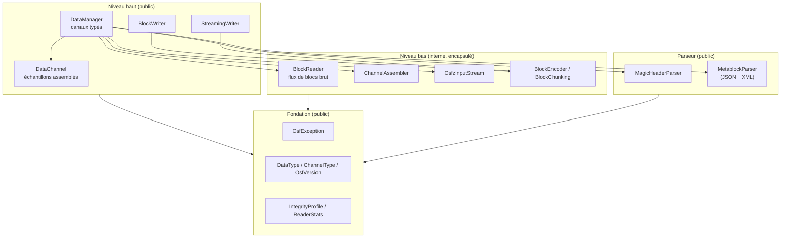
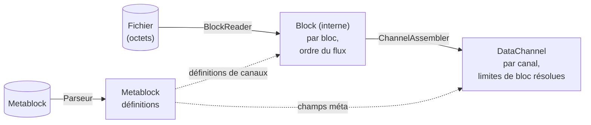

# Architecture de l'implémentation Java

Cette page décrit la structure interne de l'implémentation Java :
le modèle en couches, les modules et leur interaction, le modèle de données
et les principales décisions de conception. Elle s'adresse aux développeurs
qui intègrent la bibliothèque **et** à ceux qui souhaitent contribuer à son
développement. La [page de présentation](../java.md) donne un aperçu rapide ;
les sujets détaillés lecture, écriture, gestion des erreurs, outils et build
disposent de leurs propres pages.

## Principes directeurs

L'implémentation suit quatre principes :

1. **Java 21 moderne et autonome.** Du Java idiomatique sur la version LTS
   actuelle — records, types scellés, pattern `switch` — sans passerelles vers
   d'autres langages. Le comportement est défini uniquement par la
   spécification du format OSF, et non par un portage de référence.
2. **Encapsulation stricte via JPMS.** Le descripteur du Java Platform Module
   System exporte exclusivement `com.optimeas.osf` ; le paquet interne
   `com.optimeas.osf.internal` reste fermé, y compris face à la réflexion.
   La surface publique est ainsi réduite et stable.
3. **Best effort à la lecture.** Les fichiers tronqués (coupure de courant
   pendant l'écriture sur le système embarqué) fournissent tous les blocs
   entièrement lisibles au lieu d'une erreur ; les types de données futurs
   inconnus sont ignorés au lieu d'interrompre le chargement.
4. **Dépendances légères et courantes.** Jackson pour le JSON d'OSF5,
   l'API StAX incluse dans le JDK pour le XML d'OSF4,
   `java.util.zip` (décompression OSFZ + CRC32C) et SLF4J comme façade de
   journalisation. Aucun framework lourd.

## Modèle en couches



La plupart des applications travaillent exclusivement au niveau haut
(`DataManager` pour la lecture, l'un des deux writers pour l'écriture). Le
niveau bas — lecteur de blocs, assembleur de canaux, flux OSFZ, encodeur —
se trouve dans le paquet encapsulé `com.optimeas.osf.internal` et est
invisible de l'extérieur ; le pipeline de lecture est entièrement orchestré
par le `DataManager`.

## Modules et responsabilités

Le réacteur Maven `com.optimeas.osf:osf-parent` regroupe trois modules :

| Module | Artefact | Rôle |
|---|---|---|
| Bibliothèque principale | `com.optimeas.osf:osf-java` | Lecture (OSF4 + OSF5 + OSFZ), les deux writers OSF5, le profil d'intégrité `crc` |
| Ligne de commande | `osf-cli` | Inspection et conversion de fichiers OSF ; jar exécutable |
| Visionneuse | `osf-viewer` | Application JavaFX d'affichage multicanal de signaux |

Cette page décrit le module principal. La surface publique du module
principal (paquet `com.optimeas.osf`) :

| Type | Contenu | Couche |
|---|---|---|
| `DataManager` | Chargement + liste de canaux typés + télémétrie | Haut |
| `DataChannel` | échantillons assemblés d'un canal ; `Kind`, `Segment` | Haut |
| `StreamingWriter` | writer OSF5 tolérant aux pannes (`fsync` par bloc) | Haut |
| `BlockWriter` | writer OSF5 collectant en mémoire ; `fromManager` | Haut |
| `MagicHeader` / `MagicHeaderParser` | ligne d'en-tête magique + jeton d'intégrité | Parseur |
| `Metablock` / `MetablockParser` / `ChannelDef` | définitions ; parseurs JSON **et** XML | Parseur |
| `DataType` / `ChannelType` | énumérations wire + `fromWireName` | Fondation |
| `OsfVersion` | version sur disque (OSF4 / OSF5) | Fondation |
| `GpsLocation` | échantillon GPS (record : `latitude`/`longitude`/`altitude`) | Fondation |
| `IntegrityProfile` | niveau d'intégrité (`NONE` / `CRC32C` / `ED25519`) | Fondation |
| `ReaderStats` | télémétrie de lecture (blocs, troncature, compression) | Fondation |
| `OsfException` | hiérarchie d'exceptions (voir ci-dessous) | Fondation |

Composants internes (paquet `com.optimeas.osf.internal`, **non** exporté) :
`BlockReader` + `Block` (flux de blocs brut), `ChannelAssembler`
(bloc → canal), `OsfzInputStream` (décompression OSFZ transparente),
`BlockEncoder` + `BlockChunking` (encodeur de blocs OSF5 + calcul du chunking),
`Integrity` (trame CRC32C), `MetablockBuilder`, `JsonMetablockParser` /
`XmlMetablockParser` et `LittleEndian` (utilitaires d'ordre des octets).
Pour plus de détails, voir [Éléments internes](internals.md).

## Encapsulation JPMS

Le descripteur de module `module-info.java` trace une frontière stricte :

```
module com.optimeas.osf {
    requires com.fasterxml.jackson.databind;
    requires org.slf4j;
    requires java.xml;          // StAX für den OSF4-XML-Metablock

    exports com.optimeas.osf;
    // com.optimeas.osf.internal ist bewusst NICHT exportiert.
}
```

Seul `com.optimeas.osf` est exporté. Le paquet interne est encapsulé à deux
niveaux : le compilateur refuse l'accès aux types non exportés et — comme il
n'y a pas de `opens` — il reste également fermé à la réflexion à l'exécution.
Le code applicatif ne peut donc ni importer les classes internes, ni les
adresser par réflexion.

Cela a une conséquence visible dans le modèle de données : `DataChannel`
possède certes un constructeur nominalement `public` pour le
`ChannelAssembler`, mais le type de son paramètre (`Block.Values`) se trouve
dans le paquet interne. Depuis l'extérieur du module, ce constructeur ne peut
donc pas être appelé — les instances de `DataChannel` ne sont créées que par
le `DataManager`.

## Trois modèles de données — qui voit quoi

La bibliothèque comporte volontairement trois représentations des mêmes
données, selon le niveau d'abstraction :



1. **`Metablock`** (`MetablockParser`) — les *définitions* :
   métadonnées du fichier (`Map<String,String>`) et définitions de canaux
   (`ChannelDef`). OSF4 (XML, via StAX) et OSF5 (JSON, via Jackson)
   ne diffèrent que par la sérialisation ; les deux parseurs alimentent
   symétriquement le même modèle.
2. **`Block`** (interne) — la *vue flux* : un bloc décodé avec son index de
   canal et son type de bloc (`bcStartData`, `bcContinuedData`,
   `bcAbsTimeStampData`, `bcContinuedRelStampData`). Les charges utiles sont
   présentes sous forme de records `Block.Values` typés et dépaquetés, afin
   qu'aucune information de type de données ne soit perdue. Ce modèle est
   encapsulé et n'apparaît jamais dans l'API publique.
3. **`DataChannel`** — la *vue canal* : pour chaque canal, une suite plate
   d'échantillons avec des timestamps absolus parallèles, les limites de bloc
   étant résolues. Un seul type de classe, dont un discriminant `Kind`
   distingue la disposition en mémoire :

   | `Kind` | Stockage |
   |---|---|
   | `EQUIDISTANT` | suite plate d'échantillons + `List<Segment>` ; timestamps reconstruits |
   | `TIMESTAMPED` | numérique/GPS avec timestamps parallèles explicites |
   | `VARIABLE` | échantillons String **ou** Binary, toujours horodatés |

**Remarque sur les noms :** `ChannelDef` est la *définition de canal* issue
du métabloc ; `DataChannel` désigne les *échantillons assemblés*. Les
accesseurs typés `asDoubles()`, `asLongs()`, `asBooleans()`,
`asStrings()`, `asBinaries()` et `asGps()` projettent la suite stockée ; si
`dataType()` ne correspond pas à la vue demandée, l'accesseur lève
`OsfException.UnsupportedType`.

## Conventions de nommage et d'API

- **Types** en PascalCase (`DataManager`, `BlockWriter`).
- **Méthodes et accesseurs** en camelCase **sans** préfixe `get`
  (`loadFromFile`, `channelByName`, `timestampsNs`, `asDoubles`) ;
  les records portent des accesseurs identiques à leurs composants (`name()`,
  `index()`).
- **Constantes d'énumération** en UPPER_SNAKE_CASE (`EQUIDISTANT`, `OSF4`,
  `CRC32C`, `GPS_LOCATION`) ; chaque énumération wire porte la graphie wire
  exacte via `wireName()` et est résolue par la fabrique infaillible
  `fromWireName(String)`.
- **Porteurs de valeurs** : lorsqu'ils sont immuables, ce sont des records
  (`GpsLocation`, `DataChannel.Segment`).
- Les opérations pouvant échouer lèvent une exception d'une hiérarchie
  placée sous `OsfException` (`RuntimeException`) ; il n'y a pas
  d'exceptions contrôlées dans l'API de lecture/écriture.
- Les recherches renvoient `Optional<DataChannel>` (`channelByName`,
  `channelByIndex`) au lieu de `null`.
- Construction via des fabriques statiques (`DataManager.loadFromFile`,
  `DataManager.load`, `BlockWriter.fromManager`) ou via une configuration de
  writer de type builder (`add…Channel` → ajouter des échantillons → phase
  d'écriture).
- Les horodatages sont systématiquement des `long` en **nanosecondes depuis
  l'époque Unix (UTC)** ; les fréquences d'échantillonnage sont des `double`
  en Hz.

## Décisions de conception essentielles

### Encapsulation plutôt qu'API étendue

La surface publique est volontairement limitée à un seul paquet. Tout le
chemin de lecture — décodage des blocs, assemblage des canaux, décompression
OSFZ, vérification CRC — se trouve derrière `DataManager` et est inaccessible
via JPMS. L'API garantie reste ainsi réduite, et les remaniements internes ne
cassent aucun code consommateur.

### Best effort et compatibilité ascendante

Les fichiers OSF réels sont produits sur des appareils susceptibles de perdre
l'alimentation à tout moment, et avec des versions de spécification que le
lecteur ne connaît pas encore. Trois règles de comportement en découlent :

- **La troncature n'est pas une erreur.** Si le fichier se termine au milieu
  d'un bloc, le reader fournit tous les blocs complets et met
  `ReaderStats.truncationSeen()` à `true` au lieu de lever une exception.
- **L'inconnu est toléré.** Un type de données inconnu (futur) est analysé
  comme `DataType.UNSUPPORTED`, un type de canal inconnu comme
  `ChannelType.UNSUPPORTED` ; le fichier continue de se charger et la graphie
  d'origine est conservée dans l'entrée `attributes` du canal.
- **Les éléments de spécification supprimés sont des erreurs franches.** Les
  types de données retirés de la spécification (`pair`, `triple`, `candata`,
  `gpsdata`) sont rejetés avec `OsfException.UnsupportedType` — leur
  disposition de charge utile ne peut pas être reproduite, et deviner
  silencieusement reviendrait à corrompre les données.

### Deux writers plutôt qu'un

`StreamingWriter` (embarqué : `fsync` par bloc via `FileChannel.force`,
mémoire constante, tolérant aux pannes) et `BlockWriter` (analyste : collecte
en mémoire, émet à la fin, peut relever automatiquement `sizeoflengthvalue`
de 2 à 4) ont des invariants incompatibles — un writer commun aurait dilué les
deux profils. Les deux partagent toutefois le même calcul de chunking
(`BlockChunking`) et produisent, pour des canaux, échantillons,
`sizeoflengthvalue` et `created_utc` identiques, un **OSF5 identique à
l'octet près**. Détails sur la page [Écriture](writing.md).

### OSFZ transparent uniquement à la lecture

OSFZ (= OSF compressé en gzip ou zlib) est reconnu et décompressé de manière
transparente à la **lecture** : `DataManager.load` place un `OsfzInputStream`
sur la source avant l'analyse de l'en-tête magique et renseigne
`ReaderStats.compressed()` / `compressionFormat()`. À l'**écriture**, la
bibliothèque ne compresse volontairement jamais en ligne ; la compression est
une étape en aval.

### Profil d'intégrité `crc`

Si l'en-tête magique porte un jeton `crc32c`, `DataManager.load` vérifie le
CRC32C du métabloc en mode fail-closed par rapport à la valeur de l'en-tête et
rejette le fichier avec `OsfException.MetablockCrcMismatch` en cas d'écart ;
les trames de blocs sont elles aussi validées par CRC32C. Les fichiers signés
(`IntegrityProfile.ED25519`) sont lus de manière transparente — les blocs de
signature sont ignorés et comptés —, mais les signatures ne sont pas vérifiées.

### Sécurité des threads

| Classe | Contrat |
|---|---|
| `DataManager` (chargé) | immuable → lisible en parallèle sans restriction |
| `DataChannel` | immuable ; ne pas modifier les tableaux sous-jacents |
| `StreamingWriter` / `BlockWriter` | non thread-safe ; sérialiser les appels de l'extérieur |
| writers différents sur fichiers différents | aucun problème en parallèle |

## Organisation des répertoires

```
implementations/java/
├── pom.xml                    — Reaktor (osf-parent), drei Module
├── osf-java/                  — Kernbibliothek
│   ├── pom.xml
│   └── src/main/java/
│       ├── module-info.java   — JPMS-Deskriptor
│       └── com/optimeas/osf/
│           ├── *.java         — öffentliche API-Fläche
│           └── internal/      — gekapselte Bausteine
├── osf-cli/                   — Kommandozeilenwerkzeug (picocli)
└── osf-viewer/                — JavaFX-Betrachter
```

## Pour aller plus loin

- [Lecture — DataManager, DataChannel, OSFZ](reading.md)
- [Écriture — StreamingWriter, BlockWriter](writing.md)
- [Gestion des erreurs — hiérarchie OsfException](error-handling.md)
- [Outils — osf-cli et osf-viewer](tools.md)
- [Build et intégration — Maven, JPMS, CI](building.md)
- [Livre de recettes — recettes pour les tâches courantes](cookbook.md)
- [Éléments internes — encodeur, chunking, assembleur](internals.md)
- [Spécification du format](../../osf_general.md)

> Ce document est publié sous licence [CC BY 4.0](https://creativecommons.org/licenses/by/4.0/deed.de). Attribution : optiMEAS GmbH et optiMEAS Switzerland GmbH.
