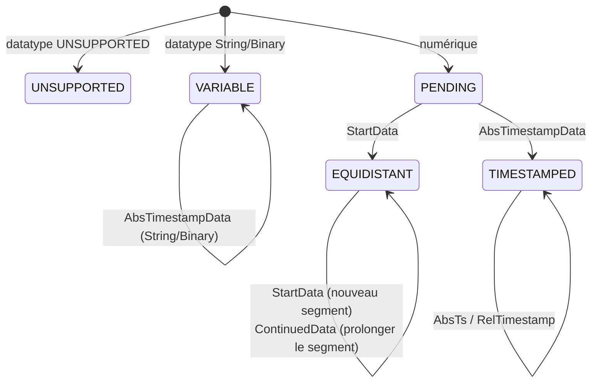

# Éléments internes

Cette page décrit les composants privés du paquet encapsulé
`com.optimeas.osf.internal` — pertinents pour tous ceux qui contribuent à la
bibliothèque ou veulent comprendre son comportement jusqu'au niveau de
l'octet. Les définitions du format wire se trouvent dans la
[spécification du format](../../osf_general.md) ; la structure publique est
décrite dans l'[architecture](./architecture.md).

## La frontière « non exporté »

Le descripteur de module `module-info.java` exporte **exclusivement**
`com.optimeas.osf`. Le paquet `com.optimeas.osf.internal` n'est volontairement
**pas** exporté et — comme il n'y a pas de `opens` — il reste aussi fermé à la
réflexion à l'exécution. Le code applicatif ne peut ni importer ces classes ni
les adresser par réflexion ; elles constituent une pure surface
d'implémentation et peuvent être remaniées sans rupture d'API.

| Composant | Classe(s) | Utilisé par |
|---|---|---|
| Modèle de bloc | `Block` (scellé) + `Block.Values` | Reader, assembleur |
| Lecteur de blocs | `BlockReader` | `DataManager` |
| Encodeur de blocs | `BlockEncoder` | les deux writers |
| Calcul du chunking | `BlockChunking` | les deux writers |
| Lecture du métabloc | `JsonMetablockParser`, `XmlMetablockParser` | `DataManager` |
| Écriture du métabloc | `MetablockBuilder` | les deux writers |
| Utilitaires d'intégrité (écriture) | `Integrity` | les deux writers |
| Assembleur de canaux | `ChannelAssembler` | `DataManager` |
| Décompression OSFZ | `OsfzInputStream` | `DataManager` |
| Utilitaire d'ordre des octets | `LittleEndian` | Reader + encodeur |

Toutes les entrées/sorties binaires passent par `java.nio.ByteBuffer` /
`FileChannel` avec `ByteOrder.LITTLE_ENDIAN` — il n'y a ni casts de type
`reinterpret` ni hypothèses sur l'endianness.

## Encodeur de blocs (`BlockEncoder`)

L'encodeur écrit un bloc OSF5 complet dans un `byte[]`. La trame est
entièrement little-endian :

```
[u16 channelIndex][Längenfeld (sizeOfLengthValue Bytes)][u8 control][body…]
```

Le champ de longueur compte les octets de `control + body`. L'octet de
contrôle porte le type de bloc dans les bits 0–6 et, dans le bit 7 (`0x80`),
l'indicateur multi-échantillons — positionné précisément lorsque
`count != 1` ; le corps commence alors par un compteur d'échantillons N de
type `u32`, sinon suit exactement un échantillon sans préfixe N.

| Méthode | Type de bloc (control) | Corps |
|---|---|---|
| `timestampedBlock` | `bcAbsTimeStampData` (`0x08`) | par échantillon `[i64 ts][valeur]` |
| `timestampedGpsBlock` | `bcAbsTimeStampData` | par échantillon `[i64 ts][3 × f64]` (24 o) |
| `startDataBlock` | `bcStartData` (`0x06`) | `[i64 startTs][f64 rate][N?][valeurs]` |
| `continuedDataBlock` | `bcContinuedData` (`0x05`) | `[N?][valeurs]` |
| `variableStringBlock` / `variableBinaryBlock` | `bcAbsTimeStampData` | échantillon unique `[i64 ts][octets]` |

`startDataBlock` et `continuedDataBlock` n'acceptent que `float` /
`double` (`requireFloatOrDouble`, sinon `OsfException.MalformedFile`).
Les String et Binary sont écrits à raison de **un** échantillon par bloc dans
la forme compacte (bit 7 libre, pas de préfixe N), encodés en UTF-8 et **sans**
`0x00` final (OSF5) ; un `0x00` contenu dans les données est un contenu
légitime et est conservé. `frame(…)` vérifie `sizeOfLengthValue ∈ {2, 4}` et
que la charge utile tient dans le champ de longueur. La classe interne `Body`
est un petit constructeur d'octets little-endian (`u8/u16/u32/i16/i32/i64/f32/f64`) ;
`f32`/`f64` passent par `Float.floatToRawIntBits` /
`Double.doubleToRawLongBits`.

`applyFrameCrc(frame, sizeOfLengthValue)` munit une trame terminée du CRC
d'intégrité : il augmente de 4 le champ de longueur sur disque (afin qu'il
compte le CRC) et ajoute le CRC32C calculé sur la trame **entière** corrigée
sous forme de quatre octets little-endian — exactement ce que le reader
recalcule.

## Calcul du chunking (`BlockChunking`)

Cette classe est le **seul** endroit où les tailles de bloc sont calculées ;
comme les deux writers l'appellent, ils découpent en chunks de manière
identique octet pour octet (base de la garantie d'identité à l'octet près). La
largeur du champ de longueur détermine la charge utile maximale :

```java
MAX_PAYLOAD_U16 = 0xFFFF;                 // 2-Byte-Längenfeld
MAX_PAYLOAD_U32 = Integer.MAX_VALUE - 1024;  // Soft-Cap, vermeidet i32-Überlauf
```

Lorsque le profil d'intégrité est actif, le CRC de trame
(`FRAME_CRC_RESERVE = 4` octets) est compté dans le champ de longueur pour
chaque bloc et réduit donc le budget de charge utile. À partir de ce budget,
trois utilitaires dérivent le nombre maximal d'échantillons par type de bloc
(surcoût : `bcAbsTimeStampData` 5 o = ctrl + N et 8 o d'horodatage
supplémentaires par échantillon ; `bcStartData` 21 o = ctrl + startTs + rate +
N ; `bcContinuedData` 5 o = ctrl + N) :

```java
maxSamplesPerTimestamped(valueSize, sov, frameCrc);  // perSample = 8 + valueSize
maxSamplesPerStart(valueSize, sov, frameCrc);
maxSamplesPerContinued(valueSize, sov, frameCrc);
maxSamplesPerTimestampedGps(sov, frameCrc);          // GPS_VALUE_SIZE = 24
```

Chaque utilitaire renvoie au moins 1 (`Math.max(1, …)`), de sorte qu'un seul
échantillon surdimensionné ne provoque jamais de boucle infinie.

## Utilitaires d'intégrité (`Integrity`)

Le côté écriture du profil d'intégrité OSF5 *niveau crc*. `magicLine`
construit la ligne d'en-tête magique `OSF5 <len>\n` et, lorsque le profil est
actif, y ajoute un jeton `crc32c:<HEX8>` — le CRC32C des octets du métabloc
sous forme de huit chiffres hexadécimaux en majuscules (`hex8`). Le métabloc
est ainsi protégé dans l'en-tête ; les CRC de trame des blocs de données sont
fournis par `BlockEncoder`. Tout calcul de CRC utilise `java.util.zip.CRC32C`.

## Flux de décompression OSFZ (`OsfzInputStream`)

`wrap(in, onFormat)` reconnaît gzip/zlib de manière transparente au début du
flux. Via un `PushbackInputStream(in, 2)`, deux octets sont lus à l'avance et
classés :

- **gzip** — `0x1F 0x8B` → `GZIPInputStream`, `onFormat("gzip")`.
- **zlib** — `0x78` suivi de `0x01 / 0x5E / 0x9C / 0xDA` →
  `InflaterInputStream`, `onFormat("zlib")`.
- **plain** — tout le reste (un vrai OSF commence par `'O' = 0x4F`) ; les
  octets lus sont réinjectés et le flux est transmis inchangé ; `onFormat`
  n'est **pas** appelé.

Les flux de moins de deux octets sont considérés comme plain — le parseur
d'en-tête magique en aval signale alors l'erreur appropriée. Le callback
alimente généralement `ReaderStats.setCompression`.

## Parseurs de métabloc (`JsonMetablockParser` / `XmlMetablockParser`)

Les deux parseurs alimentent symétriquement le même modèle `Metablock`
(métadonnées du fichier sous forme de `Map<String,String>` plus liste
`ChannelDef`) :

- **OSF5 / JSON** — `JsonMetablockParser` (Jackson) lit l'enveloppe `osf`
  avec `format`, `version`, `file{}` et `channels[]`. Champs obligatoires par
  canal : `index` (0..65535), `name`, `channeltype`, `datatype`,
  `sizeoflengthvalue` (doit valoir 2 ou 4). `timeincrement`
  (absent/0 ⇒ non équidistant) et `physicalunit` sont facultatifs ;
  les autres champs String scalaires vont dans la map `attributes`.
- **OSF4 / XML** — `XmlMetablockParser` (StAX) lit l'élément racine
  `<optimeas>` avec les attributs du fichier et les enfants `<channel>`.
  La `XMLInputFactory` est configurée de façon **sûre contre XXE**
  (`IS_SUPPORTING_EXTERNAL_ENTITIES = false`, `SUPPORT_DTD = false`,
  `IS_REPLACING_ENTITY_REFERENCES = false`) ; la version est fixée à 4.

Les types de données inconnus (futurs) deviennent `DataType.UNSUPPORTED`, les
types de canaux inconnus `ChannelType.UNSUPPORTED` ; la graphie d'origine est
conservée dans l'entrée `attributes`. Les types de données supprimés de la
spécification lèvent `OsfException.UnsupportedType`. Les types Jackson ou
StAX n'apparaissent **jamais** dans les records publics du modèle. Le côté
écriture est `MetablockBuilder` (il construit le même contrat wire JSON :
`osf.file` tel quel, `osf.channels[]` avec `index` redérivé de la position
dans la liste ; `timeincrement` uniquement lorsqu'un incrément existe).

## Assembleur de canaux (`ChannelAssembler`)

`assemble(channelDefs, blocks)` replie la `List<Block>` plate avec les
définitions de canaux en `DataChannel` typés, dans l'ordre du métabloc. Pour
chaque canal, un `Builder` maintient une machine à états :



- `StartData` ouvre un segment équidistant
  (`Segment(startTs, rate, startIndex, count)`) ; le premier bloc typé
  détermine le `Kind`.
- `ContinuedData` prolonge le dernier segment.
- `AbsTimestampData` s'ajoute à une disposition `TIMESTAMPED` (numérique/GPS)
  ou `VARIABLE` (String/Binary) et met à jour l'ancre
  (`lastTimestampNs`).
- `RelTimestampData` ne prolonge qu'un canal `TIMESTAMPED` disposant d'une
  ancre : chaque delta est ajouté cumulativement, via `saturatingAdd`, au
  dernier horodatage absolu.
- Les timestamps équidistants sont reconstruits par segment sous la forme
  `start + (long)(i * 1e9 / rate)` (addition saturante) ; les lacunes entre
  segments ne sont pas interpolées.

L'assembleur est volontairement indulgent : un type étranger au bloc sur un
canal déjà déterminé est ignoré au lieu d'être traité comme une erreur
(best effort). `finish()` écarte les canaux `UNSUPPORTED` (`null`) et
matérialise un `PENDING` sans aucun bloc comme un canal équidistant vide. Les
chunks de valeurs (un par bloc) ne sont concaténés qu'à la fin en un tableau
plat par primitive Java — l'assemblage reste ainsi en O(total des
échantillons).

## Utilitaire d'ordre des octets (`LittleEndian`)

Un module minuscule mais central : `wrap(byte[])` et `allocate(int)`
fournissent un `ByteBuffer` avec `ByteOrder.LITTLE_ENDIAN`. C'est le **seul**
endroit où l'ordre des octets est défini ; le reader et l'encodeur passent
sans exception par lui, de sorte que l'endianness n'a besoin d'être répétée
nulle part ailleurs.

## Structure des tests et vérification

Les tests sont réalisés avec **JUnit** sous
`osf-java/src/test/java/com/optimeas/osf/` :

| Niveau | Emplacement | Nature |
|---|---|---|
| Unitaire (interne) | `…/internal/*Test.java` | octets synthétiques, un fichier par composant (`BlockEncoderTest`, `BlockReaderTest`, `JsonMetablockParserTest`, `XmlMetablockParserTest`, `MetablockBuilderTest`, `LittleEndianTest`, `OsfzInputStreamTest`, `FrameCrcCheckValueTest`) |
| API publique | `…/*Test.java` | `DataManagerTest`, `BlockWriterTest`, `StreamingWriterTest`, `MagicHeaderParserTest`, `IntegrityReaderTest`, `WriterIntegrityTest` |
| Exemples / aller-retour | `*ExamplesTest`, `Roundtrip…` | fichiers réels de `examples/` (données de terrain + jeu de référence), y compris `OsfzExamplesTest` |
| Identité à l'octet près | `WriterIdentityTest` | les deux writers produisent le même OSF5 pour la même entrée |
| Conformité | `ConformanceManifestTest` | `reference_manifest.json` commun |
| Robustesse | `FuzzTruncationTest` | les entrées tronquées / mutilées ne déclenchent jamais d'exception inattendue |

L'exécution complète se fait via
`mvn -f implementations/java/pom.xml test` ; la CI l'exécute à chaque push.
Code source complet du paquet interne :
[`osf-java/src/main/java/com/optimeas/osf/internal/`](https://github.com/optimeas/osf/tree/main/implementations/java/osf-java/src/main/java/com/optimeas/osf/internal).

## Suite

- [Architecture](./architecture.md) — modèle en couches et modèles de données.
- [Lecture](./reading.md) et [Écriture](./writing.md) — l'API publique.
- [Gestion des erreurs](./error-handling.md) — la hiérarchie `OsfException`.
- [Outils](./tools.md) et [Build](./building.md).
- [Livre de recettes](./cookbook.md) — recettes à copier.
- [Retour à la présentation Java](../java.md).

> Ce document est publié sous licence [CC BY 4.0](https://creativecommons.org/licenses/by/4.0/deed.de). Attribution : optiMEAS GmbH et optiMEAS Switzerland GmbH.
