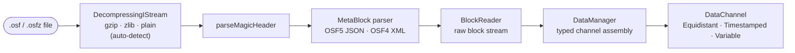
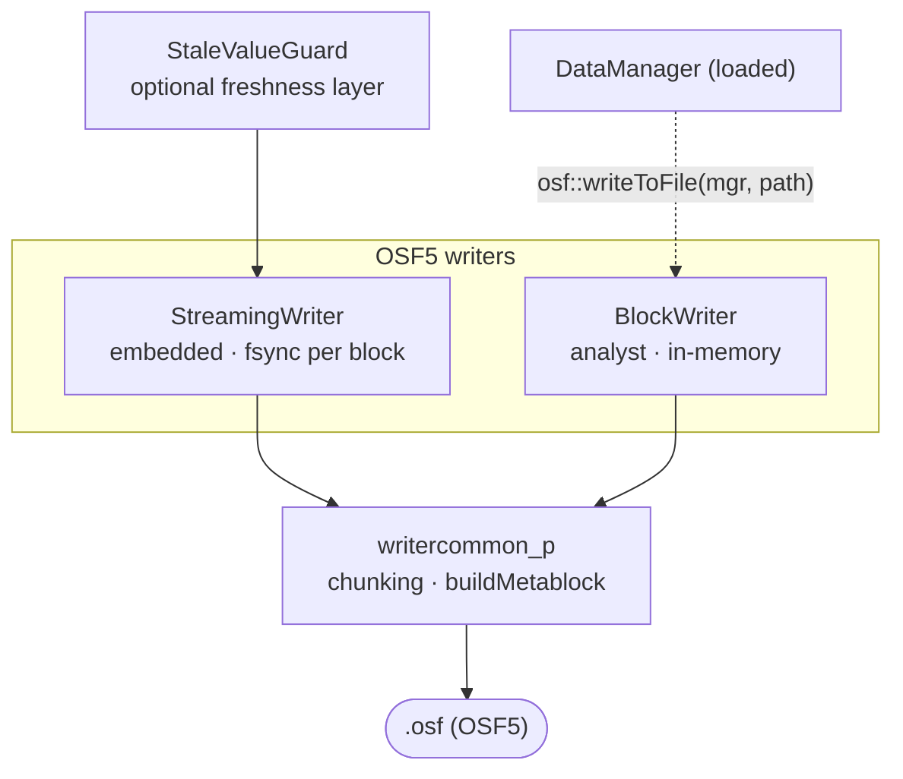
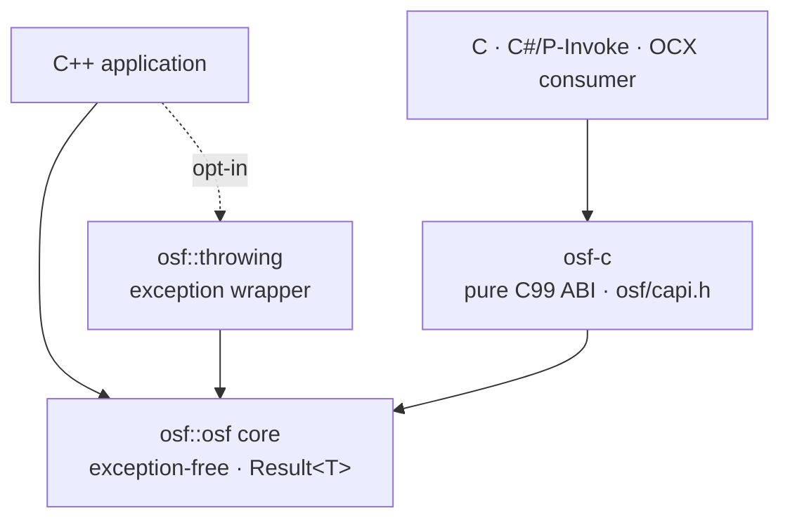

# Implementazione C++

Un'**implementazione C++17 autonoma** del Open Streaming Format —
C++ moderno e idiomatico, senza dipendenze esterne a runtime. Legge file
`.osf` e `.osfz` e scrive OSF5. La libreria è completamente utilizzabile
e distribuibile in modo autonomo; il suo comportamento è definito
esclusivamente dalla specifica del formato OSF.

:::tip Manuale per sviluppatori
Questa pagina è la panoramica. La documentazione dettagliata per
sviluppatori si trova nel sottocapitolo **C++ nel dettaglio**:

| Pagina | Contenuto |
|---|---|
| [Architettura](cpp/architecture.md) | Modello a livelli, moduli, modello dei dati, decisioni di progettazione, thread safety |
| [Lettura](cpp/reading.md) | `DataManager`, `DataChannel`, segmenti, `BlockReader`, `ReaderStats`, OSFZ trasparente |
| [Scrittura](cpp/writing.md) | `StreamingWriter`, `BlockWriter`, `StaleValueGuard`, `ChannelDef`, valori predefiniti dei metadati, round-trip |
| [Gestione degli errori](cpp/error-handling.md) | `Result<T>`, catalogo completo dei codici di errore, `osf::throwing` |
| [C-ABI](cpp/c-abi.md) | `osf-c` — regole di ownership, catalogo delle funzioni, esempi in C e P/Invoke |
| [Build e integrazione](cpp/building.md) | Opzioni CMake, target, `add_subdirectory`/FetchContent, Doxygen, CI |
| [Cookbook](cpp/cookbook.md) | Ricette pronte per la copia, dall'ispezione al ciclo embedded |
| [Interni](cpp/internals.md) | Encoder, matematica del chunking, macchina a stati del builder — per i collaboratori |
:::

## Funzionalità

L'implementazione è **funzionalmente completa**.
I percorsi di lettura e di scrittura sono coperti da una suite
GoogleTest/ctest (0 avvisi con MSVC `/W4 /permissive-`), e la CI compila
e testa su **Linux, macOS e Windows**.

**Percorso di lettura**

- Parser del magic header; parser del metablock OSF5 JSON e OSF4 XML
- Block stream reader e `DataManager` tipizzato (reader in memoria
  unificato con canali tipizzati)
- Decompressione **OSFZ** (gzip/zlib) trasparente — `.osf` e `.osfz`
  vengono letti tramite la stessa API
- **Best effort**: i file troncati (interruzione dell'alimentazione)
  restituiscono tutti i blocchi leggibili per intero; i tipi di dati
  futuri sconosciuti vengono saltati anziché interrompere il caricamento

**Percorso di scrittura (OSF5)**

- `StreamingWriter` — embedded, campione per campione, `fsync` per
  blocco (a prova di perdita di alimentazione), fabbisogno di memoria
  costante
- `BlockWriter` — a misura di analista, raccoglie in memoria e scrive il
  file completo alla fine; all'occorrenza adegua automaticamente
  `sizeOfLengthValue` da 2 → 4
- `StaleValueGuard` — livello opzionale di freschezza che emette di nuovo
  l'ultimo valore dei canali inattivi
- Valori predefiniti automatici dei metadati: `created_utc` viene
  marcato in scrittura; `creator`/`tag` ricevono valori di ripiego se non
  impostati

**Comodità e integrazione**

- Un **livello di comodità con eccezioni** (`osf::throwing`) sopra il
  nucleo `Result<T>` per i chiamanti che preferiscono le eccezioni
- La **libreria C-ABI `osf-c`** (`osf/capi.h`) — un puro livello C99 per
  l'utilizzo tra linguaggi diversi (DLL/shared object)

## Architettura in sintesi

Due livelli di API poggiano su un nucleo comune privo di eccezioni
(`osf::Result<T>`). Il lato di lettura assembla canali tipizzati dal
block stream; il lato di scrittura offre due classi writer per profili
d'uso diversi; e una C-ABI rende il tutto accessibile ai consumer non
C++. Approfondimento: [Architettura](cpp/architecture.md).

### Percorso di lettura



`DataManager::loadFromFile()` controlla l'intera pipeline; OSFZ viene
riconosciuto e decompresso automaticamente, così che `.osf` e `.osfz`
utilizzino la stessa chiamata.

### Percorso di scrittura (OSF5)



### Livelli e C-ABI



### Quale classe per quale scopo

| Desidero … | Classe | Note |
|---|---|---|
| Leggere un file e ottenere canali tipizzati | `osf::DataManager` | Punto di ingresso centrale — `loadFromFile()`, `channel("name")`. Legge `.osf` e `.osfz`. → [Lettura](cpp/reading.md) |
| Iterare sul block stream grezzo | `osf::BlockReader` | Livello più basso; per file molto grandi e consumer in streaming. → [Lettura](cpp/reading.md) |
| Conservare i campioni di un canale | `osf::DataChannel` | Variante tra Equidistant / Timestamped / Variable; accessor piatti tipizzati. → [Lettura](cpp/reading.md) |
| Registrare su un dispositivo embedded | `osf::StreamingWriter` | `fsync` per blocco, memoria costante, a prova di perdita di alimentazione. → [Scrittura](cpp/writing.md) |
| Scrivere il file completo in un unico passaggio | `osf::BlockWriter` | Raccoglie in memoria, scrive con `writeToFile()`; adegua automaticamente `sizeOfLengthValue`. → [Scrittura](cpp/writing.md) |
| Mantenere «freschi» i canali inattivi | `osf::StaleValueGuard` | Emette di nuovo l'ultimo valore dei canali che hanno superato una soglia. → [Scrittura](cpp/writing.md) |
| Round-trip / OSF4 → OSF5 | funz. libera `osf::writeToFile(mgr, …)` | Carica un `DataManager` in un `BlockWriter` e scrive OSF5. → [Cookbook](cpp/cookbook.md) |
| Usare eccezioni anziché `Result<T>` | `osf::throwing` | Header opt-in; non compilato nel nucleo. → [Gestione degli errori](cpp/error-handling.md) |
| Richiamare da C, C#, OCX … | `osf-c` (`osf/capi.h`) | ABI C99 puro; compilare con `-D OSF_BUILD_C_API=ON`. → [C-ABI](cpp/c-abi.md) |

### Esempi eseguibili

`implementations/cpp/examples/` contiene quattro piccoli programmi basati
su `<osf/osf.h>` — **`inspect`** (header / metadati / canali, OSFZ
trasparente), **`dump`** (valori dei campioni), **`write`** (sintetizzare
e scrivere OSF5) e **`copy`** (round-trip). Vengono compilati con
`-D OSF_BUILD_EXAMPLES=ON` (attivo per impostazione predefinita).
Ricette di codice elaborate: [Cookbook](cpp/cookbook.md).

## Build — avvio rapido

```bash
cmake -B build
cmake --build build
ctest --test-dir build
```

Le note specifiche per piattaforma, le opzioni CMake e le FAQ si trovano
nel file `BUILD.md` fornito con la libreria e nella pagina
[Build e integrazione](cpp/building.md).

### Opzioni CMake

| Opzione | Predefinito | Effetto |
|---|---|---|
| `OSF_BUILD_TESTS` | `ON` | Compilare la suite GoogleTest/ctest |
| `OSF_BUILD_EXAMPLES` | `ON` | Compilare i programmi di esempio eseguibili in `examples/` |
| `OSF_BUILD_DOCS` | `OFF` | Generare il riferimento API Doxygen (target `osf-docs`; richiede Doxygen) |
| `OSF_BUILD_C_API` | `OFF` | Compilare anche la libreria C-ABI `osf-c` (+ test C) |
| `OSF_USE_SYSTEM_ZLIB` | `OFF` | Usare la zlib di sistema anziché FetchContent |
| `OSF_WARNINGS_AS_ERRORS` | `OFF` | Avvisi come errori (`/WX` o `-Werror`); in CI `ON` |
| `BUILD_SHARED_LIBS` | `OFF` | Compilare la libreria core come shared library |

C++17 è la baseline linguistica definita in modo fisso della libreria.
Il passaggio a C++20 o superiore è un aggiornamento deliberato della
libreria, non un'opzione di build. Il codice di terze parti
(`tl::expected`, `nlohmann/json`, `pugixml`) è incluso nel repository
in `third_party/`; zlib proviene da FetchContent o dal sistema.

### Integrazione

La libreria esporta due target CMake:

- `osf::osf` — la libreria core (predefinita statica; nome file `libosf.a`
  / `osf.lib`)
- `osf::headers` — un target INTERFACE con i percorsi di include pubblici

Integrazione tramite `add_subdirectory` o `FetchContent` — snippet di
esempio in [Build e integrazione](cpp/building.md).

## API in sintesi

Il nucleo è **privo di eccezioni**: le operazioni che possono fallire
restituiscono `osf::Result<T>` (un `tl::expected<T, osf::Error>`).
Il catalogo completo dei codici di errore si trova in
[Gestione degli errori](cpp/error-handling.md).

### Lettura

```cpp
#include <osf/manager.h>

auto result = osf::DataManager::loadFromFile("messung.osf");  // auch .osfz
if (!result) {
    // result.error().message  —  strukturierter Fehler, keine Exception
    return;
}
osf::DataManager const& mgr = *result;

// Kanal über den Namen ansprechen (primäre Zugriffsform)
if (osf::DataChannel const* ch = mgr.channel("Sensor.Temperatur")) {
    auto werte = osf::asDoublesFlat(
        std::get<osf::TimestampedChannel>(*ch));   // typisierter Zugriff
}
```

Chi preferisce lavorare con le eccezioni utilizza il livello opt-in:

```cpp
#include <osf/throwing.h>

auto mgr = osf::throwing::load("messung.osf");   // wirft osf::Exception bei Fehler
```

### Scrittura (OSF5)

```cpp
#include <osf/blockwriter.h>

osf::BlockWriter writer;
writer.setCreator("mein-tool/1.0");

osf::ChannelDef def;
def.name        = "signale.sinus";
def.dataType    = osf::DataType::Double;
def.channelType = osf::ChannelType::Scalar;

auto idx = writer.addChannel(def);              // Result<uint16_t>
// … Samples zu *idx hinzufügen (addTimestampedSample, addEquidistantSegment, …)
writer.writeToFile("ausgabe.osf");
```

Per la scrittura embedded a prova di interruzione esiste invece lo
`StreamingWriter` (`fsync` per blocco). Un `DataManager` caricato può
essere riscritto direttamente come OSF5 con la funzione libera
`osf::writeToFile(mgr, pfad)` (round-trip / OSF4 → OSF5). Tutti i
dettagli e la scelta del corretto `sizeOfLengthValue`:
[Scrittura](cpp/writing.md).

### C-ABI (`osf-c`)

Con `-D OSF_BUILD_C_API=ON` viene generata inoltre la shared library
`osf-c` con un'interfaccia C99 pura (`osf/capi.h`): handle opachi
(`osf_manager`, `osf_channel`), codici `osf_status`, un
`osf_last_error_message()` thread-local e reader copy-out per timestamp
e valori — più `osf_write_to_file` per il percorso di scrittura
round-trip. Nessuna eccezione C++ attraversa il confine ABI. Pensata per
l'integrazione da C, C#/P-Invoke, ActiveX/OCX e futuri binding di
linguaggio. Catalogo delle funzioni ed esempi: [C-ABI](cpp/c-abi.md).

## Note

- **Viene scritto solo OSF5** — anche se la sorgente era un file OSF4.
- **OSFZ in scrittura è un passaggio successivo**: i writer non
  comprimono mai in linea; OSFZ (gzip) nasce *dopo* la chiusura del file
  `.osf` — tramite un futuro compressore post-close (thread in
  background) o una CLI di compressione autonoma. OSFZ viene **letto** in
  modo trasparente.
- **Best effort in lettura**: i file troncati restituiscono tutti i dati
  fino all'ultimo blocco leggibile per intero, senza arresto anomalo.
- La libreria è **neutrale rispetto a Qt**; un'aggiunta vicina a Qt
  potrà seguire in seguito come voce `integrations/` a sé stante.

## Codice sorgente e ulteriori informazioni

- Codice sorgente: [github.com/optimeas/osf](https://github.com/optimeas/osf),
  directory `implementations/cpp/`
- Guida di build: `BUILD.md` nella directory della libreria — riepilogo
  in [Build e integrazione](cpp/building.md)
- Riferimento API: generare con Doxygen tramite `-D OSF_BUILD_DOCS=ON` (target `osf-docs`) — vedere [Build e integrazione](cpp/building.md)
- Specifica del formato: capitolo [Formato OSF](../osf_general.md)

> Questo documento è distribuito con licenza [CC BY 4.0](https://creativecommons.org/licenses/by/4.0/deed.de). Attribuzione: optiMEAS GmbH e optiMEAS Switzerland GmbH.
