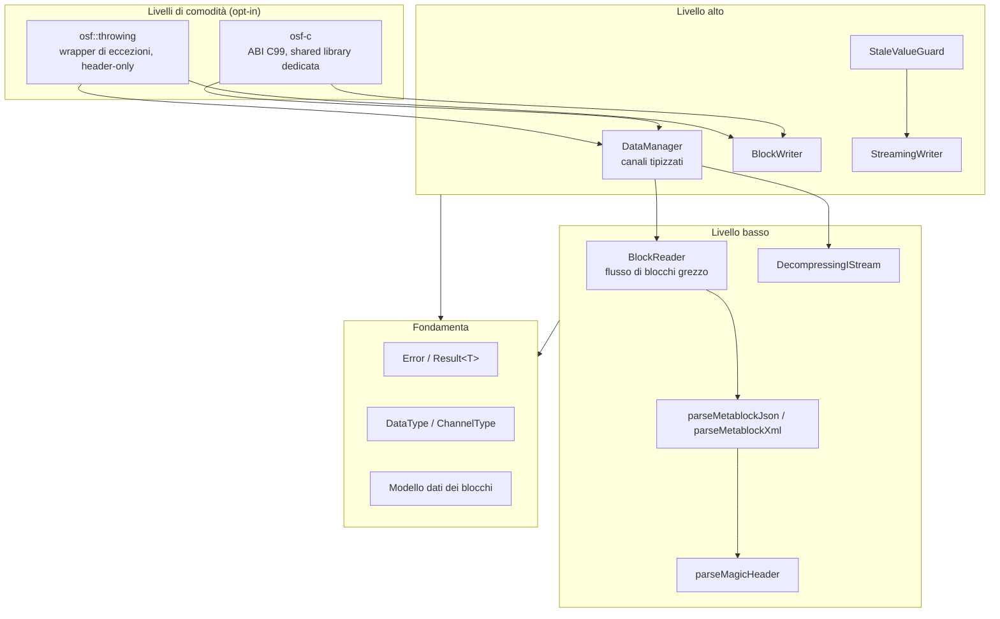
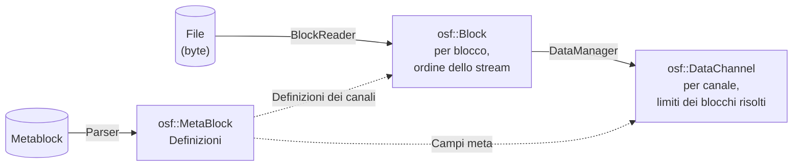

# Architettura dell'implementazione C++

Questa pagina descrive la struttura interna dell'implementazione C++:
il modello a livelli, i moduli e la loro interazione, il modello dati
e le principali decisioni di progetto. È rivolta agli sviluppatori
che integrano la libreria **e** a coloro che desiderano contribuire al suo sviluppo.
Una rapida panoramica è fornita dalla
[pagina di panoramica](../cpp.md); gli argomenti di dettaglio lettura, scrittura,
gestione degli errori, C-ABI e build hanno pagine dedicate.

## Linee guida

L'implementazione segue quattro principi:

1. **C++17 autonomo.** C++ moderno idiomatico senza ponti verso altri
   linguaggi e senza dipendenze esterne a runtime; il
   comportamento è definito esclusivamente dalla specifica del formato OSF.
2. **Nucleo privo di eccezioni.** Ogni operazione che può fallire restituisce
   `osf::Result<T>` (un `tl::expected<T, osf::Error>`).
   Le eccezioni esistono solo nel livello opt-in `osf::throwing`.
3. **Best effort in lettura.** I file troncati (interruzione di corrente
   durante la scrittura da parte di un writer embedded) restituiscono tutti i blocchi leggibili
   completamente anziché un errore; i tipi di dati futuri sconosciuti vengono
   saltati anziché interrompere il caricamento.
4. **Dipendenze ridotte.** Tre librerie header incluse nel progetto (vendored)
   (`tl::expected`, `nlohmann/json`, `pugixml`) più zlib (FetchContent
   o di sistema). Nessuna dipendenza da Boost né da Qt.

## Modello a livelli



La maggior parte delle applicazioni lavora esclusivamente al livello alto
(`DataManager` per la lettura, uno dei due writer per la scrittura). Il
livello basso è pubblico e stabile: chi desidera leggere in streaming o
costruire strumenti propri utilizza direttamente `BlockReader`.

## Moduli e responsabilità

| Header | Contenuto | Livello |
|---|---|---|
| `osf/error.h` | `Error` (codice + messaggio), `Result<T>` | Fondamenta |
| `osf/types.h` | `DataType`, `ChannelType`, `SpectrumType` + parser | Fondamenta |
| `osf/header.h` | Magic header: `OsfVersion`, `MagicHeader`, `parseMagicHeader` | Basso |
| `osf/metablock.h` | `MetaBlock`/`FileInfo`/`Channel`/`Info`; parser JSON e XML; serializzazione JSON | Basso |
| `osf/block.h` | Modello dati dei blocchi: `Block`, `BlockKind`, varianti di payload, decoder del control byte | Fondamenta |
| `osf/reader.h` | `BlockReader` — iteratore sul flusso di blocchi | Basso |
| `osf/stats.h` | `ReaderStats` / `ChannelStats` — telemetria di lettura | Basso |
| `osf/compression.h` | `DecompressingIStream`, `detectCompression` — OSFZ trasparente | Basso |
| `osf/datachannel.h` | Variante `DataChannel` (Equidistant / Timestamped / Variable), `Segment`, accessori flat | Alto |
| `osf/manager.h` | `DataManager` — caricamento + elenco tipizzato dei canali | Alto |
| `osf/streamingwriter.h` | `StreamingWriter` + `ChannelDef` | Alto |
| `osf/blockwriter.h` | `BlockWriter` + funzioni libere `writeToFile` / `writeTo` | Alto |
| `osf/stalevalueguard.h` | `StaleValueGuard` — livello di freschezza sopra `StreamingWriter` | Alto |
| `osf/binarysample.h` | `BinarySample` — vista di byte non proprietaria (sostituto di span) | Fondamenta |
| `osf/throwing.h` | `osf::Exception`, `throwing::unwrap/load/writeToFile` — **non** incluso nell'umbrella | Comodità |
| `osf/capi.h` | ABI C99 pura della libreria `osf-c` — **non** inclusa nell'umbrella | Comodità |
| `osf/osf.h` | Header umbrella (tutto tranne `throwing.h` e `capi.h`) | — |
| `osf/version.h` | generato; `osf::version()` e `OSF_VERSION_*` | Fondamenta |

Componenti di implementazione privati (in `src/`, non installabili):
`blockencode_p.{h,cpp}` (encoder di blocchi OSF5), `writercommon_p.{h,cpp}`
(matematica del chunking + assemblaggio del metablock), `durablefile_p.{h,cpp}`
(file RAII con `fsync`), `binaryio_p.h` (helper little-endian).
Per i dettagli vedere [Interni](internals.md).

## Tre modelli dati: chi vede cosa

La libreria ha volutamente tre rappresentazioni degli stessi dati, a seconda
del livello di astrazione:



1. **`osf::MetaBlock`** (`metablock.h`) — le *definizioni*:
   metadati del file (`FileInfo`), definizioni dei canali (`osf::Channel`)
   e voci `Info` opzionali. OSF4 (XML) e OSF5 (JSON)
   differiscono solo nella serializzazione; entrambi i parser popolano
   lo stesso modello in modo simmetrico.
2. **`osf::Block`** (`block.h`) — la *vista dello stream*: un blocco
   decodificato con indice di canale e variante `BlockKind` (`StartData`,
   `ContinuedData`, `AbsTimestampData`, `ContinuedRelStampData`,
   `Skipped`). I payload sono vettori tipizzati già decompressi — nessuno
   zero-copy (i blocchi hanno dimensioni da KB a pochi MB; la semplice
   semantica del ciclo di vita compensa l'allocazione).
3. **`osf::DataChannel`** (`datachannel.h`) — la *vista del canale*:
   un `std::variant` su tre layout di memorizzazione, perché la
   memorizzazione differisce effettivamente:

   | Variante | Memorizzazione |
   |---|---|
   | `EquidistantChannel` | vettore di campioni flat + `std::vector<Segment>` |
   | `TimestampedChannel` | vettori paralleli `timestampsNs` + `values` |
   | `VariableChannel` | timestamp + campioni stringa **oppure** binari |

**Nota sui nomi:** `osf::Channel` è la *definizione del canale* dal
metablock; `osf::DataChannel` sono i *campioni assemblati*.
Entrambi condividono il namespace `osf`, da qui i nomi
diversi.

## Convenzioni di denominazione e di API

- **Tipi** in PascalCase (`DataManager`, `BlockReader`).
- **Metodi e funzioni libere** in camelCase (`loadFromFile`,
  `channelName`, `asDoublesFlat`, `writeToFile`).
- **Campi pubblici delle struct** in camelCase senza prefisso (`blocksTotal`,
  `sizeOfLengthValue`, `startTimestampNs`, `compressionFormat`).
- **Membri privati** con prefisso `m_` + camelCase (`m_channelData`,
  `m_writer`).
- **Costanti** in UPPER_SNAKE_CASE (`MAX_MAGIC_HEADER_LEN`,
  `GPS_WIRE_SIZE`).
- **Nomi dei file header** in minuscolo, senza separatori, con estensione
  `.h` (`blockwriter.h`, `streamingwriter.h`, `datachannel.h`).
  Gli header interni nella directory `src/` hanno il suffisso `_p.h`
  (`blockencode_p.h`, `writercommon_p.h`).
- La **C-ABI** (simboli `osf_*` in `osf/capi.h`) segue la
  convenzione `snake_case` usuale in C ed è esclusa dalle regole
  C++.
- I discriminatori nelle varianti si chiamano `kind` (`BlockKind`,
  `SkipReason::Kind`, `VariableValueRef::Kind`).
- Tutto ciò che può fallire restituisce `Result<T>` ed è `[[nodiscard]]`.
- La costruzione avviene tramite factory statiche (`DataManager::loadFromFile`)
  o configurazione in stile builder (writer: `set*` → `addChannel` →
  fase di scrittura).
- I setter fluent su `BlockReader` (`withCaptureSkippedPayload`,
  `withFileSize`) restituiscono `BlockReader&`.
- I timestamp sono ovunque `std::int64_t` in **nanosecondi dall'epoca
  Unix (UTC)**; le frequenze di campionamento sono `double` in Hz.

## Principali decisioni di progetto

### `Result<T>` anziché eccezioni nel nucleo

La libreria è rivolta anche a codebase embedded e industriali
in cui le eccezioni sono disattivate o indesiderate. Il nucleo non
lancia quindi mai eccezioni; `tl::expected` (vendored, CC0) fornisce la monade. Chi
preferisce le eccezioni utilizza [`osf::throwing`](error-handling.md),
un livello sottile e header-only che volutamente **non** è stato incluso
nell'header umbrella, affinché gli utenti del nucleo non introducano alcun
meccanismo di eccezioni.

### Best effort e compatibilità in avanti

I file OSF reali nascono su dispositivi che possono perdere l'alimentazione in qualsiasi momento,
e con versioni della specifica che il
lettore non conosce ancora. Ne derivano tre regole di comportamento:

- **Il troncamento non è un errore.** Se il file termina a metà di un blocco,
  `BlockReader` restituisce tutti i blocchi completi, porta
  `stats().blocksTruncated` a 1 e termina l'iterazione in modo pulito.
- **Ciò che è sconosciuto viene saltato, non inghiottito.** I canali con
  tipo di dati sconosciuto (futuro) vengono analizzati come
  `DataType::Unsupported`; i loro blocchi compaiono come
  `BlockKind::Skipped` (i byte del payload vengono consumati affinché lo
  stream rimanga allineato). La grafia originale resta conservata in
  `Channel::dataTypeRaw`.
- **Gli elementi rimossi dalla specifica sono errori gravi.** I tipi di dati rimossi dalla
  revisione della specifica 2026-05-04 (`pair`, `triple`, `candata`,
  `gpsdata`) vengono rifiutati con `Error::Code::RemovedInSpec`:
  il loro layout di payload non è riproducibile da una build attuale,
  indovinare in silenzio comporterebbe una corruzione dei dati.

### Due writer anziché uno

`StreamingWriter` (embedded: `fsync` per blocco, memoria costante,
a prova di guasto) e `BlockWriter` (analista: raccoglie in memoria, emette
alla fine, può aumentare automaticamente `sizeOfLengthValue`) hanno
invarianti incompatibili: un writer comune avrebbe
indebolito entrambi i profili. I componenti comuni (chunking, assemblaggio del metablock) risiedono
in `src/writercommon_p.*`. Per i dettagli vedere la pagina [Scrittura](writing.md).

### OSFZ trasparente solo in lettura

OSFZ (= OSF compresso con gzip o zlib) viene riconosciuto e decompresso
in modo trasparente in **lettura** (`DecompressingIStream` prima dell'analisi del
magic header). In **scrittura** la libreria volutamente non comprime mai
inline: la compressione è un passaggio successivo
alla chiusura del file, affinché le modalità di errore di scrittura e di
compressione restino disaccoppiate.

### Thread safety

| Classe | Contratto |
|---|---|
| `DataManager` (caricato) | immutabile → leggibile in parallelo senza limiti |
| `BlockReader` | non thread-safe; un'istanza per thread |
| `StreamingWriter` / `BlockWriter` / `StaleValueGuard` | non thread-safe; serializzare le chiamate dall'esterno (ad es. `std::mutex`) |
| writer diversi su file diversi | nessun problema in parallelo |
| `osf-c` | `osf_last_error_message()` è thread-local; non condividere gli handle tra thread senza serializzare |

## Struttura delle directory

```
implementations/cpp/
├── CMakeLists.txt           — Projekt, Optionen, Targets
├── BUILD.md                 — Bauanleitung (EN)
├── cmake/                   — CompilerWarnings.cmake, version.h.in
├── include/osf/             — öffentliche Header (API-Fläche)
├── src/                     — Implementierung + private Header
├── tests/
│   ├── unit/                — GoogleTest-Units (synthetische Daten)
│   ├── integration/         — Tests gegen examples/*.osf(z)
│   └── capi/                — reiner C99-Test für osf-c
├── examples/                — inspect, dump, write, copy
└── third_party/             — tl::expected, nlohmann/json, pugixml (vendort)
```

## Approfondimenti

- [Lettura — DataManager, DataChannel, BlockReader, OSFZ](reading.md)
- [Scrittura — StreamingWriter, BlockWriter, StaleValueGuard](writing.md)
- [Gestione degli errori — Result, catalogo degli Error, throwing](error-handling.md)
- [C-ABI — osf-c per C, C#, OCX](c-abi.md)
- [Build e integrazione — CMake, opzioni, CI](building.md)
- [Cookbook — ricette per compiti tipici](cookbook.md)
- [Interni — encoder, chunking, macchina a stati del builder](internals.md)

> Questo documento è rilasciato con licenza [CC BY 4.0](https://creativecommons.org/licenses/by/4.0/deed.de). Attribuzione: optiMEAS GmbH e optiMEAS Switzerland GmbH.
