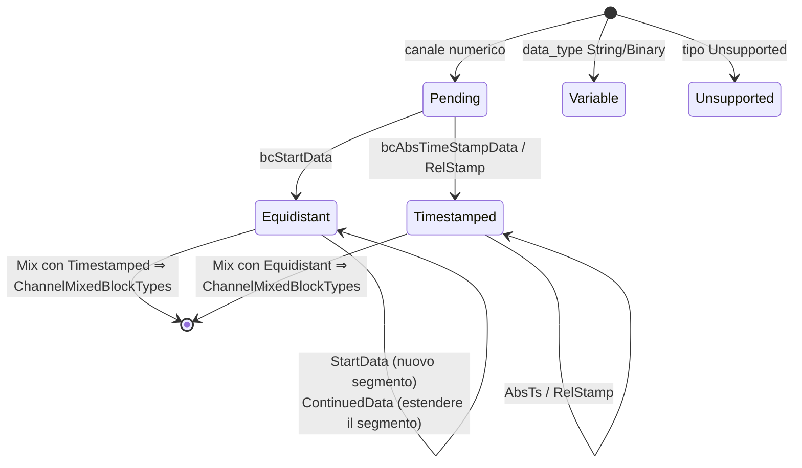

# Interni

Questa pagina descrive i componenti privati nella directory `src/`
della libreria, rilevanti per tutti coloro che collaborano al suo sviluppo o
desiderano comprenderne il comportamento fino al livello dei byte. Le
definizioni del wire format si trovano nella
[specifica OSF](../../osf_general.md).

## Panoramica dei componenti privati

| Componente | File | Utilizzato da |
|---|---|---|
| Encoder di blocchi | `blockencode_p.{h,cpp}` | entrambi i writer |
| Parti comuni dei writer (chunking, assemblaggio del metablock) | `writercommon_p.{h,cpp}` | entrambi i writer |
| I/O di file durevole | `durablefile_p.{h,cpp}` | solo `StreamingWriter` |
| Helper little-endian | `binaryio_p.h` | Encoder |
| Streambuf di decompressione | `compression.cpp` (classe `DecompressingIStream::Streambuf`) | Percorso di lettura |
| Macchina a stati del builder | `manager.cpp` (struct `ChannelBuilder`) | `DataManager` |

## Encoder di blocchi (`osf::detail::encode*`)

L'encoder scrive frame di blocco completi
`[u16 indice canale][campo lunghezza][payload]` in un vettore di byte
(sempre little-endian):

| Funzione | Blocco | Layout del payload |
|---|---|---|
| `encodeStartData<T>` | `bcStartData` (6) | `[u8 ctrl][i64 start_ts][f64 rate][u32 N][N × T]` |
| `encodeContinuedData<T>` | `bcContinuedData` (5) | `[u8 ctrl][u32 N][N × T]` |
| `encodeAbsTimestampData<T>` | `bcAbsTimeStampData` (8) | `[u8 ctrl][u32 N][N × (i64 ts + T)]` |
| `encodeAbsTimestampDataGps` | idem per GPS | Valore = 3 × f64 (lat, lon, alt) = 24 byte |
| Overload String/Binary | idem, campione singolo | `[u8 ctrl][i64 ts][byte]` — bit 7 = 0, **nessun** terminatore `0x00` (OSF5) |

Convenzioni: il bit 7 del control byte viene impostato solo se viene usata la
forma multi-campione (prefisso u32 N); con `count == 1`
il prefisso viene omesso (risparmia 4 byte per ogni blocco a campione singolo,
revisione della specifica 2026-05-24). I writer chiamano l'encoder esclusivamente con
quantità di campioni conformi alla capacità, calcolate in anticipo tramite `writercommon_p`.

## Matematica del chunking (`writercommon_p`)

Il campo lunghezza di un blocco ha una larghezza di `sizeOfLengthValue` (2 o 4) byte;
ne deriva il payload massimo per blocco:

```cpp
maxPayloadForSov(2) == 0xFFFF;                  // 65 535 Bytes
maxPayloadForSov(4) == 0x7FFFFFFF - 1024;       // soft-cap, vermeidet i32-Überlauf
```

Da qui tre helper derivano il numero massimo di campioni per tipo di blocco
(overhead: `bcStartData` 21 byte = ctrl + ts + rate + N;
`bcContinuedData`/`bcAbsTimeStampData` 5 byte = ctrl + N; nei blocchi
timestamped ogni campione richiede 8 byte aggiuntivi di timestamp). Per
i blocchi variabili a campione singolo vale
`variableSampleCapacity(sov) = max_payload - 9` (ctrl + ts).
Queste funzioni sono l'**unico** punto in cui vengono calcolate le dimensioni dei blocchi:
lo streaming writer e il block writer eseguono il chunking in modo identico.

`buildMetablock(FileInfoDraft, ChannelDefs)` assembla il metablock OSF5:
indici sequenziali 0..N, `channeltype` normalizzato
(`equidistant` resta, tutto il resto diventa `scalar` — la convenzione consolidata
dei file di riferimento OSF) e vengono applicati i valori predefiniti automatici
dei metadati (`created_utc` = ora UTC corrente come
`YYYY-MM-DDTHH:MM:SSZ`, fallback di `creator` `osf-cpp/<version>`,
fallback di `tag` `default`; `reason`/tripla GPS vengono omessi
anziché `null`).

## `DurableFile` — semantica fsync dello streaming writer

Wrapper RAII attorno a un handle di file nativo con tre operazioni:
`write` (completa o errore), `force` (Windows:
`FlushFileBuffers`, POSIX: `fsync`) e `close`. Lo
`StreamingWriter` chiama `force` dopo ogni blocco: per questo «la chiamata
ritorna con successo» equivale a «il blocco è sul
supporto». Gli errori di `write`/`force` portano il writer nello
stato `Broken` (sticky error).

## Streambuf di decompressione (percorso di lettura)

`DecompressingIStream` nasconde uno `std::streambuf` personalizzato dietro
un PIMPL, in modo che l'header pubblico resti privo di zlib:

- Classificazione tramite i primi due byte (`detectCompression`,
  non consumante tramite read + seek-back: la sorgente deve essere
  seekable).
- `underflow()` decomprime su richiesta in un buffer fisso:
  memoria costante indipendentemente dalla dimensione del file.
- `inflateInit2(MAX_WBITS | 32)` attiva il riconoscimento automatico
  dell'header gzip/zlib da parte di zlib stessa.
- I flussi compressi troncati restituiscono EOF anziché un errore
  (best effort, coerente con il resto del percorso di lettura).
- Con `CompressionFormat::None` i byte vengono passati 1:1:
  `DataManager` può quindi anteporre la facciata in modo incondizionato.

## Macchina a stati del builder (`DataManager`)

Per ogni canale `manager.cpp` mantiene un `ChannelBuilder` con cinque
stati:



Regole imposte dalle transizioni (tutte coperte da test):

- `bcContinuedData` nello stato `Pending` ⇒ `ContinuedDataWithoutStart`.
- `bcContinuedRelStampData` senza un precedente timestamp assoluto ⇒
  `RelStampWithoutAnchor`; altrimenti i delta u32 vengono sommati con l'ultimo
  timestamp assoluto come ancoraggio.
- Tipo di dati del payload ≠ tipo di dati del canale ⇒ `DataTypeMismatch`.
- I canali `Unsupported` consumano i propri blocchi (già `Skipped` lato
  reader) e vengono esclusi dall'elenco dei canali in `finalize`.

`finalize_builder` traduce lo stato finale nella corrispondente
variante `DataChannel`; `Pending` senza alcun blocco viene materializzato come canale
vuoto del tipo dichiarato.

## Dettagli del reader

- La decodifica dei byte avviene tramite piccoli helper `readLeU16`/`readLeU32`/`readLeU64`
  (più overload signed/float) anziché `reinterpret_cast`, senza
  presupposti su allineamento ed endianness.
- `PayloadCursor` scorre il payload del blocco presente in memoria
  e restituisce `std::optional<T>`; un overflow diventa così un pulito
  `InvalidBlock` anziché UB.
- I blocchi String/Binary multi-campione (bit 7 impostato) vengono suddivisi
  tramite split a lunghezza uguale; se la lunghezza non è divisibile il
  reader ricade sul campione singolo.
- Il terminatore nullo viene gestito in modo deterministico rispetto alla versione
  (campo `m_osfVersion` nel reader): OSF4 rimuove l'ultimo byte di ogni
  payload String/Binary, OSF5 mai (revisione della specifica 2026-05-24).
- L'infoblock opzionale OSF4 `0xFFFF` e il trailer di 40 byte
  (`OSF_STREAM_END …`) vengono consumati e mai restituiti come `Block`.

## Struttura dei test e verifica

| Livello | Posizione | Caratteristiche |
|---|---|---|
| Unit | `tests/unit/test_*.cpp` | byte/strutture sintetici, un file per modulo |
| Integrazione | `tests/integration/*_examples.cpp` | file reali da `examples/` (dati di campo + 17 file di riferimento generati) |
| Round trip | `tests/integration/roundtriphelper.h` | Caricamento → scrittura → ricaricamento → confronto dei campioni **esatto al bit** |
| C-ABI | `tests/capi/test_capi.c` | programma C99 autonomo, dimostra il linking C |

Prima di ogni push vale: esecuzione completa di ctest in locale con esito positivo (attualmente 321
test con `OSF_BUILD_C_API=ON`), 0 avvisi; la CI verifica inoltre
GCC/AppleClang/MSVC con `-Werror`/`/WX`.

## Aggiungere un nuovo tipo di dati (checklist)

Se una futura revisione della specifica aggiunge un tipo di dati:

1. `types.h/cpp` — enumeratore + grafia wire in `parseDataType`.
2. `block.h` — estendere le varianti di payload (`NumericPayload`,
   `TimestampedPayload`, eventualmente `RelTimestampedPayload`).
3. `reader.cpp` — ramo del decoder (dimensione del campione, parser del payload).
4. `datachannel.h/cpp` — `NumericValues`, macro degli accessor flat,
   `numericValuesEmptyFor`.
5. `manager.cpp` — estendere il visitor `*PayloadDataType`.
6. `blockencode_p` + writer — istanziazione dell'encoder,
   specializzazione `IsTimestampedNumeric` in entrambi gli header dei writer.
7. `capi` — eventualmente `osf_data_type` + reader di conversione.
8. Test a ogni livello; integrare i file di riferimento nel generatore.

Il fatto che l'elenco sia lungo è voluto: ogni livello è tipizzato
esplicitamente, nulla passa attraverso `void*` o cast a runtime.

> Questo documento è rilasciato con licenza [CC BY 4.0](https://creativecommons.org/licenses/by/4.0/deed.de). Attribuzione: optiMEAS GmbH e optiMEAS Switzerland GmbH.
