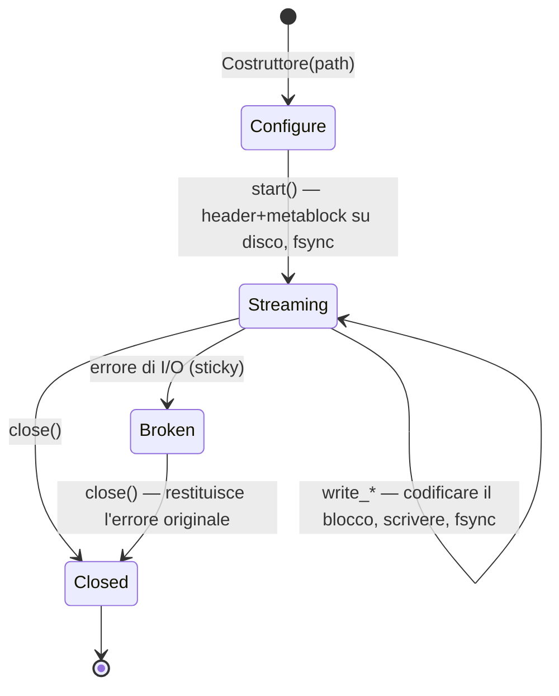

# Scrittura

La libreria scrive **esclusivamente OSF5**, anche
quando la sorgente era un file OSF4. Due classi writer coprono
due profili d'uso molto diversi:

| | `StreamingWriter` | `BlockWriter` |
|---|---|---|
| Impiego | Registrazione embedded | Analisi, conversione, esportazione |
| Memoria | costante (buffer scratch) | raccoglie tutti i campioni in RAM |
| Durabilità | `fsync` per blocco — a prova di perdita di alimentazione | nessun fsync; il file viene creato alla fine |
| Destinazione | Percorso del file | Percorso del file **oppure** `std::ostream` (memoria, socket) |
| `sizeOfLengthValue` | fisso da `start()` (il metablock è su disco) | bump automatico 2 → 4 in caso di necessità |
| Ciclo di vita | Configure → `start()` → scrittura → `close()` | Raccolta → `writeToFile()` / `writeTo()` (un numero qualsiasi di volte) |
| Emissione multipla | no (un file per istanza) | sì (`writeTo*` è `const`) |

Entrambi condividono la descrizione dei canali `osf::ChannelDef` e le stesse
famiglie di scrittura (equidistante, numerica timestamped, GPS, String/Binary).

## Dichiarare i canali — `ChannelDef`

```cpp
osf::ChannelDef def;
def.name             = "motor.drehzahl";         // Pflicht
def.dataType         = osf::DataType::Double;    // Pflicht
def.channelType      = osf::ChannelType::Scalar; // Pflicht (Scalar = Konvention)
def.sizeOfLengthValue = 2;                       // 2 (Standard) oder 4
def.physicalUnit     = "1/min";                  // optional
def.displayName      = "Motordrehzahl";          // optional
// ferner: physicalDimension, mimeType, reference, comment, timeIncrementNs
```

`addChannel(def)` restituisce l'indice del canale (sequenziale a partire da 0), che viene utilizzato da tutte le
chiamate di scrittura. Vengono rifiutati (`InvalidArgument`):
`sizeOfLengthValue` ≠ 2/4, tipi `Unsupported`, più di 65535
canali — nello `StreamingWriter` inoltre ogni chiamata dopo `start()`.

### Scegliere correttamente `sizeOfLengthValue`

Il campo lunghezza di ogni blocco ha una larghezza di 2 o 4 byte e limita la
dimensione del blocco (~64 KB o ~2 GB). Regole pratiche:

- **Canali String/Binary con campioni grandi** (immagini, audio, blob):
  con `StreamingWriter` dichiarare obbligatoriamente `4`: non può modificare il valore
  dopo `start()` e rifiuta i campioni troppo grandi con
  `InvalidBlock`. Il `BlockWriter` lo aumenta da sé (bump 2 → 4 durante
  l'emit), per cui lì `2` come valore iniziale va sempre bene.
- **Canali numerici ad alta frequenza** nello `StreamingWriter`: `4` evita il
  chunking: un append di 100k campioni `double` in un canale `sov=2`
  verrebbe altrimenti suddiviso in ~13 blocchi = ~13 fsync.
- Altrimenti: restare con il valore predefinito `2` (blocchi più compatti).

## `StreamingWriter` — embedded, a prova di guasto

### Ciclo di vita



```cpp
#include <osf/streamingwriter.h>

osf::StreamingWriter w("aufzeichnung.osf");
w.setCreator("logger-fw/3.2");                 // Metadaten vor start()
w.setTag("pruefstand-7");

auto rpm = w.addChannel(rpm_def);              // Result<uint16_t>
auto gps = w.addChannel(gps_def);
if (!rpm || !gps) { /* … */ }

if (auto r = w.start(); !r) { /* Datei offen, Metablock geschrieben */ }

// Aufzeichnungsschleife
while (running) {
    auto r = w.writeTimestampedSample<double>(*rpm, now_ns(), read_rpm());
    if (!r) { /* I/O-Fehler => Writer ist Broken; abbrechen */ break; }
}

if (auto r = w.close(); !r) { /* … */ }
```

Garanzie e comportamento:

- **Ogni `write_*` che ritorna con successo è su disco**
  (`FlushFileBuffers` in Windows, `fsync` in POSIX). Dopo
  un'interruzione di corrente il file è leggibile fino all'ultimo blocco confermato:
  il reader è progettato esattamente per questo scenario (best effort in caso di
  troncamento).
- **Sticky error:** dopo un errore di I/O il writer passa nello
  stato `Broken`; ogni ulteriore chiamata (anche `close()`) restituisce
  l'errore originale. In questo modo la causa dell'errore non va persa nei
  cicli fire-and-forget.
- **I setter dei metadati sono efficaci solo prima di `start()`**: il metablock viene
  scritto da `start()` e non viene mai più toccato.
- **Nessun OSFZ:** lo streaming writer scrive file `.osf` grezzi.
  La compressione è un passaggio successivo: le modalità di errore di scrittura e di
  compressione restano così disaccoppiate.
- Costruibile/assegnabile per move, non copiabile. Non thread-safe:
  serializzare gli accessi dall'esterno.
- Il buffer scratch cresce fino alla dimensione del blocco più grande mai scritto
  e viene rilasciato solo nel distruttore.

### Famiglie di scrittura

```cpp
// Äquidistant (nur float/double per Spec) — Segment öffnen + verlängern:
w.startEquidistantSegment(ch, t0_ns, 1000.0 /*Hz*/, daten.data(), daten.size());
w.appendEquidistantSamples(ch, weitere.data(), weitere.size());   // braucht offenes Segment

// Timestamped numerisch (11 Typen, Template):
w.writeTimestampedSample<std::int32_t>(ch, ts_ns, wert);
w.writeTimestampedSamples<double>(ch, ts_array, werte, n);        // parallele Arrays

// GPS (eigene Symbole, kein Template):
w.writeTimestampedGpsSample(ch, ts_ns, osf::GpsLocation{lat, lon, alt});

// String/Binary (ein Sample pro Block per Spec; OSF5: kein 0x00-Terminator):
w.writeTimestampedString(ch, ts_ns, "Ereignis: Tür offen");
w.writeTimestampedBinary(ch, ts_ns, osf::BinarySample::fromVector(jpeg_bytes));
```

Ogni chiamata multi-campione viene suddivisa automaticamente in chunk secondo la capacità di blocco del
canale (un fsync per blocco). Un nuovo
`startEquidistantSegment` apre volutamente un **nuovo** segmento:
le lacune tra i segmenti sono il mezzo conforme alla specifica per rappresentare
le pause di registrazione.

## `BlockWriter` — raccogliere ed emettere

```cpp
#include <osf/blockwriter.h>

osf::BlockWriter w;
w.setCreator("analyse-tool/1.0");

auto ch = w.addChannel(def);
w.addEquidistantSegment(*ch, t0_ns, 100.0, samples.data(), samples.size());
w.addTimestampedSample<double>(*ev, ts_ns, 42.0);
w.addStringSample(*log, ts_ns, "Kalibrierung ok");

if (auto r = w.writeToFile("ergebnis.osf"); !r) { /* … */ }

std::ostringstream mem;                 // oder in einen beliebigen ostream
if (auto r = w.writeTo(mem); !r) { /* … */ }
```

- La famiglia `add*` rispecchia la famiglia `write*` dello
  streaming writer (stessi tipi, stessa validazione), ma raccoglie
  solo in memoria; il chunking in blocchi conformi alla specifica avviene durante l'emit.
- `writeToFile` / `writeTo` sono **`const`**: la stessa istanza può essere
  emessa più volte (ad es. file + rete).
- **Auto-bump:** i canali variabili il cui campione più grande non entra nel
  campo lunghezza u16 dichiarato ottengono per l'emissione
  `sizeOfLengthValue = 4`.
- Nessun fsync: la durabilità è responsabilità del chiamante.
- `channelIndex("name")` e `channelCount()` aiutano se gli
  indici non vengono tenuti da parte.

## Valori predefiniti automatici dei metadati

Entrambi i writer applicano gli stessi valori predefiniti durante l'assemblaggio del
metablock:

| Campo | Comportamento se non impostato |
|---|---|
| `createdUtc` | **sempre** timbrato automaticamente (ora UTC corrente, `YYYY-MM-DDTHH:MM:SSZ`; la chiave JSON su disco è `created_utc`) |
| `creator` | `osf-cpp/<versione della libreria>` |
| `tag` | `default` |
| `reason`, `createdAt*`, `namespaceSep`, `comment` | omessi (non scritti come `null` se non impostati) |

## `StaleValueGuard` — mantenere freschi i canali inattivi

I canali sporadici (di eventi) ricevono un campione solo in caso di variazione del valore.
Su una linea temporale un canale scritto per l'ultima volta ore prima
è ambiguo: il valore è ancora valido oppure la registrazione è morta? La
convenzione optiMEAS limita questa «staleness» ripetendo l'ultimo valore
al più ogni 100 s. È esattamente ciò che
la guard automatizza come wrapper write-through su uno
`StreamingWriter` avviato:

```cpp
#include <osf/stalevalueguard.h>

osf::StreamingWriter w(path);
/* … konfigurieren, start() … */
osf::StaleValueGuard guard(w);                  // Default: 100 s; eigener Wert möglich

// Timestamped-Writes durch den Guard routen (cached den letzten Wert):
guard.writeTimestampedSample<double>(temp_ch, ts_ns, 21.5);

// Periodisch (z. B. im Aufzeichnungs-Tick):
auto reemitted = guard.poll(now_ns);            // Result<std::size_t>
```

Caratteristiche:

- **Basato su pull:** nessun thread interno, nessun orologio proprio: il
  chiamante fornisce `now_ns` a `poll()`. Deterministico e
  adatto all'embedded.
- Per ogni `poll()` al massimo **una** ripetizione per canale (nessun
  backfill della lacuna).
- Solo canali numerici + GPS; String/Binary volutamente no (ripetere grandi
  blob sarebbe controproducente).
- I canali vengono rilevati automaticamente al primo write-through;
  `isTracked` / `forget` / `clear` controllano il tracking.
- Le scritture reali azzerano l'orologio di inattività: i canali
  scritti attivamente non ricevono mai una ripetizione sintetica.

## Round trip e conversione

Riscrivere un `DataManager` caricato (anche come
conversione OSF4 → OSF5):

```cpp
#include <osf/manager.h>
#include <osf/blockwriter.h>

auto mgr = osf::DataManager::loadFromFile("alt.osf");      // auch OSF4 / OSFZ
if (!mgr) { /* … */ }

if (auto r = osf::writeToFile(*mgr, "neu.osf"); !r) { /* … */ }   // immer OSF5
```

Internamente `BlockWriter::fromManager(mgr)` costruisce un writer dai
canali tipizzati; chi desidera filtrare o rinominare prima della scrittura
utilizza direttamente `fromManager` e lavora sul writer.

Vengono conservati: nomi dei canali, tipi di dati, valori dei campioni (esatti al bit),
confini dei segmenti, metadati del file (tranne `created_utc`, che viene
timbrato di nuovo durante la scrittura). **Non** viene conservato
l'indice del canale: il writer lo riassegna in modo sequenziale 0..N.

## Ciò che i writer volutamente non fanno

- **Nessun output OSF4** — OSF5 è l'unico formato di scrittura.
- **Nessun output OSFZ** — la compressione è un passaggio successivo;
  un compressore post-close e una CLI `osf-compress` sono previsti come
  lavoro futuro.
- **Nessun `bcContinuedRelStampData`** — il formato temporale relativo è
  un retaggio di lettura di OSF4; i writer emettono timestamp assoluti.
- **Nessuna validazione dei timestamp** — la monotonia secondo la specifica non è
  richiesta e non viene imposta.

> Questo documento è rilasciato con licenza [CC BY 4.0](https://creativecommons.org/licenses/by/4.0/deed.de). Attribuzione: optiMEAS GmbH e optiMEAS Switzerland GmbH.
