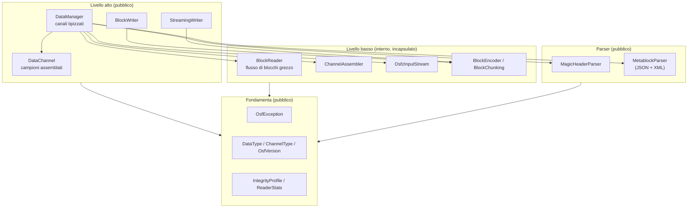
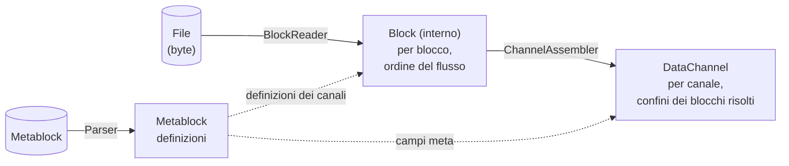

# Architettura dell'implementazione Java

Questa pagina descrive la struttura interna dell'implementazione Java:
il modello a livelli, i moduli e la loro interazione, il modello dei dati
e le principali decisioni di progettazione. È rivolta agli sviluppatori
che integrano la libreria **e** a quelli che desiderano contribuire al
suo sviluppo. Una rapida panoramica è disponibile nella
[pagina di panoramica](../java.md); gli argomenti di dettaglio lettura,
scrittura, gestione degli errori, strumenti e build hanno pagine dedicate.

## Principi guida

L'implementazione segue quattro principi:

1. **Java 21 moderno e autonomo.** Java idiomatico sull'attuale versione
   LTS — record, tipi sealed, pattern `switch` — senza ponti verso altri
   linguaggi. Il comportamento è definito esclusivamente dalla
   specifica del formato OSF, non da un porting di riferimento.
2. **Incapsulamento rigoroso tramite JPMS.** Il descrittore del Java
   Platform Module System esporta esclusivamente `com.optimeas.osf`; il
   package interno `com.optimeas.osf.internal` resta precluso anche alla
   reflection. La superficie pubblica è quindi ridotta e stabile.
3. **Best effort in lettura.** I file troncati (interruzione
   dell'alimentazione durante la scrittura su sistemi embedded)
   restituiscono tutti i blocchi leggibili per intero anziché un errore;
   i tipi di dati futuri sconosciuti vengono saltati invece di
   interrompere il caricamento.
4. **Dipendenze snelle e diffuse.** Jackson per il JSON di OSF5, l'API
   StAX inclusa nel JDK per l'XML di OSF4, `java.util.zip`
   (decompressione OSFZ + CRC32C) e SLF4J come facade di logging.
   Nessun framework pesante.

## Modello a livelli



La maggior parte delle applicazioni lavora esclusivamente al livello alto
(`DataManager` per la lettura, uno dei due writer per la scrittura). Il
livello basso — block reader, channel assembler, flusso OSFZ, encoder —
si trova nel package incapsulato `com.optimeas.osf.internal` ed è
invisibile dall'esterno; la pipeline di lettura è orchestrata
interamente dal `DataManager`.

## Moduli e responsabilità

Il reactor Maven `com.optimeas.osf:osf-parent` riunisce tre moduli:

| Modulo | Artefatto | Ruolo |
|---|---|---|
| Libreria core | `com.optimeas.osf:osf-java` | Lettura (OSF4 + OSF5 + OSFZ), entrambi i writer OSF5, il profilo di integrità `crc` |
| Riga di comando | `osf-cli` | Ispezione e conversione di file OSF; JAR eseguibile |
| Viewer | `osf-viewer` | Applicazione JavaFX per la visualizzazione multicanale dei segnali |

Questa pagina descrive il modulo core. La superficie pubblica del core
(package `com.optimeas.osf`):

| Tipo | Contenuto | Livello |
|---|---|---|
| `DataManager` | Caricamento + elenco tipizzato dei canali + telemetria | Alto |
| `DataChannel` | Campioni assemblati di un canale; `Kind`, `Segment` | Alto |
| `StreamingWriter` | Writer OSF5 a prova di interruzione (`fsync` per blocco) | Alto |
| `BlockWriter` | Writer OSF5 che accumula in memoria; `fromManager` | Alto |
| `MagicHeader` / `MagicHeaderParser` | Riga magic header + token di integrità | Parser |
| `Metablock` / `MetablockParser` / `ChannelDef` | Definizioni; parser JSON **e** XML | Parser |
| `DataType` / `ChannelType` | Enum di wire + `fromWireName` | Fondamenta |
| `OsfVersion` | Versione su disco (OSF4 / OSF5) | Fondamenta |
| `GpsLocation` | Campione GPS (record: `latitude`/`longitude`/`altitude`) | Fondamenta |
| `IntegrityProfile` | Livello di integrità (`NONE` / `CRC32C` / `ED25519`) | Fondamenta |
| `ReaderStats` | Telemetria di lettura (blocchi, troncamento, compressione) | Fondamenta |
| `OsfException` | Gerarchia delle eccezioni (vedere sotto) | Fondamenta |

Componenti interni (package `com.optimeas.osf.internal`, **non**
esportato): `BlockReader` + `Block` (flusso di blocchi grezzo),
`ChannelAssembler` (blocco → canale), `OsfzInputStream` (decompressione
OSFZ trasparente), `BlockEncoder` + `BlockChunking` (encoder di blocchi
OSF5 + matematica del chunking), `Integrity` (frame CRC32C),
`MetablockBuilder`, `JsonMetablockParser` / `XmlMetablockParser` e
`LittleEndian` (helper per l'ordine dei byte).
Per i dettagli vedere [Interni](internals.md).

## Incapsulamento JPMS

Il descrittore di modulo `module-info.java` traccia un confine netto:

```
module com.optimeas.osf {
    requires com.fasterxml.jackson.databind;
    requires org.slf4j;
    requires java.xml;          // StAX für den OSF4-XML-Metablock

    exports com.optimeas.osf;
    // com.optimeas.osf.internal ist bewusst NICHT exportiert.
}
```

Solo `com.optimeas.osf` è esportato. Il package interno è incapsulato su
due livelli: il compilatore nega l'accesso ai tipi non esportati e —
poiché non esiste alcun `opens` — il package resta precluso alla
reflection anche in fase di esecuzione. Il codice applicativo non può
quindi né importare né indirizzare per reflection le classi interne.

Ne deriva una conseguenza visibile nel modello dei dati: `DataChannel`
possiede sì un costruttore nominalmente `public` per il
`ChannelAssembler`, ma il tipo del suo parametro (`Block.Values`) si
trova nel package interno. Dall'esterno del modulo il costruttore non
può quindi essere invocato — le istanze di `DataChannel` nascono
esclusivamente tramite il `DataManager`.

## Tre modelli di dati — chi vede cosa

La libreria prevede deliberatamente tre rappresentazioni degli stessi
dati, a seconda del livello di astrazione:



1. **`Metablock`** (`MetablockParser`) — le *definizioni*:
   metadati del file (`Map<String,String>`) e definizioni dei canali
   (`ChannelDef`). OSF4 (XML, tramite StAX) e OSF5 (JSON, tramite
   Jackson) differiscono solo per la serializzazione; entrambi i parser
   popolano lo stesso modello in modo simmetrico.
2. **`Block`** (interno) — la *vista del flusso*: un blocco decodificato
   con indice del canale e tipo di blocco (`bcStartData`,
   `bcContinuedData`, `bcAbsTimeStampData`, `bcContinuedRelStampData`).
   I payload sono disponibili come record `Block.Values` tipizzati e
   decompressi, in modo da non perdere alcuna informazione sul tipo di
   dati. Questo modello è incapsulato e non compare mai nell'API
   pubblica.
3. **`DataChannel`** — la *vista per canale*: per ogni canale una
   sequenza piatta di campioni con timestamp assoluti paralleli, con i
   confini dei blocchi risolti. Un'unica classe, il cui layout di
   memorizzazione è distinto da un discriminatore `Kind`:

   | `Kind` | Memorizzazione |
   |---|---|
   | `EQUIDISTANT` | sequenza piatta di campioni + `List<Segment>`; timestamp ricostruiti |
   | `TIMESTAMPED` | numerico/GPS con timestamp paralleli espliciti |
   | `VARIABLE` | campioni String **oppure** Binary, sempre con timestamp |

**Nota sulla denominazione:** `ChannelDef` è la *definizione del canale*
dal metablock; `DataChannel` sono i *campioni assemblati*. Gli accessor
tipizzati `asDoubles()`, `asLongs()`, `asBooleans()`, `asStrings()`,
`asBinaries()` e `asGps()` proiettano la sequenza memorizzata; se il
`dataType()` non corrisponde alla vista richiesta, l'accessor genera
`OsfException.UnsupportedType`.

## Convenzioni di denominazione e dell'API

- **Tipi** in PascalCase (`DataManager`, `BlockWriter`).
- **Metodi e accessor** in camelCase **senza** prefisso `get`
  (`loadFromFile`, `channelByName`, `timestampsNs`, `asDoubles`); i
  record espongono accessor omonimi ai componenti (`name()`, `index()`).
- **Costanti enum** in UPPER_SNAKE_CASE (`EQUIDISTANT`, `OSF4`,
  `CRC32C`, `GPS_LOCATION`); ogni enum di wire riporta l'esatta
  grafia di wire tramite `wireName()` e viene risolto con la factory
  infallibile `fromWireName(String)`.
- **Contenitori di valori**, se immutabili, sono record (`GpsLocation`,
  `DataChannel.Segment`).
- Le operazioni soggette a errore generano eccezioni di una gerarchia
  sotto `OsfException` (`RuntimeException`); l'API di lettura/scrittura
  non prevede eccezioni controllate.
- Le ricerche restituiscono `Optional<DataChannel>` (`channelByName`,
  `channelByIndex`) anziché `null`.
- Costruzione tramite factory statiche (`DataManager.loadFromFile`,
  `DataManager.load`, `BlockWriter.fromManager`) o configurazione dei
  writer in stile builder (`add…Channel` → aggiunta dei campioni → fase
  di scrittura).
- I timestamp sono ovunque `long` in **nanosecondi dall'epoca Unix
  (UTC)**; le frequenze di campionamento sono `double` in Hz.

## Principali decisioni di progettazione

### Incapsulamento invece di un'API ampia

La superficie pubblica è deliberatamente limitata a un solo package.
L'intero percorso di lettura — decodifica dei blocchi, assemblaggio dei
canali, decompressione OSFZ, verifica CRC — si trova dietro
`DataManager` ed è irraggiungibile tramite JPMS. In questo modo l'API
garantita resta ridotta e le ristrutturazioni interne non compromettono
il codice dei consumer.

### Best effort e compatibilità in avanti

I file OSF reali vengono generati su dispositivi che possono perdere
l'alimentazione in qualsiasi momento e con versioni della specifica
ancora sconosciute al lettore. Ne derivano tre regole di comportamento:

- **Il troncamento non è un errore.** Se il file termina a metà di un
  blocco, il reader restituisce tutti i blocchi completi e imposta
  `ReaderStats.truncationSeen()` a `true`, anziché generare
  un'eccezione.
- **Il materiale sconosciuto è tollerato.** Un tipo di dati sconosciuto
  (futuro) viene interpretato come `DataType.UNSUPPORTED`, un tipo di
  canale sconosciuto come `ChannelType.UNSUPPORTED`; il file continua a
  essere caricato e la grafia originale resta conservata nella voce
  `attributes` del canale.
- **Gli elementi rimossi dalla specifica sono errori bloccanti.** I tipi
  di dati rimossi dalla specifica (`pair`, `triple`, `candata`,
  `gpsdata`) vengono rifiutati con `OsfException.UnsupportedType` — il
  loro layout del payload non è riproducibile e un'interpretazione
  tacita sarebbe corruzione dei dati.

### Due writer invece di uno

`StreamingWriter` (embedded: `fsync` per blocco tramite
`FileChannel.force`, memoria costante, a prova di interruzione) e
`BlockWriter` (analista: accumula in memoria, emette alla fine, può
portare automaticamente `sizeoflengthvalue` da 2 a 4) hanno invarianti
inconciliabili — un writer unico avrebbe indebolito entrambi i profili.
Entrambi condividono tuttavia la stessa matematica del chunking
(`BlockChunking`) e, per canali, campioni, `sizeoflengthvalue` e
`created_utc` identici, producono **OSF5 identico byte per byte**.
Dettagli nella pagina [Scrittura](writing.md).

### OSFZ trasparente solo in lettura

OSFZ (= OSF compresso con gzip o zlib) viene riconosciuto e
decompresso in modo trasparente in **lettura**: `DataManager.load`
antepone un `OsfzInputStream` alla sorgente prima del parsing del magic
header e popola `ReaderStats.compressed()` / `compressionFormat()`. In
**scrittura** la libreria non comprime deliberatamente mai in linea; la
compressione è un passaggio successivo.

### Profilo di integrità `crc`

Se il magic header contiene un token `crc32c`, `DataManager.load`
verifica in modalità fail-closed il CRC32C del metablock rispetto al
valore dell'header e, in caso di discordanza, rifiuta con
`OsfException.MetablockCrcMismatch`; anche i frame dei blocchi vengono
validati tramite CRC32C. I file firmati (`IntegrityProfile.ED25519`)
vengono letti in modo trasparente — i blocchi di firma vengono saltati e
conteggiati —, ma le firme non vengono verificate.

### Thread safety

| Classe | Contratto |
|---|---|
| `DataManager` (caricato) | immutabile → leggibile in parallelo senza limiti |
| `DataChannel` | immutabile; non modificare gli array di backing |
| `StreamingWriter` / `BlockWriter` | non thread-safe; serializzare le chiamate dall'esterno |
| writer diversi su file diversi | parallelo senza problemi |

## Layout delle directory

```
implementations/java/
├── pom.xml                    — Reaktor (osf-parent), drei Module
├── osf-java/                  — Kernbibliothek
│   ├── pom.xml
│   └── src/main/java/
│       ├── module-info.java   — JPMS-Deskriptor
│       └── com/optimeas/osf/
│           ├── *.java         — öffentliche API-Fläche
│           └── internal/      — gekapselte Bausteine
├── osf-cli/                   — Kommandozeilenwerkzeug (picocli)
└── osf-viewer/                — JavaFX-Betrachter
```

## Approfondimenti

- [Lettura — DataManager, DataChannel, OSFZ](reading.md)
- [Scrittura — StreamingWriter, BlockWriter](writing.md)
- [Gestione degli errori — gerarchia OsfException](error-handling.md)
- [Strumenti — osf-cli e osf-viewer](tools.md)
- [Build e integrazione — Maven, JPMS, CI](building.md)
- [Cookbook — ricette per attività tipiche](cookbook.md)
- [Interni — encoder, chunking, assembler](internals.md)
- [Specifica del formato](../../osf_general.md)

> Questo documento è distribuito con licenza [CC BY 4.0](https://creativecommons.org/licenses/by/4.0/deed.de). Attribuzione: optiMEAS GmbH e optiMEAS Switzerland GmbH.
