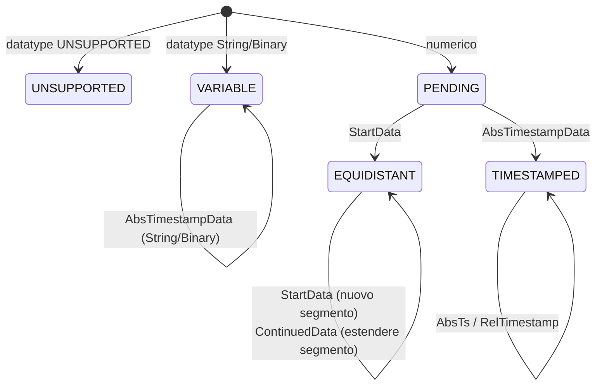

# Interni

Questa pagina descrive i componenti privati nel package incapsulato
`com.optimeas.osf.internal` — rilevante per chi collabora allo sviluppo
della libreria o desidera comprenderne il comportamento fino al livello
dei byte. Le definizioni del formato wire si trovano nella
[specifica del formato](../../osf_general.md); la struttura pubblica è
descritta nell'[architettura](./architecture.md).

## Il confine «non esportato»

Il descrittore di modulo `module-info.java` esporta **esclusivamente**
`com.optimeas.osf`. Il package `com.optimeas.osf.internal` è
deliberatamente **non** esportato e — poiché non esiste alcun `opens` —
precluso alla reflection anche in fase di esecuzione. Il codice
applicativo non può né importare né indirizzare per reflection queste
classi; sono pura superficie implementativa e possono essere
ristrutturate senza rompere l'API.

| Componente | Classe/i | Utilizzato da |
|---|---|---|
| Modello dei blocchi | `Block` (sealed) + `Block.Values` | Reader, assembler |
| Block reader | `BlockReader` | `DataManager` |
| Block encoder | `BlockEncoder` | entrambi i writer |
| Matematica del chunking | `BlockChunking` | entrambi i writer |
| Lettura del metablock | `JsonMetablockParser`, `XmlMetablockParser` | `DataManager` |
| Scrittura del metablock | `MetablockBuilder` | entrambi i writer |
| Helper di integrità (scrittura) | `Integrity` | entrambi i writer |
| Channel assembler | `ChannelAssembler` | `DataManager` |
| Decompressione OSFZ | `OsfzInputStream` | `DataManager` |
| Helper per l'ordine dei byte | `LittleEndian` | Reader + encoder |

Tutto l'I/O binario passa attraverso `java.nio.ByteBuffer` /
`FileChannel` con `ByteOrder.LITTLE_ENDIAN` — non esistono cast in stile
`reinterpret` né assunzioni sull'endianness.

## Block encoder (`BlockEncoder`)

L'encoder scrive un blocco OSF5 completo in un `byte[]`. Il frame è
ovunque little-endian:

```
[u16 channelIndex][Längenfeld (sizeOfLengthValue Bytes)][u8 control][body…]
```

Il campo di lunghezza conta i byte di `control + body`. Il byte di
controllo riporta nei bit 0–6 il tipo di blocco e nel bit 7 (`0x80`) il
flag multi-sample — impostato esattamente quando `count != 1`; in tal
caso il body inizia con un contatore di campioni N di tipo `u32`,
altrimenti segue esattamente un campione senza prefisso N.

| Metodo | Tipo di blocco (control) | Body |
|---|---|---|
| `timestampedBlock` | `bcAbsTimeStampData` (`0x08`) | per campione `[i64 ts][Wert]` |
| `timestampedGpsBlock` | `bcAbsTimeStampData` | per campione `[i64 ts][3 × f64]` (24 B) |
| `startDataBlock` | `bcStartData` (`0x06`) | `[i64 startTs][f64 rate][N?][Werte]` |
| `continuedDataBlock` | `bcContinuedData` (`0x05`) | `[N?][Werte]` |
| `variableStringBlock` / `variableBinaryBlock` | `bcAbsTimeStampData` | campione singolo `[i64 ts][Bytes]` |

`startDataBlock` e `continuedDataBlock` accettano solo `float` /
`double` (`requireFloatOrDouble`, altrimenti `OsfException.MalformedFile`).
String e Binary vengono scritti **un** campione per blocco nella forma
compatta (bit 7 libero, nessun prefisso N), codificati in UTF-8 e
**senza** `0x00` finale (OSF5); un `0x00` contenuto è contenuto
legittimo e viene conservato. `frame(…)` verifica
`sizeOfLengthValue ∈ {2, 4}` e che il payload rientri nel campo di
lunghezza. La classe interna `Body` è un piccolo byte builder
little-endian (`u8/u16/u32/i16/i32/i64/f32/f64`); `f32`/`f64` passano
tramite `Float.floatToRawIntBits` / `Double.doubleToRawLongBits`.

`applyFrameCrc(frame, sizeOfLengthValue)` dota un frame finito del CRC
di integrità: incrementa di 4 il campo di lunghezza su disco (in modo
che includa anche il CRC) e aggiunge il CRC32C calcolato sull'**intero**
frame modificato come quattro byte little-endian — esattamente ciò che
il reader ricalcola.

## Matematica del chunking (`BlockChunking`)

Questa classe è l'**unico** punto in cui vengono calcolate le
dimensioni dei blocchi; poiché entrambi i writer la invocano, eseguono
il chunking in modo identico byte per byte (fondamento della garanzia
di identità byte per byte). Dalla larghezza del campo di lunghezza
deriva il payload massimo:

```java
MAX_PAYLOAD_U16 = 0xFFFF;                 // 2-Byte-Längenfeld
MAX_PAYLOAD_U32 = Integer.MAX_VALUE - 1024;  // Soft-Cap, vermeidet i32-Überlauf
```

Se il profilo di integrità è attivo, il CRC di frame
(`FRAME_CRC_RESERVE = 4` byte) viene contato per ogni blocco nel campo
di lunghezza e riduce quindi il budget di payload. Su questo budget tre
helper ricavano il numero massimo di campioni per tipo di blocco
(overhead: `bcAbsTimeStampData` 5 B = ctrl + N e 8 B di timestamp in più
per campione; `bcStartData` 21 B = ctrl + startTs + rate + N;
`bcContinuedData` 5 B = ctrl + N):

```java
maxSamplesPerTimestamped(valueSize, sov, frameCrc);  // perSample = 8 + valueSize
maxSamplesPerStart(valueSize, sov, frameCrc);
maxSamplesPerContinued(valueSize, sov, frameCrc);
maxSamplesPerTimestampedGps(sov, frameCrc);          // GPS_VALUE_SIZE = 24
```

Ogni helper restituisce almeno 1 (`Math.max(1, …)`), così che un singolo
campione sovradimensionato non finisca mai in un ciclo infinito.

## Helper di integrità (`Integrity`)

Il lato di scrittura del profilo di integrità OSF5 *livello crc*.
`magicLine` costruisce la riga del magic header `OSF5 <len>\n` e, con il
profilo attivo, aggiunge un token `crc32c:<HEX8>` — il CRC32C dei byte
del metablock come otto cifre esadecimali maiuscole (`hex8`). In questo
modo il metablock è protetto nell'header; i CRC di frame dei blocchi di
dati sono forniti da `BlockEncoder`. Tutto il calcolo CRC utilizza
`java.util.zip.CRC32C`.

## Flusso di decompressione OSFZ (`OsfzInputStream`)

`wrap(in, onFormat)` riconosce gzip/zlib in modo trasparente all'inizio
del flusso. Tramite un `PushbackInputStream(in, 2)` vengono letti in
anticipo e classificati due byte:

- **gzip** — `0x1F 0x8B` → `GZIPInputStream`, `onFormat("gzip")`.
- **zlib** — `0x78` seguito da `0x01 / 0x5E / 0x9C / 0xDA` →
  `InflaterInputStream`, `onFormat("zlib")`.
- **plain** — tutto il resto (un vero OSF inizia con `'O' = 0x4F`); i
  byte letti vengono rimessi indietro e il flusso viene inoltrato
  invariato; `onFormat` **non** viene invocato.

I flussi con meno di due byte sono considerati plain — il successivo
parser del magic header segnala quindi l'errore appropriato. La callback
alimenta tipicamente `ReaderStats.setCompression`.

## Parser del metablock (`JsonMetablockParser` / `XmlMetablockParser`)

Entrambi i parser popolano in modo simmetrico lo stesso modello
`Metablock` (metadati del file come `Map<String,String>` più elenco
`ChannelDef`):

- **OSF5 / JSON** — `JsonMetablockParser` (Jackson) legge l'involucro
  `osf` con `format`, `version`, `file{}` e `channels[]`. Campi
  obbligatori per canale: `index` (0..65535), `name`, `channeltype`,
  `datatype`, `sizeoflengthvalue` (deve essere 2 o 4). `timeincrement`
  (assente/0 ⇒ non equidistante) e `physicalunit` sono opzionali; i
  restanti campi String scalari confluiscono nella mappa `attributes`.
- **OSF4 / XML** — `XmlMetablockParser` (StAX) legge l'elemento radice
  `<optimeas>` con gli attributi del file e i figli `<channel>`. La
  `XMLInputFactory` è configurata in modo **sicuro contro XXE**
  (`IS_SUPPORTING_EXTERNAL_ENTITIES = false`, `SUPPORT_DTD = false`,
  `IS_REPLACING_ENTITY_REFERENCES = false`); la versione viene impostata
  a 4.

I tipi di dati sconosciuti (futuri) diventano `DataType.UNSUPPORTED`, i
tipi di canale sconosciuti `ChannelType.UNSUPPORTED`; la grafia
originale resta conservata nella voce `attributes`. I tipi di dati
rimossi dalla specifica generano `OsfException.UnsupportedType`. I tipi
Jackson o StAX **non** compaiono mai nei record pubblici del modello.
Il lato di scrittura è `MetablockBuilder` (costruisce lo stesso
contratto wire JSON: `osf.file` verbatim, `osf.channels[]` con `index`
ricavato nuovamente dalla posizione nell'elenco; `timeincrement` solo se
è presente un incremento).

## Channel assembler (`ChannelAssembler`)

`assemble(channelDefs, blocks)` combina la `List<Block>` piatta con le
definizioni dei canali in `DataChannel` tipizzati, nell'ordine del
metablock. Per ogni canale un `Builder` mantiene una macchina a stati:



- `StartData` apre un segmento equidistante
  (`Segment(startTs, rate, startIndex, count)`); il primo blocco
  tipizzato determina il `Kind`.
- `ContinuedData` estende l'ultimo segmento.
- `AbsTimestampData` si accoda a un layout `TIMESTAMPED`
  (numerico/GPS) oppure `VARIABLE` (String/Binary) e aggiorna l'ancora
  (`lastTimestampNs`).
- `RelTimestampData` estende solo un canale `TIMESTAMPED` dotato di
  ancora: ogni delta viene sommato in modo cumulativo all'ultimo
  timestamp assoluto tramite `saturatingAdd`.
- I timestamp equidistanti vengono ricostruiti per segmento come
  `start + (long)(i * 1e9 / rate)` (addizione con saturazione); i vuoti
  tra i segmenti non vengono interpolati.

L'assembler è deliberatamente indulgente: un tipo di blocco estraneo su
un canale già definito viene ignorato anziché trattato come errore
(best effort). `finish()` scarta i canali `UNSUPPORTED` (`null`) e
materializza un `PENDING` senza alcun blocco come canale equidistante
vuoto. I chunk di valori (uno per blocco) vengono concatenati solo alla
fine in un array piatto per primitiva Java — l'assemblaggio resta così
O(campioni totali).

## Helper per l'ordine dei byte (`LittleEndian`)

Un modulo minuscolo ma centrale: `wrap(byte[])` e `allocate(int)`
restituiscono un `ByteBuffer` con `ByteOrder.LITTLE_ENDIAN`. È
l'**unico** punto in cui viene stabilito l'ordine dei byte; reader ed
encoder passano senza eccezioni da qui, così che l'endianness non debba
essere ripetuta in nessun altro luogo.

## Struttura dei test e verifica

I test sono eseguiti con **JUnit** in
`osf-java/src/test/java/com/optimeas/osf/`:

| Livello | Posizione | Caratteristiche |
|---|---|---|
| Unit (interno) | `…/internal/*Test.java` | byte sintetici, un file per componente (`BlockEncoderTest`, `BlockReaderTest`, `JsonMetablockParserTest`, `XmlMetablockParserTest`, `MetablockBuilderTest`, `LittleEndianTest`, `OsfzInputStreamTest`, `FrameCrcCheckValueTest`) |
| API pubblica | `…/*Test.java` | `DataManagerTest`, `BlockWriterTest`, `StreamingWriterTest`, `MagicHeaderParserTest`, `IntegrityReaderTest`, `WriterIntegrityTest` |
| Esempi / round-trip | `*ExamplesTest`, `Roundtrip…` | file reali da `examples/` (dati sul campo + set di riferimento), incl. `OsfzExamplesTest` |
| Identità byte per byte | `WriterIdentityTest` | entrambi i writer producono lo stesso OSF5 a parità di input |
| Conformità | `ConformanceManifestTest` | `reference_manifest.json` condiviso |
| Robustezza | `FuzzTruncationTest` | input troncati / alterati non causano mai un'eccezione inattesa |

L'esecuzione completa avviene tramite
`mvn -f implementations/java/pom.xml test`; la CI la esegue a ogni push.
Codice sorgente completo del package interno:
[`osf-java/src/main/java/com/optimeas/osf/internal/`](https://github.com/optimeas/osf/tree/main/implementations/java/osf-java/src/main/java/com/optimeas/osf/internal).

## Proseguire

- [Architettura](./architecture.md) — modello a livelli e modelli di dati.
- [Lettura](./reading.md) e [Scrittura](./writing.md) — l'API pubblica.
- [Gestione degli errori](./error-handling.md) — la gerarchia `OsfException`.
- [Strumenti](./tools.md) e [Build](./building.md).
- [Cookbook](./cookbook.md) — ricette copiabili.
- [Torna alla panoramica Java](../java.md).

> Questo documento è distribuito con licenza [CC BY 4.0](https://creativecommons.org/licenses/by/4.0/deed.de). Attribuzione: optiMEAS GmbH e optiMEAS Switzerland GmbH.
